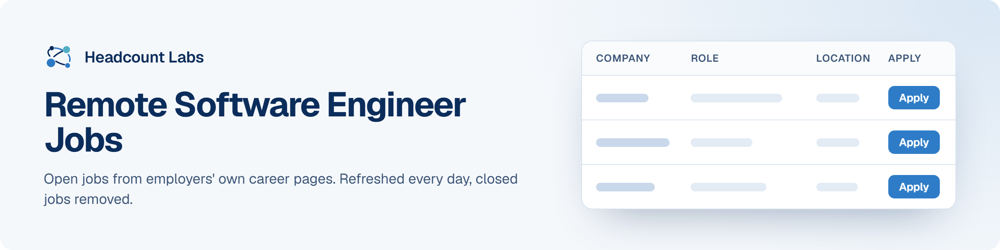

# Remote Software Engineer Jobs

Fully remote software engineering jobs at US employers, where the employer says the job is remote.

**293 open jobs** · first published October 18, 2026 at 6:27 PM EDT

This list is built and refreshed every day by [Headcount Labs](https://headcountlabs.com/?utm_source=github&utm_medium=job-list&utm_campaign=remote-software-engineer-jobs), which reads jobs straight from employers' own career pages and job boards. Every job here was still listed on its source board when we last read that board, within the past 3 days, and was posted in the past 30 days. Copies of the same job are merged into one row, and jobs that close are removed at the next update.

Want this data in your own app or agent? Use the [Headcount Labs jobs API](https://headcountlabs.com/docs/?utm_source=github&utm_medium=job-list&utm_campaign=remote-software-engineer-jobs) (free tier) or the [open dataset](https://huggingface.co/datasets/HeadcountLabs/job-postings) on Hugging Face.

**Jump to:** [Posted in the last 7 days (144)](#posted-in-the-last-7-days) · [Posted 8 to 30 days ago (149)](#posted-8-to-30-days-ago)

**Columns.** *Apply* opens the original posting on the employer's site. *Details* opens the job on Headcount Labs, with every posting we found for it. *Remote* shows what the employer states; a dash means the posting doesn't say. *Pay* is the range the employer published.

## Posted in the last 7 days

| Company | Role | Location | Remote | Pay | Posted | Apply | Details |
| --- | --- | --- | --- | --- | --- | :---: | :---: |
| **Shield AI** | Staff Engineer, Software (R6331) | United States | Remote | $140k–$210k/yr | Oct 18 |  | <a href="https://headcountlabs.com/catalog/jobs/1eb64756-b4e5-4a90-88d8-24776eae0331?utm_source=github&utm_medium=job-list&utm_campaign=remote-software-engineer-jobs">via Headcount Labs</a> |
| **YipitData** | Lead Web Designer &amp; Developer | United States | Remote | $150k/yr | Oct 17 |  | <a href="https://headcountlabs.com/catalog/jobs/6a69e561-e989-437e-825f-6ed01c4e3a37?utm_source=github&utm_medium=job-list&utm_campaign=remote-software-engineer-jobs">via Headcount Labs</a> |
| **TeamSnap** | Staff Software Engineer (Android) | United States | Remote | — | Oct 17 |  | <a href="https://headcountlabs.com/catalog/jobs/0fdd37a3-a409-450e-928e-7f9748ffd687?utm_source=github&utm_medium=job-list&utm_campaign=remote-software-engineer-jobs">via Headcount Labs</a> |
| **Beacon Software** | Lead Software Engineer | United States | Remote | — | Oct 17 |  | <a href="https://headcountlabs.com/catalog/jobs/98b41df3-5042-4b9d-a400-89c282c7c068?utm_source=github&utm_medium=job-list&utm_campaign=remote-software-engineer-jobs">via Headcount Labs</a> |
| **Ace IT Careers** | Associate Software Test Analyst | 

6 locations
Detroit, MI Kansas City, MO Nashville, TN Newark, NJ Richmond, VA United States
 | Remote | — | Oct 17 |  | <a href="https://headcountlabs.com/catalog/jobs/0376756f-9503-4546-bacb-632646ea1ff6?utm_source=github&utm_medium=job-list&utm_campaign=remote-software-engineer-jobs">via Headcount Labs</a> |
| **Virta Health** | Senior Software Engineer - Client Lifecycle | 

3 locations
Seattle, WA San Francisco, CA New York, NY
 | Remote | — | Oct 16 |  | <a href="https://headcountlabs.com/catalog/jobs/93755991-fb0f-4d08-9675-b01e91c748a5?utm_source=github&utm_medium=job-list&utm_campaign=remote-software-engineer-jobs">via Headcount Labs</a> |
| **vCluster Labs** | Senior Software Quality Engineer | 

2 locations
EMEA United States
 | Remote | — | Oct 16 |  | <a href="https://headcountlabs.com/catalog/jobs/274c5b55-a403-43aa-9f6a-e870c5ed0034?utm_source=github&utm_medium=job-list&utm_campaign=remote-software-engineer-jobs">via Headcount Labs</a> |
| **Thryv** | Outside Software Account Representative - Tacoma, WA | Tacoma, WA | Remote | — | Oct 16 |  | <a href="https://headcountlabs.com/catalog/jobs/b1c56d03-d93f-40a6-bfba-8adb7a8c6db4?utm_source=github&utm_medium=job-list&utm_campaign=remote-software-engineer-jobs">via Headcount Labs</a> |
| **Thryv** | Outside Software Account Representative - Olympia, WA | Olympia, WA | Remote | — | Oct 16 |  | <a href="https://headcountlabs.com/catalog/jobs/744ee242-7a50-44bf-acb6-f7b4b8c23e5b?utm_source=github&utm_medium=job-list&utm_campaign=remote-software-engineer-jobs">via Headcount Labs</a> |
| **Thryv** | Outside Software Account Representative - Little Rock, AR | Little Rock, AR | Remote | — | Oct 16 |  | <a href="https://headcountlabs.com/catalog/jobs/42eeb1c8-fdd7-4a1f-b0d4-7493a37537dc?utm_source=github&utm_medium=job-list&utm_campaign=remote-software-engineer-jobs">via Headcount Labs</a> |
| **The Fedcap Group** | Head of Software Systems &amp; Business Enablement | United States | Remote | $180k–$220k/yr | Oct 16 |  | <a href="https://headcountlabs.com/catalog/jobs/23dd92d2-45f8-4905-a56c-1c1e573e269a?utm_source=github&utm_medium=job-list&utm_campaign=remote-software-engineer-jobs">via Headcount Labs</a> |
| **TetraScience** | Lead Software Platform Engineer, MLOps | 

3 locations
Cambridge, MA San Mateo, CA United States
 | Remote | — | Oct 16 |  | <a href="https://headcountlabs.com/catalog/jobs/ae4dbf0e-ac02-4ebd-8617-3b491415dc22?utm_source=github&utm_medium=job-list&utm_campaign=remote-software-engineer-jobs">via Headcount Labs</a> |
| **Startekk Inc** | Mid–Senior Databricks Developer | Plano, TX | Remote | — | Oct 16 |  | <a href="https://headcountlabs.com/catalog/jobs/3ccf4fa6-a59e-4d6d-a600-4434e129c8c8?utm_source=github&utm_medium=job-list&utm_campaign=remote-software-engineer-jobs">via Headcount Labs</a> |
| **Sorenson Communications, LLC** | Software Engineer II | Salt Lake City, UT | Remote | — | Oct 16 |  | <a href="https://headcountlabs.com/catalog/jobs/6cbb8de7-b218-4bc6-ad4b-f9a09bcbf3b7?utm_source=github&utm_medium=job-list&utm_campaign=remote-software-engineer-jobs">via Headcount Labs</a> |
| **SmartLight Analytics** | Senior Software Engineer | Tulsa, OK | Remote | $125k–$140k/yr | Oct 16 |  | <a href="https://headcountlabs.com/catalog/jobs/e963b144-4938-4b43-aaa2-b1d63c489e9c?utm_source=github&utm_medium=job-list&utm_campaign=remote-software-engineer-jobs">via Headcount Labs</a> |
| **SmartLight Analytics** | Staff Software Engineer | PLANO, TX | Remote | $140k–$170k/yr | Oct 16 |  | <a href="https://headcountlabs.com/catalog/jobs/347d790f-895e-410b-92e3-4d06692c5811?utm_source=github&utm_medium=job-list&utm_campaign=remote-software-engineer-jobs">via Headcount Labs</a> |
| **Skylight** | Senior Full Stack Engineer - Customer Service | United States | Remote | — | Oct 16 |  | <a href="https://headcountlabs.com/catalog/jobs/748d889c-1ff6-435b-a9ee-8f938215a38e?utm_source=github&utm_medium=job-list&utm_campaign=remote-software-engineer-jobs">via Headcount Labs</a> |
| **Sitetracker** | Senior Software Engineer | 

2 locations
New York, MC, Austin, TX Toronto
 | Remote | — | Oct 16 |  | <a href="https://headcountlabs.com/catalog/jobs/fa732810-e8cd-466d-aa85-c9edc821d727?utm_source=github&utm_medium=job-list&utm_campaign=remote-software-engineer-jobs">via Headcount Labs</a> |
| **ServiceNow** | Sr Staff Software Engineer- Access Security - Veza | Minneapolis, MN | Remote | $172k–$301k/yr | Oct 16 |  | <a href="https://headcountlabs.com/catalog/jobs/6c4e81d7-4250-47be-a1ff-9b7dd6ed27aa?utm_source=github&utm_medium=job-list&utm_campaign=remote-software-engineer-jobs">via Headcount Labs</a> |
| **Presidio** | Team Lead, Enterprise Software Solutions | United States | Remote | — | Oct 16 |  | <a href="https://headcountlabs.com/catalog/jobs/e76384b8-80ab-4911-b164-dc846186eeae?utm_source=github&utm_medium=job-list&utm_campaign=remote-software-engineer-jobs">via Headcount Labs</a> |
| **NMDP** | Senior Software Quality &amp; Compliance Specialist | 

2 locations
United States Minneapolis, MN
 | Remote | $95k–$115k/yr | Oct 16 |  | <a href="https://headcountlabs.com/catalog/jobs/5f4c4cd8-9244-4d64-929f-704061a914a2?utm_source=github&utm_medium=job-list&utm_campaign=remote-software-engineer-jobs">via Headcount Labs</a> |
| **NFF Inc** | Sr. Full Stack Developer | Alexandria, VA | Remote | $125k–$150k/yr | Oct 16 |  | <a href="https://headcountlabs.com/catalog/jobs/979cb1b9-f6bc-4b99-accc-79d76468ecce?utm_source=github&utm_medium=job-list&utm_campaign=remote-software-engineer-jobs">via Headcount Labs</a> |
| **Navitas Business Consulting** | 26-1111: MuleSoft Integration Developer - DC Metro | Washington, DC | Remote | $120k–$150k/yr | Oct 16 |  | <a href="https://headcountlabs.com/catalog/jobs/ebd742c2-0c6f-4b90-b1fe-3ffeb940a3d7?utm_source=github&utm_medium=job-list&utm_campaign=remote-software-engineer-jobs">via Headcount Labs</a> |
| **MLabs** | Quant Developer | United States | Remote | — | Oct 16 |  | <a href="https://headcountlabs.com/catalog/jobs/a0501e28-f4ea-4181-bd13-4273404cefb7?utm_source=github&utm_medium=job-list&utm_campaign=remote-software-engineer-jobs">via Headcount Labs</a> |
| **Lynx Software Technologies, Inc.** | Senior Embedded Software Engineer | Marietta, GA | Remote | $120k–$160k/yr | Oct 16 |  | <a href="https://headcountlabs.com/catalog/jobs/252a8af7-05a5-4a5a-aba8-c8324eabfba5?utm_source=github&utm_medium=job-list&utm_campaign=remote-software-engineer-jobs">via Headcount Labs</a> |
| **LIGHTFEATHER IO LLC** | Senior ServiceNow Developer - Public Trust Clearance | United States | Remote | $90k–$115k/yr | Oct 16 |  | <a href="https://headcountlabs.com/catalog/jobs/665c81de-0c44-4ea4-9fec-8e79a90fac23?utm_source=github&utm_medium=job-list&utm_campaign=remote-software-engineer-jobs">via Headcount Labs</a> |
| **LIGHTFEATHER IO LLC** | Full Stack Engineer | United States | Remote | $90k–$115k/yr | Oct 16 |  | <a href="https://headcountlabs.com/catalog/jobs/02ec5bdc-cc70-4dc8-8d31-6bac460b4aa1?utm_source=github&utm_medium=job-list&utm_campaign=remote-software-engineer-jobs">via Headcount Labs</a> |
| **Jobgether** | Manager, Software Engineering - Engineering Tools | United States | Remote | $121k–$148k/yr | Oct 16 |  | <a href="https://headcountlabs.com/catalog/jobs/76c922c2-1721-470a-a02f-8c87103ff86b?utm_source=github&utm_medium=job-list&utm_campaign=remote-software-engineer-jobs">via Headcount Labs</a> |
| **Jobgether** | Senior Software Engineer - Full Stack | United States | Remote | $140k–$200k/yr | Oct 16 |  | <a href="https://headcountlabs.com/catalog/jobs/a246d849-0862-4db8-ba40-5a8abe309c8e?utm_source=github&utm_medium=job-list&utm_campaign=remote-software-engineer-jobs">via Headcount Labs</a> |
| **Jobgether** | Senior Software Engineer II, Mobile - Revenue Experiences (AI Native) | United States | Remote | $118k–$216k/yr | Oct 16 |  | <a href="https://headcountlabs.com/catalog/jobs/c4447ec7-30a4-4b90-b0ca-d39e7a56451a?utm_source=github&utm_medium=job-list&utm_campaign=remote-software-engineer-jobs">via Headcount Labs</a> |
| **Jobgether** | Senior Software Development Engineer - Big Data | United States | Remote | $164k–$263k/yr | Oct 16 |  | <a href="https://headcountlabs.com/catalog/jobs/8dc81552-94d7-4b2c-ab5d-113fa521440d?utm_source=github&utm_medium=job-list&utm_campaign=remote-software-engineer-jobs">via Headcount Labs</a> |
| **Jobgether** | Senior Software Engineer, Containers | United States | Remote | $157k–$184k/yr | Oct 16 |  | <a href="https://headcountlabs.com/catalog/jobs/0bf22972-cdca-4a46-8640-8d9cb5390314?utm_source=github&utm_medium=job-list&utm_campaign=remote-software-engineer-jobs">via Headcount Labs</a> |
| **Jobgether** | Field Application Scientist, Pathway &amp; NGS Analysis Software, QDI | United States | Remote | $100k–$124k/yr | Oct 16 |  | <a href="https://headcountlabs.com/catalog/jobs/2b5ce776-a73e-4dda-b51a-ff6926b256a7?utm_source=github&utm_medium=job-list&utm_campaign=remote-software-engineer-jobs">via Headcount Labs</a> |
| **Jobgether** | Staff Software Engineer | United States | Remote | $170k–$200k/yr | Oct 16 |  | <a href="https://headcountlabs.com/catalog/jobs/2deb72e3-5804-4c98-a8a3-47a3a65af127?utm_source=github&utm_medium=job-list&utm_campaign=remote-software-engineer-jobs">via Headcount Labs</a> |
| **Jobgether** | Sr. Manager, Software Engineering-Android &amp; Device Platforms | United States | Remote | $154k–$212k/yr | Oct 16 |  | <a href="https://headcountlabs.com/catalog/jobs/46f189fc-d29d-485c-a882-bf70d6b7da2c?utm_source=github&utm_medium=job-list&utm_campaign=remote-software-engineer-jobs">via Headcount Labs</a> |
| **InfluxData** | Developer Advocate | United States | Remote | $155k–$175k/yr | Oct 16 |  | <a href="https://headcountlabs.com/catalog/jobs/c2b23736-253e-4478-b8eb-79dfc7e299d6?utm_source=github&utm_medium=job-list&utm_campaign=remote-software-engineer-jobs">via Headcount Labs</a> |
| **Hims &amp; Hers Health** | Staff Software Engineer, Frontend | United States | Remote | $190k–$230k/yr | Oct 16 |  | <a href="https://headcountlabs.com/catalog/jobs/98cb9ad7-9180-4699-a5b6-89f1711773bd?utm_source=github&utm_medium=job-list&utm_campaign=remote-software-engineer-jobs">via Headcount Labs</a> |
| **H&amp;R Block** | Principal Software Engineer-Native Mobile Development | Missouri | Remote | $132k–$225k/yr | Oct 16 |  | <a href="https://headcountlabs.com/catalog/jobs/54f31160-c5ac-459d-bd1e-e57ca20598da?utm_source=github&utm_medium=job-list&utm_campaign=remote-software-engineer-jobs">via Headcount Labs</a> |
| **H&amp;R Block** | Lead Software Engineer-Dynamics 365 Contact Center | Missouri | Remote | $118k–$188k/yr | Oct 16 |  | <a href="https://headcountlabs.com/catalog/jobs/cfa61c14-0263-4aab-9af9-e4f4b24aa981?utm_source=github&utm_medium=job-list&utm_campaign=remote-software-engineer-jobs">via Headcount Labs</a> |
| **H&amp;R Block** | Senior Software Engineer-Microsoft Dynamics OR Power Platform | Missouri | Remote | $101k–$162k/yr | Oct 16 |  | <a href="https://headcountlabs.com/catalog/jobs/ccf88c49-e402-473b-897f-734628fb1c22?utm_source=github&utm_medium=job-list&utm_campaign=remote-software-engineer-jobs">via Headcount Labs</a> |
| **Eurofins** | Global Software Implementation Manager | Lancaster, PA | Remote | $100k–$120k/yr | Oct 16 |  | <a href="https://headcountlabs.com/catalog/jobs/a0cc57cf-a7bb-4576-9bba-3efd3d301ef1?utm_source=github&utm_medium=job-list&utm_campaign=remote-software-engineer-jobs">via Headcount Labs</a> |
| **EngFlow** | Site Reliability Engineer | 

2 locations
New York, NY Austin, TX
 | Remote | — | Oct 16 |  | <a href="https://headcountlabs.com/catalog/jobs/0607f0bb-f9f2-4ce7-be02-1de5a946f241?utm_source=github&utm_medium=job-list&utm_campaign=remote-software-engineer-jobs">via Headcount Labs</a> |
| **Drips** | Senior Full Stack Software Engineer | Cleveland, OH | Remote | — | Oct 16 |  | <a href="https://headcountlabs.com/catalog/jobs/7c4abdf2-3d76-44e6-b084-69841762a41a?utm_source=github&utm_medium=job-list&utm_campaign=remote-software-engineer-jobs">via Headcount Labs</a> |
| **Crane Worldwide Logistics** | Software Engineering Manager | Houston, TX | Remote | — | Oct 16 |  | <a href="https://headcountlabs.com/catalog/jobs/29a07bc2-26fe-4744-91a4-8f5b17ecbbf9?utm_source=github&utm_medium=job-list&utm_campaign=remote-software-engineer-jobs">via Headcount Labs</a> |
| **Coterie Applications Inc.** | Sr Software Engineer (Backend) | United States | Remote | $140k–$165k/yr | Oct 16 |  | <a href="https://headcountlabs.com/catalog/jobs/8dca1b84-8d52-4f70-88d0-47706a569042?utm_source=github&utm_medium=job-list&utm_campaign=remote-software-engineer-jobs">via Headcount Labs</a> |
| **Carrier** | Principal Engineer, Software Quality &amp; Engineering Governance | 

2 locations
Florida City, FL
 | Remote | $143k–$286k/yr | Oct 16 |  | <a href="https://headcountlabs.com/catalog/jobs/6c43f4b2-ded4-4f85-ab28-e8952b7f43ab?utm_source=github&utm_medium=job-list&utm_campaign=remote-software-engineer-jobs">via Headcount Labs</a> |
| **CaptionCall** | Software Engineer II | Salt Lake City, UT | Remote | — | Oct 16 |  | <a href="https://headcountlabs.com/catalog/jobs/f148150e-831c-4825-b5bf-b4dbc947c9b5?utm_source=github&utm_medium=job-list&utm_campaign=remote-software-engineer-jobs">via Headcount Labs</a> |
| **CAI** | Python/GenAI Developer | United States | Remote | $65–$70/hr | Oct 16 |  | <a href="https://headcountlabs.com/catalog/jobs/97a43c32-7503-4d2a-824e-d0b868faba35?utm_source=github&utm_medium=job-list&utm_campaign=remote-software-engineer-jobs">via Headcount Labs</a> |
| **Builders FirstSource** | Senior Manager, Software Engineering - SAP S/4 RTR | United States | Remote | — | Oct 16 |  | <a href="https://headcountlabs.com/catalog/jobs/6f1177e4-365b-434d-8219-514786c456f4?utm_source=github&utm_medium=job-list&utm_campaign=remote-software-engineer-jobs">via Headcount Labs</a> |
| **Bright Vision Technologies** | SAP UI5 Developer | Yuba City, CA | Remote | — | Oct 16 |  | <a href="https://headcountlabs.com/catalog/jobs/e3c97863-8edc-4f1b-8b5f-e341134b6157?utm_source=github&utm_medium=job-list&utm_campaign=remote-software-engineer-jobs">via Headcount Labs</a> |
| **Bright Vision Technologies** | SAP Backend Developer | Wesley Chapel, FL | Remote | $100k–$150k/yr | Oct 16 |  | <a href="https://headcountlabs.com/catalog/jobs/caa098b8-8e7a-485f-8e33-201341eb9d79?utm_source=github&utm_medium=job-list&utm_campaign=remote-software-engineer-jobs">via Headcount Labs</a> |
| **Bright Vision Technologies** | Big Data Application Developer | Wesley Chapel, FL | Remote | $100k–$150k/yr | Oct 16 |  | <a href="https://headcountlabs.com/catalog/jobs/c649b596-c911-4ae1-9851-e135eafc08b7?utm_source=github&utm_medium=job-list&utm_campaign=remote-software-engineer-jobs">via Headcount Labs</a> |
| **Bright Vision Technologies** | Workday API Developer | Franklin / Brentwood (Nashville), TN | Remote | $100k–$150k/yr | Oct 16 |  | <a href="https://headcountlabs.com/catalog/jobs/a879283c-8fce-445a-a9d1-c0f79d62a950?utm_source=github&utm_medium=job-list&utm_campaign=remote-software-engineer-jobs">via Headcount Labs</a> |
| **Bright Vision Technologies** | Robotics Software Engineer | South Plainfield, NJ | Remote | $100k–$150k/yr | Oct 16 |  | <a href="https://headcountlabs.com/catalog/jobs/9f871485-52a6-43b0-9204-32c46b2704a8?utm_source=github&utm_medium=job-list&utm_campaign=remote-software-engineer-jobs">via Headcount Labs</a> |
| **Bright Vision Technologies** | Hadoop Solutions Developer | South Jordan / Draper, UT | Remote | $100k–$150k/yr | Oct 16 |  | <a href="https://headcountlabs.com/catalog/jobs/9bfdfefe-a6c2-4b5a-9c9d-b1a3a876e939?utm_source=github&utm_medium=job-list&utm_campaign=remote-software-engineer-jobs">via Headcount Labs</a> |
| **Bright Vision Technologies** | Quant Developer (Fintech) | South Plainfield, NJ | Remote | $100k–$150k/yr | Oct 16 |  | <a href="https://headcountlabs.com/catalog/jobs/9933863a-4a3c-446c-bc8f-ffb2524135a1?utm_source=github&utm_medium=job-list&utm_campaign=remote-software-engineer-jobs">via Headcount Labs</a> |
| **Bright Vision Technologies** | Software Engineering Lead | Wildwood, MO | Remote | $205k–$230k/yr | Oct 16 |  | <a href="https://headcountlabs.com/catalog/jobs/82ff30a8-387f-4651-aa9b-77784a76856b?utm_source=github&utm_medium=job-list&utm_campaign=remote-software-engineer-jobs">via Headcount Labs</a> |
| **BlueCross BlueShield of Tennessee** | Software Engineer - UI | Chattanooga, TN | Remote | — | Oct 16 |  | <a href="https://headcountlabs.com/catalog/jobs/757419a5-deba-4edc-8dae-cfb643cb518a?utm_source=github&utm_medium=job-list&utm_campaign=remote-software-engineer-jobs">via Headcount Labs</a> |
| **Blooming Health** | Senior Software Development Engineer in Test (SDET) | United States | Remote | — | Oct 16 |  | <a href="https://headcountlabs.com/catalog/jobs/f5aa7c14-41f2-4e3e-aa4b-85d70c39257e?utm_source=github&utm_medium=job-list&utm_campaign=remote-software-engineer-jobs">via Headcount Labs</a> |
| **Bjak** | Principal Software Engineer | United States | Remote | — | Oct 16 |  | <a href="https://headcountlabs.com/catalog/jobs/d829eb82-1a01-4481-b6f9-e2ef4b8300c4?utm_source=github&utm_medium=job-list&utm_campaign=remote-software-engineer-jobs">via Headcount Labs</a> |
| **Bjak** | Lead Software Engineer | United States | Remote | — | Oct 16 |  | <a href="https://headcountlabs.com/catalog/jobs/47704e36-1b05-41e7-a7b9-6d951d5dbcd8?utm_source=github&utm_medium=job-list&utm_campaign=remote-software-engineer-jobs">via Headcount Labs</a> |
| **Bjak** | Staff Software Engineer | United States | Remote | — | Oct 16 |  | <a href="https://headcountlabs.com/catalog/jobs/1df2971e-8fa0-448f-88d7-c73b76a34f2b?utm_source=github&utm_medium=job-list&utm_campaign=remote-software-engineer-jobs">via Headcount Labs</a> |
| **Applied Control** | Solutions Consultant Performance Software | ., CO | Remote | — | Oct 16 |  | <a href="https://headcountlabs.com/catalog/jobs/73eb1f84-c0e1-49c4-94ad-00afadc6af66?utm_source=github&utm_medium=job-list&utm_campaign=remote-software-engineer-jobs">via Headcount Labs</a> |
| **Affirm** | Manager, Software Engineering (Loans Lifecycle) | United States | Remote | $230k–$290k/yr | Oct 16 |  | <a href="https://headcountlabs.com/catalog/jobs/7efaac3d-ce1c-4386-a7c7-f8ff0fd84316?utm_source=github&utm_medium=job-list&utm_campaign=remote-software-engineer-jobs">via Headcount Labs</a> |
| **Affirm** | Software Engineer II, Full Stack (Card Acquisition) | United States | Remote | $165k–$225k/yr | Oct 16 |  | <a href="https://headcountlabs.com/catalog/jobs/6475420a-2278-4b3c-919b-f99b04d73d15?utm_source=github&utm_medium=job-list&utm_campaign=remote-software-engineer-jobs">via Headcount Labs</a> |
| **15Five** | Senior DevOps Engineer | United States | Remote | $115k–$140k/yr | Oct 16 |  | <a href="https://headcountlabs.com/catalog/jobs/24843042-8457-47ab-8481-6159669af678?utm_source=github&utm_medium=job-list&utm_campaign=remote-software-engineer-jobs">via Headcount Labs</a> |
| **Zip Co Limited** | Senior Software Engineer in Test | United States | Remote | $146k–$157k/yr | Oct 15 |  | <a href="https://headcountlabs.com/catalog/jobs/03114158-6a35-4d73-bf2b-4810281075b6?utm_source=github&utm_medium=job-list&utm_campaign=remote-software-engineer-jobs">via Headcount Labs</a> |
| **ZINC Zillow, Inc.** | Senior Software Development Engineer - Big Data | United States | Remote | $164k–$263k/yr | Oct 15 |  | <a href="https://headcountlabs.com/catalog/jobs/ff0f2df9-aa6a-4c90-9434-e6c1c59e4f40?utm_source=github&utm_medium=job-list&utm_campaign=remote-software-engineer-jobs">via Headcount Labs</a> |
| **zerohash** | Senior Software Engineer | Chicago, IL | Remote | — | Oct 15 |  | <a href="https://headcountlabs.com/catalog/jobs/3011152c-b5fe-44da-b240-fed38a7b2f31?utm_source=github&utm_medium=job-list&utm_campaign=remote-software-engineer-jobs">via Headcount Labs</a> |
| **Zebra Technologies** | Software Sales Executive - Demand Intelligence Retail &amp; CPG (Remote Anywhere US) | Illinois Offsite | Remote | $113k–$169k/yr | Oct 15 |  | <a href="https://headcountlabs.com/catalog/jobs/d93a7839-e562-4d51-8157-179be036a8bc?utm_source=github&utm_medium=job-list&utm_campaign=remote-software-engineer-jobs">via Headcount Labs</a> |
| **Xenith Solutions** | Database Developer | Virginia | Remote | $120k–$130k/yr | Oct 15 |  | <a href="https://headcountlabs.com/catalog/jobs/c69721b9-b914-48d3-aeb9-5b3b229c8363?utm_source=github&utm_medium=job-list&utm_campaign=remote-software-engineer-jobs">via Headcount Labs</a> |
| **We Are Rosie** | Interactive Designer / Creative Developer (Web Animation &amp; Data Viz) | New York, NY | Remote | $80–$95/hr | Oct 15 |  | <a href="https://headcountlabs.com/catalog/jobs/5a725c43-b950-483a-a31f-22c3e5a6e47c?utm_source=github&utm_medium=job-list&utm_campaign=remote-software-engineer-jobs">via Headcount Labs</a> |
| **US LBM Service Co** | US LBM Lead Software Engineer – Application Development (Supply Chain) | United States | Remote | — | Oct 15 |  | <a href="https://headcountlabs.com/catalog/jobs/9a071826-118a-41ca-8f66-bd37a0310af6?utm_source=github&utm_medium=job-list&utm_campaign=remote-software-engineer-jobs">via Headcount Labs</a> |
| **Truelogic** | Senior DevOps Engineer / Cloud Infrastructure Engineer - Cybersecurity | 

2 locations
New York, NY United States
 | Remote | — | Oct 15 |  | <a href="https://headcountlabs.com/catalog/jobs/d81a3353-5dce-469c-8060-cf7a16cbfcb0?utm_source=github&utm_medium=job-list&utm_campaign=remote-software-engineer-jobs">via Headcount Labs</a> |
| **Thryv** | Outside Software Account Representative - Westchester County, NY | 

4 locations
Purchase, NY Yonkers, NY New Rochelle, NY White Plains, NY
 | Remote | — | Oct 15 |  | <a href="https://headcountlabs.com/catalog/jobs/cd1a9b96-f854-496c-a7b1-6cb61bbe2753?utm_source=github&utm_medium=job-list&utm_campaign=remote-software-engineer-jobs">via Headcount Labs</a> |
| **Thryv** | Outside Software Account Representative - Cleveland, OH | Cleveland, OH | Remote | $94k–$103k/yr | Oct 15 |  | <a href="https://headcountlabs.com/catalog/jobs/34d1996c-9f33-4284-a048-80147f77f22c?utm_source=github&utm_medium=job-list&utm_campaign=remote-software-engineer-jobs">via Headcount Labs</a> |
| **Thrive** | Microsoft AI Solutions Developer | United States | Remote | — | Oct 15 |  | <a href="https://headcountlabs.com/catalog/jobs/f69f1cd4-7ca4-4a00-b706-2eac3b6dca84?utm_source=github&utm_medium=job-list&utm_campaign=remote-software-engineer-jobs">via Headcount Labs</a> |
| **SSB002 SOUTHSTATE BANK, NATIONAL ASSOCIATION** | Correspondent Software Engineer II (Remote) | 

4 locations
Winter Haven, FL Atlanta, GA AL, TX United States
 | Remote | $87k–$139k/yr | Oct 15 |  | <a href="https://headcountlabs.com/catalog/jobs/77419680-53f7-4113-bffb-3bcf05b32424?utm_source=github&utm_medium=job-list&utm_campaign=remote-software-engineer-jobs">via Headcount Labs</a> |
| **Sophos** | Senior Application Programming Developer | Dallas, TX | Remote | $157k–$184k/yr | Oct 15 |  | <a href="https://headcountlabs.com/catalog/jobs/2357be4f-149e-4912-b6b9-fe721c59f28d?utm_source=github&utm_medium=job-list&utm_campaign=remote-software-engineer-jobs">via Headcount Labs</a> |
| **SCI Summit Consulting, LLC** | Senior Business Developer (AL or TN) | 

2 locations
Alabama Tennessee
 | Remote | $80k–$155k/yr | Oct 15 |  | <a href="https://headcountlabs.com/catalog/jobs/fbf45f53-7dd4-4919-801f-8bc7034cb70d?utm_source=github&utm_medium=job-list&utm_campaign=remote-software-engineer-jobs">via Headcount Labs</a> |
| **Rev.io** | Software Developer | United States | Remote | — | Oct 15 |  | <a href="https://headcountlabs.com/catalog/jobs/0d7141ee-993a-4b21-b5a0-cac60630545a?utm_source=github&utm_medium=job-list&utm_campaign=remote-software-engineer-jobs">via Headcount Labs</a> |
| **RBGlobal** | Staff Software Engineer | Westchester, IL | Remote | $124k–$155k/yr | Oct 15 |  | <a href="https://headcountlabs.com/catalog/jobs/bf6dcdbe-c525-41de-b074-d4ff5dde4331?utm_source=github&utm_medium=job-list&utm_campaign=remote-software-engineer-jobs">via Headcount Labs</a> |
| **Qiagen LLC** | Field Application Scientist, Pathway &amp; NGS Analysis Software, QDI | _Maryland | Remote | $100k–$124k/yr | Oct 15 |  | <a href="https://headcountlabs.com/catalog/jobs/377d07c4-3af7-41ff-bb80-d0de84f14967?utm_source=github&utm_medium=job-list&utm_campaign=remote-software-engineer-jobs">via Headcount Labs</a> |
| **Pie Insurance** | Senior Software Engineer - Infrastructure | United States | Remote | $150k–$185k/yr | Oct 15 |  | <a href="https://headcountlabs.com/catalog/jobs/9fb52f69-e01b-43d2-b3fc-678e739e947f?utm_source=github&utm_medium=job-list&utm_campaign=remote-software-engineer-jobs">via Headcount Labs</a> |
| **PhillyTech.Co** | Senior Full Stack Engineer &#124; $90-$120/hr + Remote &#124; Inc. 5000 Award-Winning, High-Growth Coaching Company | Miami, FL | Remote | $90–$120/hr | Oct 15 |  | <a href="https://headcountlabs.com/catalog/jobs/121c82a3-358b-4277-93c3-ba422c351022?utm_source=github&utm_medium=job-list&utm_campaign=remote-software-engineer-jobs">via Headcount Labs</a> |
| **Pearson** | Software Engineering Manager | 

2 locations
United States Hoboken, NJ
 | Remote | $150k–$190k/yr | Oct 15 |  | <a href="https://headcountlabs.com/catalog/jobs/11ae1695-cce8-4e3b-a0a0-45f9f0aaa709?utm_source=github&utm_medium=job-list&utm_campaign=remote-software-engineer-jobs">via Headcount Labs</a> |
| **PayJunction** | Software Architect | Santa Barbara, CA | Remote | $240k–$275k/yr | Oct 15 |  | <a href="https://headcountlabs.com/catalog/jobs/12575c9d-a940-426a-b50a-d7f93e60c5c0?utm_source=github&utm_medium=job-list&utm_campaign=remote-software-engineer-jobs">via Headcount Labs</a> |
| **Parkade** | Staff Front End Software Engineer | San Francisco, CA | Remote | $180k–$200k/yr | Oct 15 |  | <a href="https://headcountlabs.com/catalog/jobs/9b96695d-7ca8-4c65-9605-79ce2ba1e022?utm_source=github&utm_medium=job-list&utm_campaign=remote-software-engineer-jobs">via Headcount Labs</a> |
| **NBCUniversal** | Sr Software Engineer | New York, NY | Remote | $120k–$160k/yr | Oct 15 |  | <a href="https://headcountlabs.com/catalog/jobs/62a7af3f-c532-4182-b8f7-72e0dabd081e?utm_source=github&utm_medium=job-list&utm_campaign=remote-software-engineer-jobs">via Headcount Labs</a> |
| **Life360** | Senior Software Engineer II, Mobile - Revenue Experiences (AI Native) | United States | Remote | $118k–$216k/yr | Oct 15 |  | <a href="https://headcountlabs.com/catalog/jobs/8cc2fd31-231e-4774-9b1c-8cba9ba8f52c?utm_source=github&utm_medium=job-list&utm_campaign=remote-software-engineer-jobs">via Headcount Labs</a> |
| **Kin Insurance** | Software Engineer, Back-End Focus | United States | Remote | $110k–$127k/yr | Oct 15 |  | <a href="https://headcountlabs.com/catalog/jobs/d8564461-139a-40a7-b454-a8ae3b3a169f?utm_source=github&utm_medium=job-list&utm_campaign=remote-software-engineer-jobs">via Headcount Labs</a> |
| **Kestrel Intelligence** | Senior Software Engineer (Remote) | United States | Remote | — | Oct 15 |  | <a href="https://headcountlabs.com/catalog/jobs/7026c3c6-6afc-4a92-baaf-cee341b418bd?utm_source=github&utm_medium=job-list&utm_campaign=remote-software-engineer-jobs">via Headcount Labs</a> |
| **Kestrel Intelligence** | Software Engineer (Remote) | United States | Remote | — | Oct 15 |  | <a href="https://headcountlabs.com/catalog/jobs/24c75211-a5d8-4c87-8f55-ad9235ef813d?utm_source=github&utm_medium=job-list&utm_campaign=remote-software-engineer-jobs">via Headcount Labs</a> |
| **Honeycomb.io** | Software Engineer I - LLM Observability | United States | Remote | — | Oct 15 |  | <a href="https://headcountlabs.com/catalog/jobs/d98450b8-6ad2-4464-92fb-e39f57d826b8?utm_source=github&utm_medium=job-list&utm_campaign=remote-software-engineer-jobs">via Headcount Labs</a> |
| **Honeycomb.io** | Senior Software Engineer II - LLM Observability | United States | Remote | — | Oct 15 |  | <a href="https://headcountlabs.com/catalog/jobs/ef2025c1-67c1-4720-9883-df792a8728e5?utm_source=github&utm_medium=job-list&utm_campaign=remote-software-engineer-jobs">via Headcount Labs</a> |
| **HIKINEX** | Embedded Firmware / Software Engineer – USB-C Power Delivery &#124; On-site Opportunity &#124; Bellevue, WA &#124; Fastwater Staffing | Bellevue, WA | Remote | — | Oct 15 |  | <a href="https://headcountlabs.com/catalog/jobs/482e2f2e-b355-42b6-89d1-3fa0c0ddc771?utm_source=github&utm_medium=job-list&utm_campaign=remote-software-engineer-jobs">via Headcount Labs</a> |
| **ElevenLabs** | Developer Advocate | United States | Remote | — | Oct 15 |  | <a href="https://headcountlabs.com/catalog/jobs/e6960185-b8b8-4925-90fc-2306a762b090?utm_source=github&utm_medium=job-list&utm_campaign=remote-software-engineer-jobs">via Headcount Labs</a> |
| **Docker** | Staff Software Engineer, AI Gateway | San Francisco, WA | Remote | — | Oct 15 |  | <a href="https://headcountlabs.com/catalog/jobs/d3ae182a-154e-4a96-9d28-65223ac12e99?utm_source=github&utm_medium=job-list&utm_campaign=remote-software-engineer-jobs">via Headcount Labs</a> |
| **Docker** | Senior Software Engineer, AI Gateway | San Francisco, WA | Remote | — | Oct 15 |  | <a href="https://headcountlabs.com/catalog/jobs/19449bc9-9137-49b0-ab33-c47fafc8f9bd?utm_source=github&utm_medium=job-list&utm_campaign=remote-software-engineer-jobs">via Headcount Labs</a> |
| **DeVry University** | Online Visiting Professor of Software Development | United States | Remote | $2k–$3k | Oct 15 |  | <a href="https://headcountlabs.com/catalog/jobs/596272c0-a5ce-47e8-9285-d3879105ad81?utm_source=github&utm_medium=job-list&utm_campaign=remote-software-engineer-jobs">via Headcount Labs</a> |
| **Cohere** | Senior/Staff Software Engineer (Back-End), Inference | 

6 locations
San Francisco, CA United States New York, NY Ottawa Toronto Montreal
 | Remote | $225k–$315k/yr | Oct 15 |  | <a href="https://headcountlabs.com/catalog/jobs/62fa941d-b7ce-42c2-8130-8c95efe0b7f5?utm_source=github&utm_medium=job-list&utm_campaign=remote-software-engineer-jobs">via Headcount Labs</a> |
| **Circana** | Senior Director, Software Engineering | United States | Remote | $145k–$190k/yr | Oct 15 |  | <a href="https://headcountlabs.com/catalog/jobs/d7ea0ec6-fe6f-40b8-875b-48e93a89c897?utm_source=github&utm_medium=job-list&utm_campaign=remote-software-engineer-jobs">via Headcount Labs</a> |
| **Cast AI** | Developer Relations &amp; Experience Engineer | 

3 locations
Los Angeles, CA San Francisco, CA Seattle, WA
 | Remote | — | Oct 15 |  | <a href="https://headcountlabs.com/catalog/jobs/d093b541-f94b-4f89-ac9b-0b369a45c997?utm_source=github&utm_medium=job-list&utm_campaign=remote-software-engineer-jobs">via Headcount Labs</a> |
| **Cardinal Technology Systems, Corp.** | Software Systems Engineer | New Cumberland, PA | Remote | — | Oct 15 |  | <a href="https://headcountlabs.com/catalog/jobs/6a338033-96ca-46bb-b232-85827f1b2270?utm_source=github&utm_medium=job-list&utm_campaign=remote-software-engineer-jobs">via Headcount Labs</a> |
| **Caliza** | Senior Software Engineer, DevOps | New York | Remote | — | Oct 15 |  | <a href="https://headcountlabs.com/catalog/jobs/23fe3a38-8ffd-4e67-9937-f6281fd8837f?utm_source=github&utm_medium=job-list&utm_campaign=remote-software-engineer-jobs">via Headcount Labs</a> |
| **CAI** | Software Developer Intern | United States | Remote | — | Oct 15 |  | <a href="https://headcountlabs.com/catalog/jobs/bbf46e6f-c589-4a34-bf3e-a13f9d4c8e79?utm_source=github&utm_medium=job-list&utm_campaign=remote-software-engineer-jobs">via Headcount Labs</a> |
| **CAI** | Mainframe Developer | United States | Remote | $56–$61/hr | Oct 15 |  | <a href="https://headcountlabs.com/catalog/jobs/80cefe93-9185-4def-874c-f05fa4c4fa79?utm_source=github&utm_medium=job-list&utm_campaign=remote-software-engineer-jobs">via Headcount Labs</a> |
| **ButterflyMX** | Principal AI-Native Software Engineer | United States | Remote | — | Oct 15 |  | <a href="https://headcountlabs.com/catalog/jobs/f3fa552f-440c-48f1-a270-e2ad471205ee?utm_source=github&utm_medium=job-list&utm_campaign=remote-software-engineer-jobs">via Headcount Labs</a> |
| **Blueprint Technologies** | Software Support Engineer, C#/.NET &amp; SQL. | Redmond, WA | Remote | $90k–$100k/yr | Oct 15 |  | <a href="https://headcountlabs.com/catalog/jobs/6c04eb5b-0dc6-457b-8b6c-29a9139f68cd?utm_source=github&utm_medium=job-list&utm_campaign=remote-software-engineer-jobs">via Headcount Labs</a> |
| **Bixal** | Principal Full Stack Engineer | Fairfax | Remote | $145k–$155k/yr | Oct 15 |  | <a href="https://headcountlabs.com/catalog/jobs/113d4cb9-a8e6-4cda-ad70-54e99793e02f?utm_source=github&utm_medium=job-list&utm_campaign=remote-software-engineer-jobs">via Headcount Labs</a> |
| **Bixal** | Full Stack Engineer | Fairfax | Remote | $120k–$140k/yr | Oct 15 |  | <a href="https://headcountlabs.com/catalog/jobs/014215b8-e23f-4052-a9ee-8e3f966327c2?utm_source=github&utm_medium=job-list&utm_campaign=remote-software-engineer-jobs">via Headcount Labs</a> |
| **Affirm** | Software Engineer I, Fullstack (Search) | United States | Remote | — | Oct 15 |  | <a href="https://headcountlabs.com/catalog/jobs/0a4c3a44-1f1f-492b-a4b6-6f01a7f98ad9?utm_source=github&utm_medium=job-list&utm_campaign=remote-software-engineer-jobs">via Headcount Labs</a> |
| **6sense** | Sr. Software Engineer | San Francisco, CA | Remote | $179k–$248k/yr | Oct 15 |  | <a href="https://headcountlabs.com/catalog/jobs/991c9f4b-d2ec-456f-ae69-fd74593619fc?utm_source=github&utm_medium=job-list&utm_campaign=remote-software-engineer-jobs">via Headcount Labs</a> |
| **31st Union** | Lead Backend Engineer | San Mateo, CA | Remote | $169k–$250k/yr | Oct 15 |  | <a href="https://headcountlabs.com/catalog/jobs/f2275e97-be51-4daa-856a-008b58b6ed2d?utm_source=github&utm_medium=job-list&utm_campaign=remote-software-engineer-jobs">via Headcount Labs</a> |
| **2K** | Lead Backend Engineer | San Mateo, CA | Remote | $169k–$250k/yr | Oct 15 |  | <a href="https://headcountlabs.com/catalog/jobs/d0070061-5778-43ce-bb5a-71a45364aa90?utm_source=github&utm_medium=job-list&utm_campaign=remote-software-engineer-jobs">via Headcount Labs</a> |
| **USAble Life - External** | Web Developer I or II | 

2 locations
United States Little Rock, AR
 | Remote | $63k–$75k/yr | Oct 14 |  | <a href="https://headcountlabs.com/catalog/jobs/df99bebf-903d-4303-8338-cb2768ed834d?utm_source=github&utm_medium=job-list&utm_campaign=remote-software-engineer-jobs">via Headcount Labs</a> |
| **True Talent Solutions Partners** | Senior Software Engineer, Autonomous Systems | United States | Remote | — | Oct 14 |  | <a href="https://headcountlabs.com/catalog/jobs/da71e545-93bd-4259-b7ad-d831b57281a3?utm_source=github&utm_medium=job-list&utm_campaign=remote-software-engineer-jobs">via Headcount Labs</a> |
| **Thryv** | Outside Software Account Representative - Neptune, NJ | Neptune, NJ | Remote | — | Oct 14 |  | <a href="https://headcountlabs.com/catalog/jobs/4281bb52-bf5c-4bc5-933d-e39cc7bbf114?utm_source=github&utm_medium=job-list&utm_campaign=remote-software-engineer-jobs">via Headcount Labs</a> |
| **Pearson** | Software Engineer III | 

2 locations
United States Hoboken, NJ
 | Remote | $150k–$170k/yr | Oct 14 |  | <a href="https://headcountlabs.com/catalog/jobs/5ed9cefa-8f15-409c-8532-cb32f76e7892?utm_source=github&utm_medium=job-list&utm_campaign=remote-software-engineer-jobs">via Headcount Labs</a> |
| **Nvidia** | Senior Software Engineer, AI Agent Compute | 

4 locations
US, CA US, NC California North Carolina
 | Remote | $168k–$270k/yr | Oct 14 |  | <a href="https://headcountlabs.com/catalog/jobs/f68a5657-b0ff-45d9-98c7-05346d7f5c13?utm_source=github&utm_medium=job-list&utm_campaign=remote-software-engineer-jobs">via Headcount Labs</a> |
| **Mercy** | Lead Applications Developer | 

2 locations
Chesterfield, MO East
 | Remote | — | Oct 14 |  | <a href="https://headcountlabs.com/catalog/jobs/b4d8a987-032d-442c-8ac8-c3849412d6e1?utm_source=github&utm_medium=job-list&utm_campaign=remote-software-engineer-jobs">via Headcount Labs</a> |
| **Life360** | Senior Software Engineer II, Mobile (Android), Revenue Experimentation (AI Native) | United States | Remote | $118k–$216k/yr | Oct 14 |  | <a href="https://headcountlabs.com/catalog/jobs/c77da0d5-1e10-4705-8614-c99291651450?utm_source=github&utm_medium=job-list&utm_campaign=remote-software-engineer-jobs">via Headcount Labs</a> |
| **Fiserv** | Senior Web Engineer | Sunnyvale, CA | Remote | $160k–$240k/yr | Oct 14 |  | <a href="https://headcountlabs.com/catalog/jobs/e11da652-6ba8-4322-b30a-7c57a93e1af6?utm_source=github&utm_medium=job-list&utm_campaign=remote-software-engineer-jobs">via Headcount Labs</a> |
| **CrowdHealth** | Software Engineer, AI &amp; Data | United States | Remote | $120k/yr | Oct 14 |  | <a href="https://headcountlabs.com/catalog/jobs/4cc2c743-aac8-4e6e-b417-49393e218421?utm_source=github&utm_medium=job-list&utm_campaign=remote-software-engineer-jobs">via Headcount Labs</a> |
| **Baylor Genetics** | R&amp;D Scientist III, Algorithm Developer | United States | Remote | — | Oct 14 |  | <a href="https://headcountlabs.com/catalog/jobs/9c02745e-c45a-43e7-b458-378e2dbf5c40?utm_source=github&utm_medium=job-list&utm_campaign=remote-software-engineer-jobs">via Headcount Labs</a> |
| **Baylor Genetics** | Sr. Software Engineer | United States | Remote | — | Oct 14 |  | <a href="https://headcountlabs.com/catalog/jobs/36d8b07f-c01a-4bf7-94c9-135005b5f174?utm_source=github&utm_medium=job-list&utm_campaign=remote-software-engineer-jobs">via Headcount Labs</a> |
| **Ai2iO** | Manager, Software Engineering - AI Tools | United States | Remote | — | Oct 14 |  | <a href="https://headcountlabs.com/catalog/jobs/f4ca17fc-2fe3-46f6-b54c-ab89c864e144?utm_source=github&utm_medium=job-list&utm_campaign=remote-software-engineer-jobs">via Headcount Labs</a> |
| **Ai2iO** | Manager, Software Engineering - Engineering Tools | United States | Remote | — | Oct 14 |  | <a href="https://headcountlabs.com/catalog/jobs/b2630b66-867e-4297-a3c5-bb7490e44814?utm_source=github&utm_medium=job-list&utm_campaign=remote-software-engineer-jobs">via Headcount Labs</a> |
| **Affirm** | Senior Staff Software Engineer, Backend (Cards) | United States | Remote | $265k–$325k/yr | Oct 14 |  | <a href="https://headcountlabs.com/catalog/jobs/1345b8e7-e52d-4ff2-874f-e50f81d30deb?utm_source=github&utm_medium=job-list&utm_campaign=remote-software-engineer-jobs">via Headcount Labs</a> |
| **Yum!** | Sr. Software Engineer II | United States | Remote | $131k–$164k/yr | Oct 13 |  | <a href="https://headcountlabs.com/catalog/jobs/ea76985b-3d36-4061-ac03-1cecb37d81fb?utm_source=github&utm_medium=job-list&utm_campaign=remote-software-engineer-jobs">via Headcount Labs</a> |
| **Yum!** | Sr. Software Engineer I | United States | Remote | $118k–$148k/yr | Oct 13 |  | <a href="https://headcountlabs.com/catalog/jobs/bcfed799-fac8-456b-80d8-60f4d6bc088e?utm_source=github&utm_medium=job-list&utm_campaign=remote-software-engineer-jobs">via Headcount Labs</a> |
| **USA Solventum Health Information Systems, Inc.** | Senior Software Engineer | 

2 locations
Pittsburgh, PA United States
 | Remote | $124k–$170k/yr | Oct 13 |  | <a href="https://headcountlabs.com/catalog/jobs/b69e19c3-bdf8-48d5-8d9d-ffd484cd3f66?utm_source=github&utm_medium=job-list&utm_campaign=remote-software-engineer-jobs">via Headcount Labs</a> |
| **The Cigna Group** | Senior Software Development Engineer - Verity Solutions - Remote | United States | Remote | $130k–$217k/yr | Oct 13 |  | <a href="https://headcountlabs.com/catalog/jobs/4d0dda96-a5a7-4c3a-aa39-e081a3394e7e?utm_source=github&utm_medium=job-list&utm_campaign=remote-software-engineer-jobs">via Headcount Labs</a> |
| **Cigna Group** | Network Automation Engineer – Python &amp; DevOps | United States | Remote | $124k–$206k/yr | Oct 13 |  | <a href="https://headcountlabs.com/catalog/jobs/44e1197d-3362-40cc-9639-73dbb22230c2?utm_source=github&utm_medium=job-list&utm_campaign=remote-software-engineer-jobs">via Headcount Labs</a> |
| **Affirm** | Senior Software Engineer, Backend (Lakehouse Infra) | United States | Remote | $195k–$255k/yr | Oct 13 |  | <a href="https://headcountlabs.com/catalog/jobs/8efa0f5f-0ea7-4e5d-b020-a5223a4a3132?utm_source=github&utm_medium=job-list&utm_campaign=remote-software-engineer-jobs">via Headcount Labs</a> |
| **WellTheory** | Full Stack Engineer, Support | United States | Remote | — | Oct 12 |  | <a href="https://headcountlabs.com/catalog/jobs/98cc171a-a5cd-4e8b-b4af-58556063bd25?utm_source=github&utm_medium=job-list&utm_campaign=remote-software-engineer-jobs">via Headcount Labs</a> |
| **UFORCE** | Software Mission Specialist | United States | Remote | — | Oct 12 |  | <a href="https://headcountlabs.com/catalog/jobs/a89e254f-bca4-4ef2-8477-64a4d3e37231?utm_source=github&utm_medium=job-list&utm_campaign=remote-software-engineer-jobs">via Headcount Labs</a> |
| **SBT Global, Inc.** | Jr. Front-End Developer(Korean Bilingual) | Plano, TX | Remote | $6k | Oct 12 |  | <a href="https://headcountlabs.com/catalog/jobs/94d3e69a-6df5-4f35-b4c9-6449abb38ce8?utm_source=github&utm_medium=job-list&utm_campaign=remote-software-engineer-jobs">via Headcount Labs</a> |
| **Nvidia** | Senior Software Engineer, Linux Platform | 

2 locations
California North Carolina
 | Remote | $168k–$270k/yr | Oct 12 |  | <a href="https://headcountlabs.com/catalog/jobs/b2fd10f9-bdbd-4f27-bb62-dae19b410ade?utm_source=github&utm_medium=job-list&utm_campaign=remote-software-engineer-jobs">via Headcount Labs</a> |
| **Bjak** | Full Stack Engineer, AI Internal Systems | United States | Remote | — | Oct 12 |  | <a href="https://headcountlabs.com/catalog/jobs/dbbee01b-805d-4dd3-95c8-2cbcae4899be?utm_source=github&utm_medium=job-list&utm_campaign=remote-software-engineer-jobs">via Headcount Labs</a> |
| **Bjak** | Backend Engineer, AI Internal Systems | United States | Remote | — | Oct 12 |  | <a href="https://headcountlabs.com/catalog/jobs/3180f4b9-8b33-4939-87c0-a6a8a39735c8?utm_source=github&utm_medium=job-list&utm_campaign=remote-software-engineer-jobs">via Headcount Labs</a> |
| **Bjak** | Android Software Engineer | United States | Remote | — | Oct 12 |  | <a href="https://headcountlabs.com/catalog/jobs/1d8b243f-bcb1-4adb-be76-0e472518e176?utm_source=github&utm_medium=job-list&utm_campaign=remote-software-engineer-jobs">via Headcount Labs</a> |
| **Baylor Genetics** | Senior R&amp;D Scientist, Algorithm Developer | United States | Remote | — | Oct 12 |  | <a href="https://headcountlabs.com/catalog/jobs/4ecf1957-7bc2-4542-b448-57690feaf251?utm_source=github&utm_medium=job-list&utm_campaign=remote-software-engineer-jobs">via Headcount Labs</a> |
| **Career Paths** | eCW Software Training Specialist | Massachusetts | Remote | $60k–$70k/yr | Oct 11 |  | <a href="https://headcountlabs.com/catalog/jobs/ccbcba96-4730-4ac8-81e3-a85653c1f0a6?utm_source=github&utm_medium=job-list&utm_campaign=remote-software-engineer-jobs">via Headcount Labs</a> |

## Posted 8 to 30 days ago

| Company | Role | Location | Remote | Pay | Posted | Apply | Details |
| --- | --- | --- | --- | --- | --- | :---: | :---: |
| **Twilio** | Developer Success Engineer | United States | Remote | $117k–$146k/yr | Oct 9 |  | <a href="https://headcountlabs.com/catalog/jobs/3434568e-6386-4969-bab4-d64c57c93229?utm_source=github&utm_medium=job-list&utm_campaign=remote-software-engineer-jobs">via Headcount Labs</a> |
| **Smartsheet** | Principal Software Engineer, Core Experiences (Remote Eligible) | United States | Remote | $205k–$275k/yr | Oct 9 |  | <a href="https://headcountlabs.com/catalog/jobs/3d084b66-b105-473a-9215-563d3968e177?utm_source=github&utm_medium=job-list&utm_campaign=remote-software-engineer-jobs">via Headcount Labs</a> |
| **Prometheus Federal Services** | Power Platform Developer | Fairfax, VA | Remote | $100k–$130k/yr | Oct 9 |  | <a href="https://headcountlabs.com/catalog/jobs/90c84e2b-e527-4fd2-aa51-18d80c115b07?utm_source=github&utm_medium=job-list&utm_campaign=remote-software-engineer-jobs">via Headcount Labs</a> |
| **Magnet Forensics** | SRE/DevOps Engineer | United States | Remote | $110k–$160k/yr | Oct 9 |  | <a href="https://headcountlabs.com/catalog/jobs/95a47686-c861-46d2-8c48-22785ff08d9a?utm_source=github&utm_medium=job-list&utm_campaign=remote-software-engineer-jobs">via Headcount Labs</a> |
| **Irth Solutions** | Software Engineering (Mid Level) | United States | Remote | — | Oct 9 |  | <a href="https://headcountlabs.com/catalog/jobs/d761c55a-cb80-4b63-a9b4-b26eaf612209?utm_source=github&utm_medium=job-list&utm_campaign=remote-software-engineer-jobs">via Headcount Labs</a> |
| **Hearst** | Senior DevOps Engineer II | 

2 locations
New York, NY San Francisco, CA
 | Remote | $133k–$150k/yr | Oct 9 |  | <a href="https://headcountlabs.com/catalog/jobs/055db7a9-ea80-48c0-9261-c4226ab05858?utm_source=github&utm_medium=job-list&utm_campaign=remote-software-engineer-jobs">via Headcount Labs</a> |
| **Cornell University** | Salesforce Platform Developer (CEMI) | Ithaca, NY | Remote | $108k–$132k/yr | Oct 9 |  | <a href="https://headcountlabs.com/catalog/jobs/050fb90b-775d-473b-8048-5f1c5b519912?utm_source=github&utm_medium=job-list&utm_campaign=remote-software-engineer-jobs">via Headcount Labs</a> |
| **Aretum** | Sr. .NET Developer | McLean, VA | Remote | — | Oct 9 |  | <a href="https://headcountlabs.com/catalog/jobs/151cb95e-f59b-43cd-8c2c-f7430a95f2e8?utm_source=github&utm_medium=job-list&utm_campaign=remote-software-engineer-jobs">via Headcount Labs</a> |
| **Affirm** | Senior Software Engineer, Fullstack (App Experience) | United States | Remote | $195k–$255k/yr | Oct 9 |  | <a href="https://headcountlabs.com/catalog/jobs/e001f345-e503-4dac-aa7c-aadf65d059c1?utm_source=github&utm_medium=job-list&utm_campaign=remote-software-engineer-jobs">via Headcount Labs</a> |
| **Affirm** | Staff Software Engineer, Backend (Fraud Decisioning) | United States | Remote | — | Oct 9 |  | <a href="https://headcountlabs.com/catalog/jobs/df1530be-1e6d-4976-b1dc-539ee424bf69?utm_source=github&utm_medium=job-list&utm_campaign=remote-software-engineer-jobs">via Headcount Labs</a> |
| **Affirm** | Software Engineer II, Fullstack (Ads Platform) | United States | Remote | $165k–$225k/yr | Oct 9 |  | <a href="https://headcountlabs.com/catalog/jobs/829e26c2-10dd-46e6-8385-a7c410ac6841?utm_source=github&utm_medium=job-list&utm_campaign=remote-software-engineer-jobs">via Headcount Labs</a> |
| **Wisp** | Senior Software Engineer | United States | Remote | $150k–$185k/yr | Oct 8 |  | <a href="https://headcountlabs.com/catalog/jobs/f15cafc3-981a-4d88-a04f-39b45cb5cebc?utm_source=github&utm_medium=job-list&utm_campaign=remote-software-engineer-jobs">via Headcount Labs</a> |
| **VIVIO Health** | Software Engineer/Sr Software Engineer | United States | Remote | $120k–$170k/yr | Oct 8 |  | <a href="https://headcountlabs.com/catalog/jobs/1efbd938-fe78-459a-8532-a71db0393fda?utm_source=github&utm_medium=job-list&utm_campaign=remote-software-engineer-jobs">via Headcount Labs</a> |
| **VIVIO Health** | Senior Software Engineer, Applied AI | United States | Remote | $165k–$205k/yr | Oct 8 |  | <a href="https://headcountlabs.com/catalog/jobs/399c7744-82b6-45b5-bab7-d581677a9972?utm_source=github&utm_medium=job-list&utm_campaign=remote-software-engineer-jobs">via Headcount Labs</a> |
| **SBH** | CRM DEVELOPER | United States | Remote | — | Oct 8 |  | <a href="https://headcountlabs.com/catalog/jobs/49bea986-21e7-4a87-aa29-94d7b9a23f3f?utm_source=github&utm_medium=job-list&utm_campaign=remote-software-engineer-jobs">via Headcount Labs</a> |
| **Satoshi Energy** | Project Developer (Manager / Director) | Austin, TX | Remote | — | Oct 8 |  | <a href="https://headcountlabs.com/catalog/jobs/b7e78dc5-26b7-45db-9a21-50643267cf45?utm_source=github&utm_medium=job-list&utm_campaign=remote-software-engineer-jobs">via Headcount Labs</a> |
| **ORAU** | UIUX Web Developer 2 | Oak Ridge, TN | Remote | $78k–$107k/yr | Oct 8 |  | <a href="https://headcountlabs.com/catalog/jobs/9f539e2e-f2ad-44bd-bec6-0787f4857a16?utm_source=github&utm_medium=job-list&utm_campaign=remote-software-engineer-jobs">via Headcount Labs</a> |
| **Home Depot** | Principal Embedded Software Engineer | United States | Remote | — | Oct 8 |  | <a href="https://headcountlabs.com/catalog/jobs/1d520691-23ea-48ad-8bdf-f1fa81e1bd35?utm_source=github&utm_medium=job-list&utm_campaign=remote-software-engineer-jobs">via Headcount Labs</a> |
| **Hike2** | Senior Marketing Cloud Developer | Pennsylvania | Remote | — | Oct 8 |  | <a href="https://headcountlabs.com/catalog/jobs/0a63b3ca-36df-44b1-9e81-8724c0e31c5a?utm_source=github&utm_medium=job-list&utm_campaign=remote-software-engineer-jobs">via Headcount Labs</a> |
| **Forterra** | Senior Software Safety Engineer | United States | Remote | $135k–$175k/yr | Oct 8 |  | <a href="https://headcountlabs.com/catalog/jobs/91ef771b-cf23-4b9b-bd7d-3beaac42da06?utm_source=github&utm_medium=job-list&utm_campaign=remote-software-engineer-jobs">via Headcount Labs</a> |
| **ECPI University** | Software Developer | Virginia Beach, VA | Remote | — | Oct 8 |  | <a href="https://headcountlabs.com/catalog/jobs/b5374504-110e-4d33-9371-668909f41ea9?utm_source=github&utm_medium=job-list&utm_campaign=remote-software-engineer-jobs">via Headcount Labs</a> |
| **Airbyte** | Customer Support Developer (Databases) | United States | Remote | $99k–$115k/yr | Oct 8 |  | <a href="https://headcountlabs.com/catalog/jobs/6ca1c0ce-002c-404c-b46c-947ca9fc0bc6?utm_source=github&utm_medium=job-list&utm_campaign=remote-software-engineer-jobs">via Headcount Labs</a> |
| **World Travel Holdings Inc** | Software Engineering Manager | United States | Remote | $175k–$185k/yr | Oct 7 |  | <a href="https://headcountlabs.com/catalog/jobs/262e0548-8fe0-40cf-8477-e1fe8839582e?utm_source=github&utm_medium=job-list&utm_campaign=remote-software-engineer-jobs">via Headcount Labs</a> |
| **McKesson** | Software Engineering Intern - Summer 2027 | 

3 locations
Irving, TX Columbus, OH United States
 | Remote | $17.33–$28.88/hr | Oct 7 |  | <a href="https://headcountlabs.com/catalog/jobs/e772842a-5d00-4510-a2b6-773c373227e4?utm_source=github&utm_medium=job-list&utm_campaign=remote-software-engineer-jobs">via Headcount Labs</a> |
| **Lively** | Sr. Software Engineer - Front-End (PST/MST ONLY) | Denver, CO | Remote | $125k–$200k/yr | Oct 7 |  | <a href="https://headcountlabs.com/catalog/jobs/21e8e3a8-fb4a-4f5e-9420-3f72a6d31af6?utm_source=github&utm_medium=job-list&utm_campaign=remote-software-engineer-jobs">via Headcount Labs</a> |
| **ImageTrend** | Database Developer | Eagan, MN | Remote | $90k–$120k/yr | Oct 7 |  | <a href="https://headcountlabs.com/catalog/jobs/4d08023a-16d0-4c2d-b72d-031cd9f39f2c?utm_source=github&utm_medium=job-list&utm_campaign=remote-software-engineer-jobs">via Headcount Labs</a> |
| **Huntress** | Senior Software Engineer- Agentic SOC | United States | Remote | $165k–$190k/yr | Oct 7 |  | <a href="https://headcountlabs.com/catalog/jobs/a4ac9ede-1cab-41cd-a656-6083495f7799?utm_source=github&utm_medium=job-list&utm_campaign=remote-software-engineer-jobs">via Headcount Labs</a> |
| **Horizon3** | Software Engineer, API Platform | United States | Remote | — | Oct 7 |  | <a href="https://headcountlabs.com/catalog/jobs/bf9c4fb5-6bee-470c-8b37-5d36ea377512?utm_source=github&utm_medium=job-list&utm_campaign=remote-software-engineer-jobs">via Headcount Labs</a> |
| **Horizon3** | Software Engineer, Partner Integrations | United States | Remote | — | Oct 7 |  | <a href="https://headcountlabs.com/catalog/jobs/6346a651-d246-45d6-99f5-277f86487896?utm_source=github&utm_medium=job-list&utm_campaign=remote-software-engineer-jobs">via Headcount Labs</a> |
| **Eyeline** | Staff Software Engineer (L6) / TLM - Developer Productivity - Platform Systems, AIMS Engineering | United States | Remote | $600k–$1,066k/yr | Oct 7 |  | <a href="https://headcountlabs.com/catalog/jobs/f396bcba-ec09-40b9-b06f-9c6d09ae5fbe?utm_source=github&utm_medium=job-list&utm_campaign=remote-software-engineer-jobs">via Headcount Labs</a> |
| **Eyeline** | Software Engineer 6 - Ads Account Foundations | United States | Remote | $499k–$820k/yr | Oct 7 |  | <a href="https://headcountlabs.com/catalog/jobs/5cc682ea-13f4-404b-9777-094f756a2572?utm_source=github&utm_medium=job-list&utm_campaign=remote-software-engineer-jobs">via Headcount Labs</a> |
| **ElevenLabs** | Full-Stack Engineer (Backend Leaning) | 

7 locations
Dublin United States New York Sofia Madrid Boston, MA Amsterdam
 | Remote | — | Oct 7 |  | <a href="https://headcountlabs.com/catalog/jobs/26d9e4ee-d5ed-403d-84ce-3ab4541509dd?utm_source=github&utm_medium=job-list&utm_campaign=remote-software-engineer-jobs">via Headcount Labs</a> |
| **DLH** | CANES SME Curriculum Developer (Job 1489) | United States | Remote | $37–$52.88/hr | Oct 7 |  | <a href="https://headcountlabs.com/catalog/jobs/c3dc7916-0b7f-4f7b-ba63-72ef02f5200c?utm_source=github&utm_medium=job-list&utm_campaign=remote-software-engineer-jobs">via Headcount Labs</a> |
| **Cornell University** | ETL Developer (CEMI) | Ithaca, NY | Remote | $88k–$103k/yr | Oct 7 |  | <a href="https://headcountlabs.com/catalog/jobs/932a25ae-c17b-4fae-8e36-0f0bf0279539?utm_source=github&utm_medium=job-list&utm_campaign=remote-software-engineer-jobs">via Headcount Labs</a> |
| **Chenega Corporation** | Senior Software Engineer | Springfield, VA | Remote | $145k/yr | Oct 7 |  | <a href="https://headcountlabs.com/catalog/jobs/f32ed53c-be00-49c6-b104-21589c5ee3bf?utm_source=github&utm_medium=job-list&utm_campaign=remote-software-engineer-jobs">via Headcount Labs</a> |
| **Akamai** | Senior II Software Development Engineer in Test | 

2 locations
United States Cambridge, MA
 | Remote | $146k–$264k/yr | Oct 7 |  | <a href="https://headcountlabs.com/catalog/jobs/a03dade5-0179-4075-b6af-71fcc614e186?utm_source=github&utm_medium=job-list&utm_campaign=remote-software-engineer-jobs">via Headcount Labs</a> |
| **Yum!** | Sr. Software Engineer II - Byte POS | United States | Remote | $131k–$164k/yr | Oct 6 |  | <a href="https://headcountlabs.com/catalog/jobs/673eb73f-ff44-4c1d-8953-ba944fbadd03?utm_source=github&utm_medium=job-list&utm_campaign=remote-software-engineer-jobs">via Headcount Labs</a> |
| **vCluster Labs** | Staff Software Engineer | United States | Remote | $180k–$220k/yr | Oct 6 |  | <a href="https://headcountlabs.com/catalog/jobs/65050bd8-bb86-4d54-8521-de96228c7c50?utm_source=github&utm_medium=job-list&utm_campaign=remote-software-engineer-jobs">via Headcount Labs</a> |
| **USA Solventum Health Information Systems, Inc.** | ENGR ADV SOFTWARE QUALITY | United States | Remote | $85k–$117k/yr | Oct 6 |  | <a href="https://headcountlabs.com/catalog/jobs/3ae68670-267d-4ae0-a603-92d723a1a6e7?utm_source=github&utm_medium=job-list&utm_campaign=remote-software-engineer-jobs">via Headcount Labs</a> |
| **ServiceNow** | Sr Staff Software Engineer | New York, NY | Remote | $191k–$298k/yr | Oct 6 |  | <a href="https://headcountlabs.com/catalog/jobs/fd03306f-46e4-45ee-b888-1124b32aeb5f?utm_source=github&utm_medium=job-list&utm_campaign=remote-software-engineer-jobs">via Headcount Labs</a> |
| **Pekin Insurance** | Guidewire PolicyCenter - Developer - REMOTE | Pekin, IL | Remote | — | Oct 6 |  | <a href="https://headcountlabs.com/catalog/jobs/5642ac61-d512-4584-bd12-9e993ee5fe15?utm_source=github&utm_medium=job-list&utm_campaign=remote-software-engineer-jobs">via Headcount Labs</a> |
| **Modern Campus** | Team Lead, Software Development | United States | Remote | — | Oct 6 |  | <a href="https://headcountlabs.com/catalog/jobs/285256b6-3e6a-49e9-85f7-2fbd0e6a4003?utm_source=github&utm_medium=job-list&utm_campaign=remote-software-engineer-jobs">via Headcount Labs</a> |
| **Lively** | Sr. Software Engineer - Backend (PST / MST ONLY) | Denver, CO | Remote | $125k–$200k/yr | Oct 6 |  | <a href="https://headcountlabs.com/catalog/jobs/6be4a9be-aeb6-4d15-a23b-6218b11a52be?utm_source=github&utm_medium=job-list&utm_campaign=remote-software-engineer-jobs">via Headcount Labs</a> |
| **LILT** | Staff Fullstack Engineer - Internal Tools | United States | Remote | $177k–$221k/yr | Oct 6 |  | <a href="https://headcountlabs.com/catalog/jobs/1afade8a-9c20-4ec8-bdce-11b4917bc983?utm_source=github&utm_medium=job-list&utm_campaign=remote-software-engineer-jobs">via Headcount Labs</a> |
| **Koniag Government Services** | Senior Developer &amp; DBE (REMOTE) | Chantilly, VA | Remote | — | Oct 6 |  | <a href="https://headcountlabs.com/catalog/jobs/4cac2b51-08d0-47ad-bb64-f460cd8647a6?utm_source=github&utm_medium=job-list&utm_campaign=remote-software-engineer-jobs">via Headcount Labs</a> |
| **Empower** | Senior Software Engineer | 

2 locations
Greenwood Village, CO United States
 | Remote | $106k–$149k/yr | Oct 6 |  | <a href="https://headcountlabs.com/catalog/jobs/59caac30-6aa8-4787-a0c3-0f47a7c687be?utm_source=github&utm_medium=job-list&utm_campaign=remote-software-engineer-jobs">via Headcount Labs</a> |
| **By Light Professional IT Services** | Senior Software Engineer | 

2 locations
United States Fort Meade, MD
 | Remote | $120k/yr | Oct 6 |  | <a href="https://headcountlabs.com/catalog/jobs/0c4b2a14-3984-45fd-89b1-70b79986fc80?utm_source=github&utm_medium=job-list&utm_campaign=remote-software-engineer-jobs">via Headcount Labs</a> |
| **Anaconda, Inc.** | Staff Software Engineer - Kilo Code | United States | Remote | $200k–$260k/yr | Oct 6 |  | <a href="https://headcountlabs.com/catalog/jobs/d652494e-dd3e-4c69-b08a-e8badf5019cd?utm_source=github&utm_medium=job-list&utm_campaign=remote-software-engineer-jobs">via Headcount Labs</a> |
| **UpSmith** | AI Software Engineer | United States | Remote | — | Oct 5 |  | <a href="https://headcountlabs.com/catalog/jobs/5c32aae9-5b36-42ba-b733-ad2bec7e381a?utm_source=github&utm_medium=job-list&utm_campaign=remote-software-engineer-jobs">via Headcount Labs</a> |
| **Track multiple requests, priorities, owners, and deadlines simultaneously.** | Software Procurement Specialist - BYU-Pathway Worldwide (Part-Time, Student Employee) | Salt Lake City, UT | Remote | — | Oct 5 |  | <a href="https://headcountlabs.com/catalog/jobs/e2a06327-0890-4d2c-bec7-ff067647b11a?utm_source=github&utm_medium=job-list&utm_campaign=remote-software-engineer-jobs">via Headcount Labs</a> |
| **Theori** | Senior, Developer Relations and Technical Marketer | United States | Remote | — | Oct 5 |  | <a href="https://headcountlabs.com/catalog/jobs/afd13734-c3e0-40a2-9102-4d7c57a65493?utm_source=github&utm_medium=job-list&utm_campaign=remote-software-engineer-jobs">via Headcount Labs</a> |
| **SOLVENTUM HEALTH INFORMATION SYSTEMS** | Senior Software Development Engineer | Murray, UT | Remote | $106k–$146k/yr | Oct 5 |  | <a href="https://headcountlabs.com/catalog/jobs/6d11eaad-eb28-411d-970e-4024e1757998?utm_source=github&utm_medium=job-list&utm_campaign=remote-software-engineer-jobs">via Headcount Labs</a> |
| **Scribe** | Senior Full-Stack Engineer | 

2 locations
United States San Francisco, CA
 | Remote | $175k–$240k/yr | Oct 5 |  | <a href="https://headcountlabs.com/catalog/jobs/a35392ea-5a7f-4bd6-ad26-7a9b4cfd212c?utm_source=github&utm_medium=job-list&utm_campaign=remote-software-engineer-jobs">via Headcount Labs</a> |
| **RACKSPACE US INC** | DevOps Engineer IV - US | United States | Remote | $194k/yr | Oct 5 |  | <a href="https://headcountlabs.com/catalog/jobs/2f6ec033-e8df-4f27-bc0b-e4ccffb85281?utm_source=github&utm_medium=job-list&utm_campaign=remote-software-engineer-jobs">via Headcount Labs</a> |
| **Ophelia** | Senior Site Reliability Engineer (Systems Engineer III) | United States | Remote | $170k–$180k/yr | Oct 5 |  | <a href="https://headcountlabs.com/catalog/jobs/6e38a169-0232-4f69-8249-107a418a0585?utm_source=github&utm_medium=job-list&utm_campaign=remote-software-engineer-jobs">via Headcount Labs</a> |
| **OneStream, Inc.** | ONESTREAM CONSULTANT (CPM/EPM SOFTWARE) | United States | Remote | $65k–$84k/yr | Oct 5 |  | <a href="https://headcountlabs.com/catalog/jobs/46841be5-7610-4128-b0b2-7d5537ab215b?utm_source=github&utm_medium=job-list&utm_campaign=remote-software-engineer-jobs">via Headcount Labs</a> |
| **Injective Labs** | Senior / Tech Lead Mobile App Developer | 

3 locations
New York (US) South America Europe
 | Remote | — | Oct 5 |  | <a href="https://headcountlabs.com/catalog/jobs/4a343f75-4f7d-4c58-896c-ebf4990b1f8a?utm_source=github&utm_medium=job-list&utm_campaign=remote-software-engineer-jobs">via Headcount Labs</a> |
| **Gifted Savings** | Senior Software Development Engineer, Full Stack | United States | Remote | $170k–$200k/yr | Oct 5 |  | <a href="https://headcountlabs.com/catalog/jobs/b47e91a9-e6bd-4c17-8f03-37c2403044f2?utm_source=github&utm_medium=job-list&utm_campaign=remote-software-engineer-jobs">via Headcount Labs</a> |
| **Conduent** | Senior Java Developer – Healthcare / PBM Platform | United States | Remote | $96k–$125k/yr | Oct 5 |  | <a href="https://headcountlabs.com/catalog/jobs/e5a5710e-0ba2-4247-93a8-beef8b6dc0fc?utm_source=github&utm_medium=job-list&utm_campaign=remote-software-engineer-jobs">via Headcount Labs</a> |
| **Autodesk** | Senior Software Engineer | 

2 locations
Novi, MI Boston, MA
 | Remote | $117k–$209k/yr | Oct 5 |  | <a href="https://headcountlabs.com/catalog/jobs/d0400674-f9b6-423c-bd14-70c220212eb8?utm_source=github&utm_medium=job-list&utm_campaign=remote-software-engineer-jobs">via Headcount Labs</a> |
| **Koniag Government Services** | Generative AI and Robotic Process Automation Developer (SECRET) (REMOTE) | Chantilly, VA | Remote | — | Oct 3 |  | <a href="https://headcountlabs.com/catalog/jobs/123d7980-b7b2-40ff-8a62-4959a90468e4?utm_source=github&utm_medium=job-list&utm_campaign=remote-software-engineer-jobs">via Headcount Labs</a> |
| **SOLVENTUM HEALTH INFORMATION SYSTEMS** | Data science software developer | Murray, UT | Remote | $124k–$170k/yr | Oct 2 |  | <a href="https://headcountlabs.com/catalog/jobs/11ab1caa-faac-468c-ada9-85006455943a?utm_source=github&utm_medium=job-list&utm_campaign=remote-software-engineer-jobs">via Headcount Labs</a> |
| **Smartsheet** | Sr. Software Engineer I (Remote Eligible) | United States | Remote | $145k–$210k/yr | Oct 2 |  | <a href="https://headcountlabs.com/catalog/jobs/d14c9d8d-339e-4d5e-90e4-5529db4e1ff4?utm_source=github&utm_medium=job-list&utm_campaign=remote-software-engineer-jobs">via Headcount Labs</a> |
| **Principal Financial Group** | Senior Software Engineer, Ruby on Rails | 

4 locations
United States Des Moines, IA Raleigh, NC Charlotte, NC
 | Remote | $115k–$170k/yr | Oct 2 |  | <a href="https://headcountlabs.com/catalog/jobs/4020ba19-8140-4c90-a9df-60e0f6a9fa1d?utm_source=github&utm_medium=job-list&utm_campaign=remote-software-engineer-jobs">via Headcount Labs</a> |
| **Modern Campus** | Senior DevOps Engineer | United States | Remote | — | Oct 2 |  | <a href="https://headcountlabs.com/catalog/jobs/c8d475c0-beb6-4ebf-aba9-7bc7708b78ff?utm_source=github&utm_medium=job-list&utm_campaign=remote-software-engineer-jobs">via Headcount Labs</a> |
| **Kreative Technologies** | Software Engineer | 

5 locations
Virginia Texas Florida Georgia Maryland
 | Remote | $74k–$82k/yr | Oct 2 |  | <a href="https://headcountlabs.com/catalog/jobs/db5973e3-9bea-4c87-8997-b810353dfc48?utm_source=github&utm_medium=job-list&utm_campaign=remote-software-engineer-jobs">via Headcount Labs</a> |
| **Illinois Tool Works** | Software Consultant-Truss-Texas | 

2 locations
Job Posting Location Only Texas
 | Remote | — | Oct 2 |  | <a href="https://headcountlabs.com/catalog/jobs/7a4cb50f-11f5-40ab-8841-59b47533bd6b?utm_source=github&utm_medium=job-list&utm_campaign=remote-software-engineer-jobs">via Headcount Labs</a> |
| **HHAeXchange** | Staff Software Engineer | United States | Remote | $150k–$160k/yr | Oct 2 |  | <a href="https://headcountlabs.com/catalog/jobs/e50a768d-a8bc-40cb-ab6d-c46a342ed4b2?utm_source=github&utm_medium=job-list&utm_campaign=remote-software-engineer-jobs">via Headcount Labs</a> |
| **GameChanger** | Senior Full Stack Engineer, Basketball | GameChanger | Remote | $140k–$155k/yr | Oct 2 |  | <a href="https://headcountlabs.com/catalog/jobs/cb705635-5cfc-4a32-9fa3-abd0d868238a?utm_source=github&utm_medium=job-list&utm_campaign=remote-software-engineer-jobs">via Headcount Labs</a> |
| **GameChanger** | Staff Software Engineer, Ads | GameChanger | Remote | $165k–$185k/yr | Oct 2 |  | <a href="https://headcountlabs.com/catalog/jobs/164118e9-5ac4-4297-adc7-3f3e43f2b0c2?utm_source=github&utm_medium=job-list&utm_campaign=remote-software-engineer-jobs">via Headcount Labs</a> |
| **ASRC Federal Holding Company** | Senior Developer | 

2 locations
United States Washington, DC
 | Remote | — | Oct 2 |  | <a href="https://headcountlabs.com/catalog/jobs/9ac8eb2a-3ff1-42e4-80fa-1cb938fb08c5?utm_source=github&utm_medium=job-list&utm_campaign=remote-software-engineer-jobs">via Headcount Labs</a> |
| **STEAMPUNK, INC.** | Mid-Level Salesforce Application Developer | McLean, VA | Remote | $130k–$190k/yr | Oct 1 |  | <a href="https://headcountlabs.com/catalog/jobs/5ddaaea1-f6d6-47ce-9d6a-a7a404b34a39?utm_source=github&utm_medium=job-list&utm_campaign=remote-software-engineer-jobs">via Headcount Labs</a> |
| **STEAMPUNK, INC.** | ServiceNow Developer | McLean, VA | Remote | $85k–$170k/yr | Oct 1 |  | <a href="https://headcountlabs.com/catalog/jobs/12f370f0-305b-44e8-bc0e-fd659622e575?utm_source=github&utm_medium=job-list&utm_campaign=remote-software-engineer-jobs">via Headcount Labs</a> |
| **SOLVENTUM HEALTH INFORMATION SYSTEMS** | SPEC SOFTWARE DEVT | Murray, UT | Remote | $124k–$170k/yr | Oct 1 |  | <a href="https://headcountlabs.com/catalog/jobs/54eee5ae-89ef-43b2-8fe5-2833a1e6e308?utm_source=github&utm_medium=job-list&utm_campaign=remote-software-engineer-jobs">via Headcount Labs</a> |
| **SI-BONE** | Software Product Manager | United States | Remote | $200–$280/hr | Oct 1 |  | <a href="https://headcountlabs.com/catalog/jobs/15b0bc51-da60-4daa-9862-22417aaff10f?utm_source=github&utm_medium=job-list&utm_campaign=remote-software-engineer-jobs">via Headcount Labs</a> |
| **Rula** | Staff Software Engineer - Referrals &amp; Conversions (Remote) | United States | Remote | $192k–$240k/yr | Oct 1 |  | <a href="https://headcountlabs.com/catalog/jobs/072916ca-c12a-4818-b70b-25bbe6903e99?utm_source=github&utm_medium=job-list&utm_campaign=remote-software-engineer-jobs">via Headcount Labs</a> |
| **Robert Half** | Salesforce Marketing Cloud Developer (Contract Talent) | 

2 locations
California United States
 | Remote | $52.40–$79.33/hr | Oct 1 |  | <a href="https://headcountlabs.com/catalog/jobs/75d3392b-b3b7-44c7-b1b6-c0d6cdbafb10?utm_source=github&utm_medium=job-list&utm_campaign=remote-software-engineer-jobs">via Headcount Labs</a> |
| **Planet Technologies** | Power Platform Developer, Mid | Metro Area, DC | Remote | $100k–$125k/yr | Oct 1 |  | <a href="https://headcountlabs.com/catalog/jobs/c8ce83df-4df9-446f-99b2-6268fff0ff37?utm_source=github&utm_medium=job-list&utm_campaign=remote-software-engineer-jobs">via Headcount Labs</a> |
| **Planet Technologies** | Power Platform Developer, Senior | Undetermined | Remote | $110k–$145k/yr | Oct 1 |  | <a href="https://headcountlabs.com/catalog/jobs/01a95c19-667f-4b7e-b963-470666365538?utm_source=github&utm_medium=job-list&utm_campaign=remote-software-engineer-jobs">via Headcount Labs</a> |
| **OneStream, Inc.** | Software Engineer I | United States | Remote | $99k–$128k/yr | Oct 1 |  | <a href="https://headcountlabs.com/catalog/jobs/d76732ac-464d-4d01-82ea-94cd276be0e4?utm_source=github&utm_medium=job-list&utm_campaign=remote-software-engineer-jobs">via Headcount Labs</a> |
| **OneStream, Inc.** | Senior Manager, Software Engineering | United States | Remote | $173k–$225k/yr | Oct 1 |  | <a href="https://headcountlabs.com/catalog/jobs/6c9fa85a-bd49-44fd-b1ca-ab3d53e657e9?utm_source=github&utm_medium=job-list&utm_campaign=remote-software-engineer-jobs">via Headcount Labs</a> |
| **OneStream, Inc.** | Director, Software Engineering | United States | Remote | $199k–$235k/yr | Oct 1 |  | <a href="https://headcountlabs.com/catalog/jobs/420d913f-2b54-4aa1-bc19-a14192042b75?utm_source=github&utm_medium=job-list&utm_campaign=remote-software-engineer-jobs">via Headcount Labs</a> |
| **OneStream, Inc.** | Senior Software Engineer I | United States | Remote | $131k–$170k/yr | Oct 1 |  | <a href="https://headcountlabs.com/catalog/jobs/edd55223-0b4b-4f09-b2e5-110ce67070eb?utm_source=github&utm_medium=job-list&utm_campaign=remote-software-engineer-jobs">via Headcount Labs</a> |
| **OneStream, Inc.** | Site Reliability Engineer | United States | Remote | $114k–$148k/yr | Oct 1 |  | <a href="https://headcountlabs.com/catalog/jobs/9096fd34-4cbd-4017-854b-e79d3f4bab86?utm_source=github&utm_medium=job-list&utm_campaign=remote-software-engineer-jobs">via Headcount Labs</a> |
| **OneStream, Inc.** | Partner Success Manager (CPM/EPM Software) - Spanish Speaker | United States | Remote | $114k–$148k/yr | Oct 1 |  | <a href="https://headcountlabs.com/catalog/jobs/56e16547-9280-4b1d-9f34-9919b9111ebe?utm_source=github&utm_medium=job-list&utm_campaign=remote-software-engineer-jobs">via Headcount Labs</a> |
| **Home Depot** | Software Engineering Manager - Order Fulfillment | Georgia | Remote | $140k–$240k/yr | Oct 1 |  | <a href="https://headcountlabs.com/catalog/jobs/9d178517-7eb5-459b-ade6-f65b85e3cd37?utm_source=github&utm_medium=job-list&utm_campaign=remote-software-engineer-jobs">via Headcount Labs</a> |
| **H&amp;R Block** | Senior ServiceNow Developer | Missouri | Remote | $101k–$162k/yr | Oct 1 |  | <a href="https://headcountlabs.com/catalog/jobs/bc6eeaf4-af7c-4222-a180-ec7901d20167?utm_source=github&utm_medium=job-list&utm_campaign=remote-software-engineer-jobs">via Headcount Labs</a> |
| **The RealReal** | Staff Software Engineer, Seller | 

2 locations
United States California
 | Remote | $172k–$216k/yr | Sep 30 |  | <a href="https://headcountlabs.com/catalog/jobs/a747bf3f-d339-4097-80da-8867ccdc0c41?utm_source=github&utm_medium=job-list&utm_campaign=remote-software-engineer-jobs">via Headcount Labs</a> |
| **Solace** | Senior Full Stack Engineer | United States | Remote | $150k–$200k/yr | Sep 30 |  | <a href="https://headcountlabs.com/catalog/jobs/914ff26b-54e6-42d9-86f8-8a1e8f273c82?utm_source=github&utm_medium=job-list&utm_campaign=remote-software-engineer-jobs">via Headcount Labs</a> |
| **Salesforce** | Senior / Lead / Principal Software Engineer - Foundations Team (Infrastructure/Platform) | 

3 locations
California Atlanta Metro, GA Seattle Metro, WA
 | Remote | $117k–$314k/yr | Sep 30 |  | <a href="https://headcountlabs.com/catalog/jobs/0da3f0e2-d5f2-427f-9b3a-89506a973157?utm_source=github&utm_medium=job-list&utm_campaign=remote-software-engineer-jobs">via Headcount Labs</a> |
| **PingWind** | Senior Salesforce Developer | United States | Remote | $100k–$140k/yr | Sep 30 |  | <a href="https://headcountlabs.com/catalog/jobs/946de201-88c1-4911-9c29-b816805f6cdc?utm_source=github&utm_medium=job-list&utm_campaign=remote-software-engineer-jobs">via Headcount Labs</a> |
| **Pindrop** | Senior Software Engineer (Capture) | United States | Remote | $130k–$170k/yr | Sep 30 |  | <a href="https://headcountlabs.com/catalog/jobs/33bbe67e-e334-4969-8269-6b49773e8f41?utm_source=github&utm_medium=job-list&utm_campaign=remote-software-engineer-jobs">via Headcount Labs</a> |
| **OneStream, Inc.** | Partner Success Manager (CPM/EPM Software) | United States | Remote | $114k–$148k/yr | Sep 30 |  | <a href="https://headcountlabs.com/catalog/jobs/ac8dbcfc-c779-4b1a-8f9c-76db7c67651a?utm_source=github&utm_medium=job-list&utm_campaign=remote-software-engineer-jobs">via Headcount Labs</a> |
| **Nvidia** | Principal Segment Sales Manager - AI Factory Fabric Software | 

4 locations
Santa Clara, CA California Texas Seattle, WA
 | Remote | $248k–$397k/yr | Sep 30 |  | <a href="https://headcountlabs.com/catalog/jobs/b9b54837-cd23-4a4c-83fa-8813b4124cf5?utm_source=github&utm_medium=job-list&utm_campaign=remote-software-engineer-jobs">via Headcount Labs</a> |
| **Nvidia** | Growth Engineer, Developer Platform | 

2 locations
Santa Clara, CA United States
 | Remote | $200k–$322k/yr | Sep 30 |  | <a href="https://headcountlabs.com/catalog/jobs/a85eb473-6a2c-4521-a2fe-3b9db506bef3?utm_source=github&utm_medium=job-list&utm_campaign=remote-software-engineer-jobs">via Headcount Labs</a> |
| **Monte Carlo** | Senior Backend Engineer | United States | Remote | $180k–$230k/yr | Sep 30 |  | <a href="https://headcountlabs.com/catalog/jobs/1c6c337b-d84a-497d-b4a5-3de573a38a54?utm_source=github&utm_medium=job-list&utm_campaign=remote-software-engineer-jobs">via Headcount Labs</a> |
| **Meadow** | Staff Software Engineer | 

3 locations
United States San Mateo, CA New York, NY
 | Remote | — | Sep 30 |  | <a href="https://headcountlabs.com/catalog/jobs/7da89ca1-c088-484f-baed-d0d9a41f2b33?utm_source=github&utm_medium=job-list&utm_campaign=remote-software-engineer-jobs">via Headcount Labs</a> |
| **Marlabs** | Salesforce Agentforce Developer | Indianapolis, IN | Remote | — | Sep 30 |  | <a href="https://headcountlabs.com/catalog/jobs/032f4142-032b-4102-8758-29a8b99f5613?utm_source=github&utm_medium=job-list&utm_campaign=remote-software-engineer-jobs">via Headcount Labs</a> |
| **Curai** | Senior Software Engineer, Agentic AI | United States | Remote | $175k–$210k/yr | Sep 30 |  | <a href="https://headcountlabs.com/catalog/jobs/df2e259f-b33d-4235-a1db-edb23b7f459a?utm_source=github&utm_medium=job-list&utm_campaign=remote-software-engineer-jobs">via Headcount Labs</a> |
| **Coder** | Software Engineering Manager (Core Workspaces) | United States | Remote | $199k–$270k/yr | Sep 30 |  | <a href="https://headcountlabs.com/catalog/jobs/363d931d-8b6f-44ad-aa96-e1c1e0b99d96?utm_source=github&utm_medium=job-list&utm_campaign=remote-software-engineer-jobs">via Headcount Labs</a> |
| **Chenega Corporation** | Web Developer II | Washington | Remote | — | Sep 30 |  | <a href="https://headcountlabs.com/catalog/jobs/d98546a3-1c42-4ce9-a4db-8630fdb8d992?utm_source=github&utm_medium=job-list&utm_campaign=remote-software-engineer-jobs">via Headcount Labs</a> |
| **Accela** | Manager, Software Engineering | United States | Remote | $150k–$185k/yr | Sep 30 |  | <a href="https://headcountlabs.com/catalog/jobs/d48e6428-7482-463e-ac44-015ada35efcf?utm_source=github&utm_medium=job-list&utm_campaign=remote-software-engineer-jobs">via Headcount Labs</a> |
| **Valsoft Corporation** | Software Developer (Medical Imaging / PACS) | United States | Remote | — | Sep 29 |  | <a href="https://headcountlabs.com/catalog/jobs/60907181-6991-4824-bf6d-a553dfba622d?utm_source=github&utm_medium=job-list&utm_campaign=remote-software-engineer-jobs">via Headcount Labs</a> |
| **Smartsheet** | Senior Software Engineer II - Solution Lifecycle (Remote Eligible) | United States | Remote | $175k–$245k/yr | Sep 29 |  | <a href="https://headcountlabs.com/catalog/jobs/a6b67dfb-67a0-45ac-8cf7-e2a6e84e175d?utm_source=github&utm_medium=job-list&utm_campaign=remote-software-engineer-jobs">via Headcount Labs</a> |
| **Reddit** | Frontend Engineer, Ads Campaign Manager | United States | Remote | $164k–$230k/yr | Sep 29 |  | <a href="https://headcountlabs.com/catalog/jobs/9df3d58b-14fe-4dd8-8363-a031ef77aa6b?utm_source=github&utm_medium=job-list&utm_campaign=remote-software-engineer-jobs">via Headcount Labs</a> |
| **Modern Family Law** | Senior Frontend React Engineer | 

2 locations
Georgia Texas
 | Remote | — | Sep 29 |  | <a href="https://headcountlabs.com/catalog/jobs/7c1152a4-694e-487e-a508-5c8d5f1cc5bd?utm_source=github&utm_medium=job-list&utm_campaign=remote-software-engineer-jobs">via Headcount Labs</a> |
| **Koniag Government Services** | COBOL Developer (REMOTE) | Chantilly, VA | Remote | — | Sep 29 |  | <a href="https://headcountlabs.com/catalog/jobs/aa71dd14-f2ac-4ecc-80fd-ebaa102e6bda?utm_source=github&utm_medium=job-list&utm_campaign=remote-software-engineer-jobs">via Headcount Labs</a> |
| **InterImage** | RPA Developer | 

2 locations
Arlington, VA United States
 | Remote | — | Sep 29 |  | <a href="https://headcountlabs.com/catalog/jobs/f8381fb2-94f0-47f3-8df9-b8723171fa76?utm_source=github&utm_medium=job-list&utm_campaign=remote-software-engineer-jobs">via Headcount Labs</a> |
| **Gopuff** | Senior Software Engineer - Delivery Tech | United States | Remote | $160k–$200k/yr | Sep 29 |  | <a href="https://headcountlabs.com/catalog/jobs/574c0457-5dbb-4fb6-b6dd-a6158b2318c6?utm_source=github&utm_medium=job-list&utm_campaign=remote-software-engineer-jobs">via Headcount Labs</a> |
| **Gopuff** | Senior Software Engineer - 3P Partnerships | United States | Remote | $160k–$200k/yr | Sep 29 |  | <a href="https://headcountlabs.com/catalog/jobs/2d107913-5833-4c5f-a5b9-46c7053a4a72?utm_source=github&utm_medium=job-list&utm_campaign=remote-software-engineer-jobs">via Headcount Labs</a> |
| **Curai** | Senior Software Engineer, Marketing Platform | United States | Remote | $150k–$180k/yr | Sep 29 |  | <a href="https://headcountlabs.com/catalog/jobs/5d3ffed2-a3c7-41c7-a523-fd32fcfb8944?utm_source=github&utm_medium=job-list&utm_campaign=remote-software-engineer-jobs">via Headcount Labs</a> |
| **TherapyNotes.com** | Cloud Systems Engineer - Site Reliability | Philadelphia, PA | Remote | — | Sep 28 |  | <a href="https://headcountlabs.com/catalog/jobs/48713a30-5cc8-4d54-8a4e-18413f63d8d6?utm_source=github&utm_medium=job-list&utm_campaign=remote-software-engineer-jobs">via Headcount Labs</a> |
| **Reveal Technology** | Full Stack Engineer (Ruby/React) | United States | Remote | $150k–$185k/yr | Sep 28 |  | <a href="https://headcountlabs.com/catalog/jobs/faa14f4a-8fb5-48ce-8289-5410a6e38c81?utm_source=github&utm_medium=job-list&utm_campaign=remote-software-engineer-jobs">via Headcount Labs</a> |
| **Pinterest** | Staff Software, Engineering – Analytics Engineering, Core Data Science | San Francisco, CA | Remote | $177k–$365k/yr | Sep 28 |  | <a href="https://headcountlabs.com/catalog/jobs/3312bdc3-7356-4156-a909-f4b96190dd0d?utm_source=github&utm_medium=job-list&utm_campaign=remote-software-engineer-jobs">via Headcount Labs</a> |
| **Pindrop** | Staff Software Engineer (Authentication) | United States | Remote | $150k–$200k/yr | Sep 28 |  | <a href="https://headcountlabs.com/catalog/jobs/ab80c395-757b-4608-8e77-c1215a4a65ad?utm_source=github&utm_medium=job-list&utm_campaign=remote-software-engineer-jobs">via Headcount Labs</a> |
| **Pindrop** | Software Engineer &#124;&#124; (Authentication) | United States | Remote | $107k–$132k/yr | Sep 28 |  | <a href="https://headcountlabs.com/catalog/jobs/8debfdcf-536d-4869-8c36-e3866ddfdea2?utm_source=github&utm_medium=job-list&utm_campaign=remote-software-engineer-jobs">via Headcount Labs</a> |
| **HHAeXchange** | Principal Software Engineer | United States | Remote | $165k–$180k/yr | Sep 28 |  | <a href="https://headcountlabs.com/catalog/jobs/5957ef6f-fca9-4ef8-9606-bfc82db6bb75?utm_source=github&utm_medium=job-list&utm_campaign=remote-software-engineer-jobs">via Headcount Labs</a> |
| **Clark Nuber PS** | Salesforce Platform Builder and Developer, Senior Consultant (Remote: WA, AR, CA, ID, OR, TX) | Bellevue, WA | Remote | $100k/yr | Sep 28 |  | <a href="https://headcountlabs.com/catalog/jobs/7e522e27-d754-412d-9628-2187281d4e7d?utm_source=github&utm_medium=job-list&utm_campaign=remote-software-engineer-jobs">via Headcount Labs</a> |
| **Blend360** | Full Stack Developer | Columbia, MD | Remote | $125k–$180k/yr | Sep 28 |  | <a href="https://headcountlabs.com/catalog/jobs/b4ba3bc2-4adf-4284-b221-f12e7033c1ca?utm_source=github&utm_medium=job-list&utm_campaign=remote-software-engineer-jobs">via Headcount Labs</a> |
| **VARSITY SPIRIT CORPORATION** | Front End Developer | 

5 locations
Indiana Kansas Texas Indiana, TX United States
 | Remote | — | Sep 25 |  | <a href="https://headcountlabs.com/catalog/jobs/ecedc07f-3b77-4933-aad2-62c66ad3abca?utm_source=github&utm_medium=job-list&utm_campaign=remote-software-engineer-jobs">via Headcount Labs</a> |
| **SmartLogic** | Staff Engineer/Senior Developer CONTRACT (Elixir, Ruby, Flutter) | United States | Remote | — | Sep 25 |  | <a href="https://headcountlabs.com/catalog/jobs/d512b1bb-b0b4-45a7-b49c-18433431eb41?utm_source=github&utm_medium=job-list&utm_campaign=remote-software-engineer-jobs">via Headcount Labs</a> |
| **Coupa Software, Inc.** | Lead Site Reliability Engineer - Active Directory - 11896 | Los Angeles, CA | Remote | $125k–$174k/yr | Sep 25 |  | <a href="https://headcountlabs.com/catalog/jobs/f2d3dd3d-8431-4822-b891-0650a76acf25?utm_source=github&utm_medium=job-list&utm_campaign=remote-software-engineer-jobs">via Headcount Labs</a> |
| **Continuum Resource Network** | Founding / Early-Stage Software Engineers | 

2 locations
New York San Francisco, CA
 | Remote | — | Sep 25 |  | <a href="https://headcountlabs.com/catalog/jobs/6512676d-fb0a-43be-bda4-367ceb69dd22?utm_source=github&utm_medium=job-list&utm_campaign=remote-software-engineer-jobs">via Headcount Labs</a> |
| **Robert Half** | Software Engineer IV NA | 

2 locations
Nebraska OMAHA
 | Remote | $119k–$180k/yr | Sep 24 |  | <a href="https://headcountlabs.com/catalog/jobs/668992f2-35a8-4cb2-828b-1d4921d87df1?utm_source=github&utm_medium=job-list&utm_campaign=remote-software-engineer-jobs">via Headcount Labs</a> |
| **R+L Carriers** | Developer - Oracle | Wilmington, OH | Remote | $90k–$120k/yr | Sep 24 |  | <a href="https://headcountlabs.com/catalog/jobs/7bff740f-966b-4d12-b9b7-88f1efb37a1a?utm_source=github&utm_medium=job-list&utm_campaign=remote-software-engineer-jobs">via Headcount Labs</a> |
| **Mozilla** | Senior Software Engineer | United States | Remote | $137k–$183k/yr | Sep 24 |  | <a href="https://headcountlabs.com/catalog/jobs/986652f0-914b-47f3-b880-6323904a3820?utm_source=github&utm_medium=job-list&utm_campaign=remote-software-engineer-jobs">via Headcount Labs</a> |
| **Eyeline** | Software Engineer 4 - Revenue Infrastructure | United States | Remote | $250k–$413k/yr | Sep 24 |  | <a href="https://headcountlabs.com/catalog/jobs/6b963fa5-b3d6-4355-9707-5030ea24a7a3?utm_source=github&utm_medium=job-list&utm_campaign=remote-software-engineer-jobs">via Headcount Labs</a> |
| **Culmen International** | Sr. Full-Stack Engineer | 

2 locations
Alexandria, VA Honolulu, HI
 | Remote | — | Sep 24 |  | <a href="https://headcountlabs.com/catalog/jobs/efee168b-8e42-443a-8ff3-548cfe9258cc?utm_source=github&utm_medium=job-list&utm_campaign=remote-software-engineer-jobs">via Headcount Labs</a> |
| **ARStrat** | Software Development Manager (Remote) | Houston, TX | Remote | $140k/yr | Sep 24 |  | <a href="https://headcountlabs.com/catalog/jobs/115fa917-1f42-4a03-b1d5-812f895951da?utm_source=github&utm_medium=job-list&utm_campaign=remote-software-engineer-jobs">via Headcount Labs</a> |
| **Akamai** | Principal Software Engineer Lead (Kubernetes Product Platform) | 

2 locations
United States Cambridge, MA
 | Remote | $169k–$305k/yr | Sep 24 |  | <a href="https://headcountlabs.com/catalog/jobs/714d6d39-a980-4551-b671-4d7e2c511d68?utm_source=github&utm_medium=job-list&utm_campaign=remote-software-engineer-jobs">via Headcount Labs</a> |
| **Akamai** | Senior Software Engineer | 

2 locations
United States Cambridge, MA
 | Remote | $121k–$219k/yr | Sep 24 |  | <a href="https://headcountlabs.com/catalog/jobs/018f1ca0-3d25-480f-a408-3db3a38f29dd?utm_source=github&utm_medium=job-list&utm_campaign=remote-software-engineer-jobs">via Headcount Labs</a> |
| **SOLVENTUM HEALTH INFORMATION SYSTEMS** | SPEC ADV SOFTWARE ENGINEER | United States | Remote | $143k–$196k/yr | Sep 23 |  | <a href="https://headcountlabs.com/catalog/jobs/631daf82-b9be-4ad1-8e3d-eb262e68a5b4?utm_source=github&utm_medium=job-list&utm_campaign=remote-software-engineer-jobs">via Headcount Labs</a> |
| **Genuine Parts Company** | Software Engineer IV | 

2 locations
Alabama Montgomery, AL
 | Remote | — | Sep 23 |  | <a href="https://headcountlabs.com/catalog/jobs/0ae9f8d6-a9ce-4818-8303-9b2696591118?utm_source=github&utm_medium=job-list&utm_campaign=remote-software-engineer-jobs">via Headcount Labs</a> |
| **SitusAMC** | Manager Software Development - Remote US | United States | Remote | $130k–$175k/yr | Sep 22 |  | <a href="https://headcountlabs.com/catalog/jobs/32142228-1fa5-4ebd-bd17-97e7dd73ccaa?utm_source=github&utm_medium=job-list&utm_campaign=remote-software-engineer-jobs">via Headcount Labs</a> |
| **Multi Media LLC** | Platform Engineer (Software Engineer II/III) | United States | Remote | — | Sep 22 |  | <a href="https://headcountlabs.com/catalog/jobs/8639ecfa-b4d2-4651-a832-4a1ea1c56db3?utm_source=github&utm_medium=job-list&utm_campaign=remote-software-engineer-jobs">via Headcount Labs</a> |
| **Fortive Corporation** | Senior Software Engineer | United States | Remote | $110k–$183k/yr | Sep 22 |  | <a href="https://headcountlabs.com/catalog/jobs/18937dd6-125c-4262-9fc3-d658f59daa8a?utm_source=github&utm_medium=job-list&utm_campaign=remote-software-engineer-jobs">via Headcount Labs</a> |
| **Cherokee Federal** | Salesforce Developer | United States | Remote | $120k–$135k/yr | Sep 22 |  | <a href="https://headcountlabs.com/catalog/jobs/bf05242c-c3e3-42e5-a508-73288e915164?utm_source=github&utm_medium=job-list&utm_campaign=remote-software-engineer-jobs">via Headcount Labs</a> |
| **BlueCross BlueShield of Tennessee** | Sr. React Native Mobile App Developer | Chattanooga, TN | Remote | — | Sep 22 |  | <a href="https://headcountlabs.com/catalog/jobs/2b8ab6ba-7671-4bd0-bd27-9ead52aa67af?utm_source=github&utm_medium=job-list&utm_campaign=remote-software-engineer-jobs">via Headcount Labs</a> |
| **Akamai** | Senior II Software Engineer | 

2 locations
United States Cambridge, MA
 | Remote | $146k–$264k/yr | Sep 22 |  | <a href="https://headcountlabs.com/catalog/jobs/dae001b2-09a6-410e-95ca-793450ce1efa?utm_source=github&utm_medium=job-list&utm_campaign=remote-software-engineer-jobs">via Headcount Labs</a> |
| **Home Depot** | Senior Software Engineer - Cloud Platform Developer Relations (Remote) | Georgia | Remote | $90k–$170k/yr | Sep 21 |  | <a href="https://headcountlabs.com/catalog/jobs/86072e7f-d9af-4a29-9856-37c5ac58a82f?utm_source=github&utm_medium=job-list&utm_campaign=remote-software-engineer-jobs">via Headcount Labs</a> |
| **EQL Tech** | Staff Software Engineer | United States | Remote | — | Sep 21 |  | <a href="https://headcountlabs.com/catalog/jobs/597846d3-845e-4fcb-9d77-bde0a88b647e?utm_source=github&utm_medium=job-list&utm_campaign=remote-software-engineer-jobs">via Headcount Labs</a> |
| **Dynatrace** | Principal Mainframe Developer - HLASM | United States | Remote | $161k–$241k/yr | Sep 21 |  | <a href="https://headcountlabs.com/catalog/jobs/d9d18a53-5b06-421f-9ec0-ef0c403c9725?utm_source=github&utm_medium=job-list&utm_campaign=remote-software-engineer-jobs">via Headcount Labs</a> |
| **DEPT®** | Senior, Software Engineering (AEM + Workfront/Fusion) | NY, US, CA, US, IL | Remote | $108k–$140k/yr | Sep 21 |  | <a href="https://headcountlabs.com/catalog/jobs/d4d2e86e-b8c6-4672-b422-854486709809?utm_source=github&utm_medium=job-list&utm_campaign=remote-software-engineer-jobs">via Headcount Labs</a> |
| **SOLVENTUM HEALTH INFORMATION SYSTEMS** | Advanced Software Architect (Remote - United States) | 

2 locations
Georgia United States
 | Remote | $143k–$196k/yr | Sep 18 |  | <a href="https://headcountlabs.com/catalog/jobs/9be5f34e-1472-493a-a83f-ae890b851fe5?utm_source=github&utm_medium=job-list&utm_campaign=remote-software-engineer-jobs">via Headcount Labs</a> |
| **SOLVENTUM HEALTH INFORMATION SYSTEMS** | Analytics Application Developer | 

2 locations
United States Georgia
 | Remote | $85k–$117k/yr | Sep 18 |  | <a href="https://headcountlabs.com/catalog/jobs/417ee385-89f2-4caa-b572-e3039e43a237?utm_source=github&utm_medium=job-list&utm_campaign=remote-software-engineer-jobs">via Headcount Labs</a> |
| **SOLVENTUM HEALTH INFORMATION SYSTEMS** | Site Reliability Engineer | 

3 locations
Pennsylvania United States Pittsburgh, PA
 | Remote | $124k–$170k/yr | Sep 18 |  | <a href="https://headcountlabs.com/catalog/jobs/1d6dd405-2e69-4526-b7a9-2f8bfde671be?utm_source=github&utm_medium=job-list&utm_campaign=remote-software-engineer-jobs">via Headcount Labs</a> |
| **Quadax, Inc.** | Healthcare EDI Software Implementation Specialist | Middleburg Heights, OH | Remote | $52k–$62k/yr | Sep 18 |  | <a href="https://headcountlabs.com/catalog/jobs/f5a1e728-4e33-463a-932c-5c3a96ebf404?utm_source=github&utm_medium=job-list&utm_campaign=remote-software-engineer-jobs">via Headcount Labs</a> |
| **Karoo Health** | Senior Software Engineer - Technical Lead | United States | Remote | — | Sep 18 |  | <a href="https://headcountlabs.com/catalog/jobs/225d9ef1-9661-43b5-906b-f9d9a0766742?utm_source=github&utm_medium=job-list&utm_campaign=remote-software-engineer-jobs">via Headcount Labs</a> |
| **Fortive Corporation** | Staff Software Engineer | United States | Remote | $137k–$229k/yr | Sep 18 |  | <a href="https://headcountlabs.com/catalog/jobs/ea4a3d73-b088-4346-a32e-d6bdfde199c9?utm_source=github&utm_medium=job-list&utm_campaign=remote-software-engineer-jobs">via Headcount Labs</a> |

## More lists from Headcount Labs

[Software Engineering Internships](https://github.com/HeadcountLabs/software-engineering-internships) · [Data Science, AI and Machine Learning Internships](https://github.com/HeadcountLabs/data-science-ai-internships) · [Engineering Internships](https://github.com/HeadcountLabs/engineering-internships) · [Business, Finance and Marketing Internships](https://github.com/HeadcountLabs/business-finance-internships) · [Internships in the US](https://github.com/HeadcountLabs/internships) · [New Grad Software Engineer Jobs](https://github.com/HeadcountLabs/new-grad-software-engineer-jobs) · [Entry-Level and New Grad Jobs](https://github.com/HeadcountLabs/entry-level-jobs) · [Entry-Level Data Analyst Jobs](https://github.com/HeadcountLabs/entry-level-data-analyst-jobs) · [Remote Data, AI and Machine Learning Jobs](https://github.com/HeadcountLabs/remote-data-jobs) · [Remote Product Manager Jobs](https://github.com/HeadcountLabs/remote-product-manager-jobs) · [Remote Marketing Jobs](https://github.com/HeadcountLabs/remote-marketing-jobs) · [Remote Sales Jobs](https://github.com/HeadcountLabs/remote-sales-jobs) · [Remote Customer Support and Success Jobs](https://github.com/HeadcountLabs/remote-customer-support-jobs) · [Remote Healthcare Jobs](https://github.com/HeadcountLabs/remote-healthcare-jobs) · [Remote Finance and Accounting Jobs](https://github.com/HeadcountLabs/remote-finance-accounting-jobs) · [Remote Jobs in the US](https://github.com/HeadcountLabs/remote-jobs) · [AI and Machine Learning Engineer Jobs](https://github.com/HeadcountLabs/ai-ml-engineer-jobs) · [Data Engineer Jobs](https://github.com/HeadcountLabs/data-engineer-jobs) · [Cybersecurity Jobs](https://github.com/HeadcountLabs/cybersecurity-jobs) · [Product Manager Jobs](https://github.com/HeadcountLabs/product-manager-jobs) · [Registered Nurse Jobs](https://github.com/HeadcountLabs/registered-nurse-jobs) · [Software Jobs Paying $200k+](https://github.com/HeadcountLabs/high-paying-software-jobs) · [San Francisco Bay Area Tech Jobs](https://github.com/HeadcountLabs/bay-area-tech-jobs) · [New York City Tech Jobs](https://github.com/HeadcountLabs/new-york-tech-jobs) · [Seattle Tech Jobs](https://github.com/HeadcountLabs/seattle-tech-jobs) · [Austin Tech Jobs](https://github.com/HeadcountLabs/austin-tech-jobs) · [Boston Tech Jobs](https://github.com/HeadcountLabs/boston-tech-jobs) · [Los Angeles Tech Jobs](https://github.com/HeadcountLabs/los-angeles-tech-jobs) · [Washington, DC Tech Jobs](https://github.com/HeadcountLabs/washington-dc-tech-jobs)

## Contributing

This README is generated, so edits to it are overwritten at the next update. If a job is closed, a link is broken or a detail is wrong, [open an issue](../../issues/new) with the link and we'll fix it in the data, which fixes it everywhere. Requests for new lists are welcome too.

## License

The list data is licensed under [CC BY 4.0](LICENSE). Credit "Headcount Labs (https://headcountlabs.com)" when you reuse it. Job postings belong to the employers that published them. The same rows are in [`data/jobs.csv`](data/jobs.csv).

Generated by Headcount Labs from the jobs API on October 18, 2026 at 6:27 PM EDT. At most 8 jobs per employer are shown in each list.
