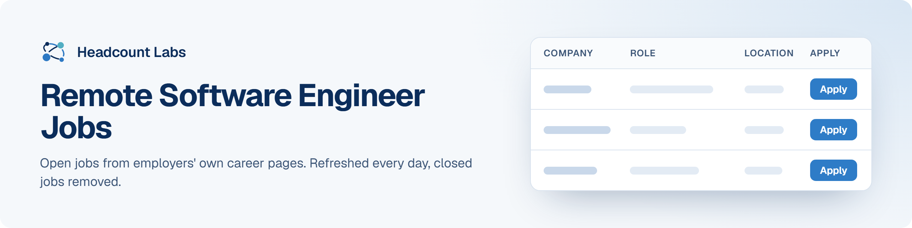

# Remote Software Engineer Jobs

Fully remote software engineering jobs at US employers, where the employer says the job is remote.

**146 open jobs** · 116 new since the last update · 370 removed because they closed or left the employer's board · updated November 7, 2026 at 4:37 AM EST

This list is built and refreshed every day by [Headcount Labs](https://headcountlabs.com/?utm_source=github&utm_medium=job-list&utm_campaign=remote-software-engineer-jobs), which reads jobs straight from employers' own career pages and job boards. Every job here was still listed on its source board when we last read that board, within the past 3 days, and was posted in the past 30 days. Copies of the same job are merged into one row, and jobs that close are removed at the next update.

Want this data in your own app or agent? Use the [Headcount Labs jobs API](https://headcountlabs.com/docs/?utm_source=github&utm_medium=job-list&utm_campaign=remote-software-engineer-jobs) (free tier), the [MCP server](https://headcountlabs.com/mcp/?utm_source=github&utm_medium=job-list&utm_campaign=remote-software-engineer-jobs) for Claude, ChatGPT and other AI assistants, or the [public dataset subsets](https://huggingface.co/HeadcountLabs) on Hugging Face (the full dataset is coming soon).

**Full dataset.** A bigger, one-off snapshot dated 2026-10-19 (all matching jobs, not only the open jobs below) is on Hugging Face: [Remote jobs](https://huggingface.co/datasets/HeadcountLabs/remote-jobs) · [Tech and software jobs](https://huggingface.co/datasets/HeadcountLabs/tech-jobs). It loads with `datasets.load_dataset` and is under the Open Database License (ODbL) 1.0.

**Jump to:** [Posted in the last 7 days (86)](#posted-in-the-last-7-days) · [Posted 8 to 30 days ago (60)](#posted-8-to-30-days-ago)

**Columns.** *Apply* opens the original posting on the employer's site. *Details* opens the job on Headcount Labs, with every posting we found for it. *Remote* shows what the employer states; a dash means the posting doesn't say. *Pay* is the range the employer published.

## Posted in the last 7 days

| Company | Role | Location | Remote | Pay | Posted | Apply | Details |
| --- | --- | --- | --- | --- | --- | :---: | :---: |
| **UPMC** | Analytics Data Integration Developer Senior | Pittsburgh, PA | Remote | — | Nov 6 |  | <a href="https://headcountlabs.com/catalog/jobs/404ba8f7-ce77-4873-b2a1-18d470153781?utm_source=github&utm_medium=job-list&utm_campaign=remote-software-engineer-jobs">via Headcount Labs</a> |
| **SYSCOM, Inc.** | Power BI Developer | Saint Paul, MN | Remote | — | Nov 6 |  | <a href="https://headcountlabs.com/catalog/jobs/05b6743b-d9ff-4419-93e2-fa08b5fb6bbf?utm_source=github&utm_medium=job-list&utm_campaign=remote-software-engineer-jobs">via Headcount Labs</a> |
| **OPEN OPENLANE US Inc** | SRE Security Engineer | Carmel, IN | Remote | — | Nov 6 |  | <a href="https://headcountlabs.com/catalog/jobs/6404dfe9-9832-4d97-8b49-552150b597b7?utm_source=github&utm_medium=job-list&utm_campaign=remote-software-engineer-jobs">via Headcount Labs</a> |
| **Humana** | Principal, Software Engineer - Enterprise Automation Frameworks &amp; Support​ | 

2 locations
New York, NY New York
 | Remote | $157k–$215k/yr | Nov 6 |  | <a href="https://headcountlabs.com/catalog/jobs/5ca8a508-84ba-4627-8ef8-9570cf32dfba?utm_source=github&utm_medium=job-list&utm_campaign=remote-software-engineer-jobs">via Headcount Labs</a> |
| **First American** | Full Stack Senior Software Engineer (Remote in CA) | 

3 locations
Santa Ana, CA Home, CA California
 | Remote | $129k–$172k/yr | Nov 6 |  | <a href="https://headcountlabs.com/catalog/jobs/4f9a39a9-1dd8-4cda-89ba-deb1472a666a?utm_source=github&utm_medium=job-list&utm_campaign=remote-software-engineer-jobs">via Headcount Labs</a> |
| **Coinbase** | Senior Software Engineer (Institutional, USDC) | United States | Remote | $208k–$219k/yr | Nov 6 |  | <a href="https://headcountlabs.com/catalog/jobs/0f32ecc6-6a5a-4ee5-b9ff-7108bb839880?utm_source=github&utm_medium=job-list&utm_campaign=remote-software-engineer-jobs">via Headcount Labs</a> |
| **BCBST BlueCross BlueShield of Tennessee, Inc.** | Sr. BAW Software Engineer | Chattanooga, TN | Remote | — | Nov 6 |  | <a href="https://headcountlabs.com/catalog/jobs/25904411-fc11-42f0-948d-c80881f7d03d?utm_source=github&utm_medium=job-list&utm_campaign=remote-software-engineer-jobs">via Headcount Labs</a> |
| **BCBST BlueCross BlueShield of Tennessee, Inc.** | IBM BAW Software Engineer | Chattanooga, TN | Remote | — | Nov 6 |  | <a href="https://headcountlabs.com/catalog/jobs/85894f70-1cd1-4edc-90ba-dc3f2fa9a2f8?utm_source=github&utm_medium=job-list&utm_campaign=remote-software-engineer-jobs">via Headcount Labs</a> |
| **ASRC Federal Holding Company** | FMS/BPC Instructor &amp; Course Developer | Oregon | Remote | — | Nov 6 |  | <a href="https://headcountlabs.com/catalog/jobs/df919033-61e6-4d0c-81b2-85279cdc708d?utm_source=github&utm_medium=job-list&utm_campaign=remote-software-engineer-jobs">via Headcount Labs</a> |
| **Travoom** | Senior Backend Engineer — LIVE Sports Data &amp; Multi-Sport Platform | Austin, TX | Remote | — | Nov 5 |  | <a href="https://headcountlabs.com/catalog/jobs/dd5e076d-9154-4e07-bc08-e0a351983adc?utm_source=github&utm_medium=job-list&utm_campaign=remote-software-engineer-jobs">via Headcount Labs</a> |
| **Thrive** | Microsoft AI Solutions Developer | United States | Remote | — | Nov 5 |  | <a href="https://headcountlabs.com/catalog/jobs/f69f1cd4-7ca4-4a00-b706-2eac3b6dca84?utm_source=github&utm_medium=job-list&utm_campaign=remote-software-engineer-jobs">via Headcount Labs</a> |
| **Terac** | Technology Leaders: 30-Minute Survey on ERP Software Evaluation | United States | Remote | — | Nov 5 |  | <a href="https://headcountlabs.com/catalog/jobs/e2fa07c9-c298-4679-98cb-03922a77ae6d?utm_source=github&utm_medium=job-list&utm_campaign=remote-software-engineer-jobs">via Headcount Labs</a> |
| **Socure** | Staff Backend Graph Engineer | 

2 locations
United States Hub - Seattle
 | Remote | $225k–$250k/yr | Nov 5 |  | <a href="https://headcountlabs.com/catalog/jobs/db286b8d-3df9-4282-a93e-4c3dbadd07c9?utm_source=github&utm_medium=job-list&utm_campaign=remote-software-engineer-jobs">via Headcount Labs</a> |
| **Scalepex** | Senior Software Development Engineer in Test (SDET) - Remote | Plano, TX | Remote | — | Nov 5 |  | <a href="https://headcountlabs.com/catalog/jobs/c50eb275-7bf8-4844-8c0d-5ebdaa2807cd?utm_source=github&utm_medium=job-list&utm_campaign=remote-software-engineer-jobs">via Headcount Labs</a> |
| **Salvo Software** | AI Developer | United States | Remote | — | Nov 5 |  | <a href="https://headcountlabs.com/catalog/jobs/d13c1be4-0ed8-4212-8b58-59480aaa358d?utm_source=github&utm_medium=job-list&utm_campaign=remote-software-engineer-jobs">via Headcount Labs</a> |
| **Qualia** | Senior Software Engineer II, Cloud Security | Austin, TX | Remote | — | Nov 5 |  | <a href="https://headcountlabs.com/catalog/jobs/293a240d-faee-40ec-ab9a-69867c93db26?utm_source=github&utm_medium=job-list&utm_campaign=remote-software-engineer-jobs">via Headcount Labs</a> |
| **Pearson** | Senior Software Engineer | Austin, TX | Remote | $140k–$160k/yr | Nov 5 |  | <a href="https://headcountlabs.com/catalog/jobs/891bbc07-273a-4588-b1fb-47b0935b9186?utm_source=github&utm_medium=job-list&utm_campaign=remote-software-engineer-jobs">via Headcount Labs</a> |
| **PatientPoint - Invite Only** | Software Engineer Intern | United States | Remote | $23–$25/hr | Nov 5 |  | <a href="https://headcountlabs.com/catalog/jobs/64aa2df9-7905-46c1-b49f-d66ef47c5e4d?utm_source=github&utm_medium=job-list&utm_campaign=remote-software-engineer-jobs">via Headcount Labs</a> |
| **Owner.com** | Staff Software Engineer - Orders Platform | United States | Remote | — | Nov 5 |  | <a href="https://headcountlabs.com/catalog/jobs/cbfafd1f-c9d0-4685-a912-90d8e5108957?utm_source=github&utm_medium=job-list&utm_campaign=remote-software-engineer-jobs">via Headcount Labs</a> |
| **neurohire.ai** | Site Reliability Engineer | United States | Remote | — | Nov 5 |  | <a href="https://headcountlabs.com/catalog/jobs/8eed7528-d520-4ba0-a99d-40ecc4170267?utm_source=github&utm_medium=job-list&utm_campaign=remote-software-engineer-jobs">via Headcount Labs</a> |
| **neurohire.ai** | Software AI Engineer | United States | Remote | — | Nov 5 |  | <a href="https://headcountlabs.com/catalog/jobs/0c687ece-c173-48c1-a99a-255743802a13?utm_source=github&utm_medium=job-list&utm_campaign=remote-software-engineer-jobs">via Headcount Labs</a> |
| **Natera** | Senior Software V&amp;V Engineer | United States | Remote | $109k–$140k/yr | Nov 5 |  | <a href="https://headcountlabs.com/catalog/jobs/54e2f395-8aff-4d52-a446-e5dba5a2daf3?utm_source=github&utm_medium=job-list&utm_campaign=remote-software-engineer-jobs">via Headcount Labs</a> |
| **Miratech** | Senior Full Stack Java Engineer - Workforce Management (WFM) | 

6 locations
Texas Richmond Hill Brampton Mississauga Georgia North York
 | Remote | — | Nov 5 |  | <a href="https://headcountlabs.com/catalog/jobs/f4eadac3-bc9b-47b4-afe3-213ee12517c4?utm_source=github&utm_medium=job-list&utm_campaign=remote-software-engineer-jobs">via Headcount Labs</a> |
| **Miratech** | Full Stack Java Engineer | United States | Remote | — | Nov 5 |  | <a href="https://headcountlabs.com/catalog/jobs/59a06daf-7e97-4503-8f9e-439715e448f5?utm_source=github&utm_medium=job-list&utm_campaign=remote-software-engineer-jobs">via Headcount Labs</a> |
| **Jobgether** | Software Engineer Lead | United States | Remote | $105k–$135k/yr | Nov 5 |  | <a href="https://headcountlabs.com/catalog/jobs/a61c42b5-d3f7-4c68-ab03-cd703ea899cc?utm_source=github&utm_medium=job-list&utm_campaign=remote-software-engineer-jobs">via Headcount Labs</a> |
| **Jobgether** | Senior Software Engineer - Mobile | United States | Remote | $190k–$230k/yr | Nov 5 |  | <a href="https://headcountlabs.com/catalog/jobs/4ed27be6-ded6-4447-bffd-ba4b631381e3?utm_source=github&utm_medium=job-list&utm_campaign=remote-software-engineer-jobs">via Headcount Labs</a> |
| **Jobgether** | Lead Site Reliability Engineer | United States | Remote | $150k–$175k/yr | Nov 5 |  | <a href="https://headcountlabs.com/catalog/jobs/4c3bf4db-7f00-4c31-9dbb-4d78839c8853?utm_source=github&utm_medium=job-list&utm_campaign=remote-software-engineer-jobs">via Headcount Labs</a> |
| **Jobgether** | Staff Software Engineer - Developer Experience | United States | Remote | $158k–$248k/yr | Nov 5 |  | <a href="https://headcountlabs.com/catalog/jobs/3b63fb85-8c98-40b7-a530-8b9d86b4065d?utm_source=github&utm_medium=job-list&utm_campaign=remote-software-engineer-jobs">via Headcount Labs</a> |
| **Jobgether** | Information Software Business Development Manager - Rockwell Automation | United States | Remote | — | Nov 5 |  | <a href="https://headcountlabs.com/catalog/jobs/2049e22c-ebf2-4da7-9421-0ceca1c79c2f?utm_source=github&utm_medium=job-list&utm_campaign=remote-software-engineer-jobs">via Headcount Labs</a> |
| **Jobgether** | Sr Business Intelligence Developer | United States | Remote | $94k–$118k/yr | Nov 5 |  | <a href="https://headcountlabs.com/catalog/jobs/0f081b47-8f2a-4f60-97a2-2ec51fd33357?utm_source=github&utm_medium=job-list&utm_campaign=remote-software-engineer-jobs">via Headcount Labs</a> |
| **Jobgether** | eLearning Developer, Articulate Rise Contractror | United States | Remote | — | Nov 5 |  | <a href="https://headcountlabs.com/catalog/jobs/34dfcdb4-604e-4e46-b5f6-879a6b9728a0?utm_source=github&utm_medium=job-list&utm_campaign=remote-software-engineer-jobs">via Headcount Labs</a> |
| **Jobgether** | Onboarding Consultant - Dental Software | United States | Remote | $65k–$85k/yr | Nov 5 |  | <a href="https://headcountlabs.com/catalog/jobs/dafad3de-c56d-433e-b5a8-1c52e0863468?utm_source=github&utm_medium=job-list&utm_campaign=remote-software-engineer-jobs">via Headcount Labs</a> |
| **IRIS** | Software Support Team Lead - Workforce Management | IRIS United States | Remote | $70k–$80k/yr | Nov 5 |  | <a href="https://headcountlabs.com/catalog/jobs/141d5af0-e3f2-4748-b432-e7d51a620bee?utm_source=github&utm_medium=job-list&utm_campaign=remote-software-engineer-jobs">via Headcount Labs</a> |
| **Funnel Leasing** | Manager, Software Engineering - Mobile Apps | United States | Remote | — | Nov 5 |  | <a href="https://headcountlabs.com/catalog/jobs/a1f3f8ea-741a-4aae-a051-bc9c8921f1ba?utm_source=github&utm_medium=job-list&utm_campaign=remote-software-engineer-jobs">via Headcount Labs</a> |
| **Fluent, LLC** | Software Engineer (AI Agents) | United States | Remote | — | Nov 5 |  | <a href="https://headcountlabs.com/catalog/jobs/b5d46bfc-aa37-4557-a6c1-5c0e25c3729e?utm_source=github&utm_medium=job-list&utm_campaign=remote-software-engineer-jobs">via Headcount Labs</a> |
| **Exiger** | Senior Software Engineer (L4) | 

3 locations
McLean, VA Richmond, VA San Francisco, CA
 | Remote | — | Nov 5 |  | <a href="https://headcountlabs.com/catalog/jobs/b8c96da5-e541-418c-bf96-36577af9a5a9?utm_source=github&utm_medium=job-list&utm_campaign=remote-software-engineer-jobs">via Headcount Labs</a> |
| **Empower Retirement, LLC** | Lead Site Reliability Engineer | United States | Remote | — | Nov 5 |  | <a href="https://headcountlabs.com/catalog/jobs/272c8824-e367-4817-a463-56dd36f42acf?utm_source=github&utm_medium=job-list&utm_campaign=remote-software-engineer-jobs">via Headcount Labs</a> |
| **C01 Carrier Corporation** | Staff Site Reliability Engineer | 

2 locations
Florida City, FL
 | Remote | $96k–$192k/yr | Nov 5 |  | <a href="https://headcountlabs.com/catalog/jobs/b243491c-d8f3-437c-9e64-36375d6a781a?utm_source=github&utm_medium=job-list&utm_campaign=remote-software-engineer-jobs">via Headcount Labs</a> |
| **Bright Vision Technologies** | OneStream Developer | Irving, TX | Remote | $115k–$165k/yr | Nov 5 |  | <a href="https://headcountlabs.com/catalog/jobs/47404314-b62f-4b5f-a5ef-a648758ed20d?utm_source=github&utm_medium=job-list&utm_campaign=remote-software-engineer-jobs">via Headcount Labs</a> |
| **Bright Vision Technologies** | Workday Integration Developer | Edison, NJ | Remote | $115k–$165k/yr | Nov 5 |  | <a href="https://headcountlabs.com/catalog/jobs/33dca212-743a-4f39-90d0-d3747b8d6a29?utm_source=github&utm_medium=job-list&utm_campaign=remote-software-engineer-jobs">via Headcount Labs</a> |
| **Allstate Insurance Co.** | Software Engineer Senior Consultant I | USA -, TX | Remote | — | Nov 5 |  | <a href="https://headcountlabs.com/catalog/jobs/281b01d1-af34-4122-acf2-1b903696167d?utm_source=github&utm_medium=job-list&utm_campaign=remote-software-engineer-jobs">via Headcount Labs</a> |
| **AECOM** | Cority Developer | 

8 locations
Conshohocken, PA Boston, MA Houston, TX Chicago, IL Raleigh, NC Orlando, FL Denver, CO Los Angeles, CA
 | Remote | $105k–$145k/yr | Nov 5 |  | <a href="https://headcountlabs.com/catalog/jobs/120d52e4-9830-4100-a976-a4d6e9fa0d0d?utm_source=github&utm_medium=job-list&utm_campaign=remote-software-engineer-jobs">via Headcount Labs</a> |
| **AECOM** | CADD/Software Tool Developer - Bridge Design | Omaha, NE | Remote | $49–$85/hr | Nov 5 |  | <a href="https://headcountlabs.com/catalog/jobs/1175b6d6-43c3-4b00-a476-a8c9f7e0f3af?utm_source=github&utm_medium=job-list&utm_campaign=remote-software-engineer-jobs">via Headcount Labs</a> |
| **003 Humana Inc.** | Senior DevOps Platform Engineer | 

13 locations
Louisville, KY Arlington, VA Atlanta Boston, MA Charlotte, NC Chicago, IL Dallas, TX Fort Lauderdale, FL Frisco, TX Nashville, TN New York, NY Tampa, FL +1 more
 | Remote | $107k–$147k/yr | Nov 5 |  | <a href="https://headcountlabs.com/catalog/jobs/c71cf52a-a359-4507-a0c8-de63c3f94f7c?utm_source=github&utm_medium=job-list&utm_campaign=remote-software-engineer-jobs">via Headcount Labs</a> |
| **VGS** | Sr. Software Engineer - DevEx | United States | Remote | $150k–$200k/yr | Nov 4 |  | <a href="https://headcountlabs.com/catalog/jobs/9765fcbe-9256-4cf2-8138-fe9bcffc57bd?utm_source=github&utm_medium=job-list&utm_campaign=remote-software-engineer-jobs">via Headcount Labs</a> |
| **Uniform Advantage Brands** | Senior Front-End Developer | Fort Lauderdale, FL | Remote | — | Nov 4 |  | <a href="https://headcountlabs.com/catalog/jobs/23755180-f8b8-49ce-8fc0-2d8fb1db7038?utm_source=github&utm_medium=job-list&utm_campaign=remote-software-engineer-jobs">via Headcount Labs</a> |
| **Temporal (member)** | Staff Software Engineer, Compute (Temporal Cloud) | United States | Remote | $212k–$274k/yr | Nov 4 |  | <a href="https://headcountlabs.com/catalog/jobs/940527ea-ca5b-42c8-8615-8dcbc4847c15?utm_source=github&utm_medium=job-list&utm_campaign=remote-software-engineer-jobs">via Headcount Labs</a> |
| **Teleport** | Staff Backend Engineer - Performance - US | United States | Remote | $222k–$342k/yr | Nov 4 |  | <a href="https://headcountlabs.com/catalog/jobs/fc615dc3-4c6d-4e7d-848d-f5b7fd067f2a?utm_source=github&utm_medium=job-list&utm_campaign=remote-software-engineer-jobs">via Headcount Labs</a> |
| **Span** | DevOps Engineer | 

6 locations
United States Buenos Aires Denver, CO New York City, NY Austin, TX Sofia City
 | Remote | — | Nov 4 |  | <a href="https://headcountlabs.com/catalog/jobs/c15e9775-5b8e-4569-bed1-bd1e628ef3ff?utm_source=github&utm_medium=job-list&utm_campaign=remote-software-engineer-jobs">via Headcount Labs</a> |
| **Southwest Airlines Co.** | Senior Operations Research Developer | Dallas, TX | Remote | $153k/yr | Nov 4 |  | <a href="https://headcountlabs.com/catalog/jobs/53970291-5f6a-4a1e-b959-cd82f45b5fcc?utm_source=github&utm_medium=job-list&utm_campaign=remote-software-engineer-jobs">via Headcount Labs</a> |
| **Southwest Airlines** | Senior Operations Research Developer | Dallas, TX | Remote | $153k/yr | Nov 4 |  | <a href="https://headcountlabs.com/catalog/jobs/b6fd435f-f9f8-4350-a39b-94bb227c38cc?utm_source=github&utm_medium=job-list&utm_campaign=remote-software-engineer-jobs">via Headcount Labs</a> |
| **Serve Robotics** | Senior Software Engineer, Operations Tools &amp; Al Enablement | United States | Remote | $180k–$200k/yr | Nov 4 |  | <a href="https://headcountlabs.com/catalog/jobs/15dd6982-ad60-4e2e-8175-a17ab83b5488?utm_source=github&utm_medium=job-list&utm_campaign=remote-software-engineer-jobs">via Headcount Labs</a> |
| **Sentinel** | Azure DevOps Engineer – Release Coordinator | Chicago, IL | Remote | $90k–$110k/yr | Nov 4 |  | <a href="https://headcountlabs.com/catalog/jobs/a30fcfac-83ec-420b-ace2-0ab8942f0bca?utm_source=github&utm_medium=job-list&utm_campaign=remote-software-engineer-jobs">via Headcount Labs</a> |
| **SentiLink** | Senior Product Engineer, Full Stack | United States | Remote | — | Nov 4 |  | <a href="https://headcountlabs.com/catalog/jobs/8c5c4a58-66e9-4aaf-92d9-1cd4b37d3598?utm_source=github&utm_medium=job-list&utm_campaign=remote-software-engineer-jobs">via Headcount Labs</a> |
| **SentiLink** | Senior Software Engineer, Full Stack | United States | Remote | — | Nov 4 |  | <a href="https://headcountlabs.com/catalog/jobs/548078e5-a7ef-46af-b7c3-4b24b1dfb17d?utm_source=github&utm_medium=job-list&utm_campaign=remote-software-engineer-jobs">via Headcount Labs</a> |
| **SentiLink** | Senior Software Engineer, Frontend | United States | Remote | — | Nov 4 |  | <a href="https://headcountlabs.com/catalog/jobs/268d7670-7687-4f62-b1cc-adab6123b937?utm_source=github&utm_medium=job-list&utm_campaign=remote-software-engineer-jobs">via Headcount Labs</a> |
| **Reveleer** | Full Stack AI Engineer | United States | Remote | $175k–$200k/yr | Nov 4 |  | <a href="https://headcountlabs.com/catalog/jobs/7a77d68e-11cb-4c2d-a6a7-b6ae08e07651?utm_source=github&utm_medium=job-list&utm_campaign=remote-software-engineer-jobs">via Headcount Labs</a> |
| **Red River** | Developer II, Software Web Development, Full Stack Developer | United States | Remote | — | Nov 4 |  | <a href="https://headcountlabs.com/catalog/jobs/dd351864-4fe9-42df-8c3c-4a461dabe916?utm_source=github&utm_medium=job-list&utm_campaign=remote-software-engineer-jobs">via Headcount Labs</a> |
| **Pearson** | Specialist, Content Developer (English Language Arts) | 

2 locations
United States Austin, TX
 | Remote | $70k–$80k/yr | Nov 4 |  | <a href="https://headcountlabs.com/catalog/jobs/8c31e5f6-20f6-40ef-8cd1-e7b624f20e2e?utm_source=github&utm_medium=job-list&utm_campaign=remote-software-engineer-jobs">via Headcount Labs</a> |
| **Pearson** | Software Engineer III | 

2 locations
United States Austin, TX
 | Remote | $80k–$120k/yr | Nov 4 |  | <a href="https://headcountlabs.com/catalog/jobs/ea1163fb-135f-42b5-b2c3-66512352ab8d?utm_source=github&utm_medium=job-list&utm_campaign=remote-software-engineer-jobs">via Headcount Labs</a> |
| **Paxos** | Senior Software Engineer, Identity &amp; Regulatory Platform | United States (East Coast | Remote | $188k–$215k/yr | Nov 4 |  | <a href="https://headcountlabs.com/catalog/jobs/75c472ad-8591-41a9-bd2f-271ef9543450?utm_source=github&utm_medium=job-list&utm_campaign=remote-software-engineer-jobs">via Headcount Labs</a> |
| **Humana Inc.** | Lead Full-Stack Engineer - Backend Focus | 

13 locations
Atlanta, GA Boston, MA Charlotte, NC Chicago, IL Dallas, TX Fort Lauderdale, FL Louisville, KY Nashville, TN New York, NY Washington, DC Tampa, FL Atlanta +1 more
 | Remote | $129k–$178k/yr | Nov 4 |  | <a href="https://headcountlabs.com/catalog/jobs/8fd0c8b7-acb6-4a38-97a6-206d83c3c1e7?utm_source=github&utm_medium=job-list&utm_campaign=remote-software-engineer-jobs">via Headcount Labs</a> |
| **Horizon3** | Senior Software Engineer, Pentest Experience | United States | Remote | — | Nov 4 |  | <a href="https://headcountlabs.com/catalog/jobs/ffb6fe24-81f1-4d7d-b010-420c720b24ff?utm_source=github&utm_medium=job-list&utm_campaign=remote-software-engineer-jobs">via Headcount Labs</a> |
| **GoodLeap** | Senior Software Engineer | 

6 locations
Flexible within tech hubs Austin, TX Plano, TX United States San Francisco, CA West Palm Beach, FL
 | Remote | $132k–$197k/yr | Nov 4 |  | <a href="https://headcountlabs.com/catalog/jobs/c5e55781-ac3f-48b7-a17d-83f7452b820a?utm_source=github&utm_medium=job-list&utm_campaign=remote-software-engineer-jobs">via Headcount Labs</a> |
| **First American** | Senior Software Engineer (CA - Remote) | 

3 locations
California Santa Ana, CA Home, CA
 | Remote | $129k–$172k/yr | Nov 4 |  | <a href="https://headcountlabs.com/catalog/jobs/9659ddf5-6cf5-4665-9af0-aa93ab54cda0?utm_source=github&utm_medium=job-list&utm_campaign=remote-software-engineer-jobs">via Headcount Labs</a> |
| **CrossFit, LLC** | eLearning Developer, Articulate Rise Contractror | United States | Remote | — | Nov 4 |  | <a href="https://headcountlabs.com/catalog/jobs/e9d87e57-75b8-47c1-a747-99153b8bfa42?utm_source=github&utm_medium=job-list&utm_campaign=remote-software-engineer-jobs">via Headcount Labs</a> |
| **CreatorIQ** | MLOps / DevOps Engineer – AI Infrastructure | 

3 locations
United States Los Angeles, CA San Francisco, CA
 | Remote | $121k–$155k/yr | Nov 4 |  | <a href="https://headcountlabs.com/catalog/jobs/9293b941-bc75-4cdd-aa9d-30d5a816eb6f?utm_source=github&utm_medium=job-list&utm_campaign=remote-software-engineer-jobs">via Headcount Labs</a> |
| **Compyl** | Software Engineer | United States | Remote | $100k–$140k/yr | Nov 4 |  | <a href="https://headcountlabs.com/catalog/jobs/9993ca6d-157a-46a8-8a3f-020f6a68cd56?utm_source=github&utm_medium=job-list&utm_campaign=remote-software-engineer-jobs">via Headcount Labs</a> |
| **Andromeda Cluster** | Senior Site Reliability Engineer | Global / San Francisco, CA | Remote | — | Nov 4 |  | <a href="https://headcountlabs.com/catalog/jobs/90051803-8567-4caf-85f2-9aed09646a01?utm_source=github&utm_medium=job-list&utm_campaign=remote-software-engineer-jobs">via Headcount Labs</a> |
| **Southwest Airlines Co.** | Tech Lead Software Engineer | Dallas, TX | Remote | $161k–$178k/yr | Nov 3 |  | <a href="https://headcountlabs.com/catalog/jobs/0f2dc9bd-a55f-48b4-a2e1-e4ea9329b370?utm_source=github&utm_medium=job-list&utm_campaign=remote-software-engineer-jobs">via Headcount Labs</a> |
| **ITC Federal, Inc.** | Graphic Designer/Instructional Developer (Junior) - DOJ EOIR | Falls Church, VA | Remote | $75k–$80k/yr | Nov 3 |  | <a href="https://headcountlabs.com/catalog/jobs/3c55978c-5e24-4c41-8362-dad4f35ca8f7?utm_source=github&utm_medium=job-list&utm_campaign=remote-software-engineer-jobs">via Headcount Labs</a> |
| **Fortive** | Software QA Engineer Lead | 

2 locations
United States Minneapolis, MN
 | Remote | — | Nov 3 |  | <a href="https://headcountlabs.com/catalog/jobs/e13b82ee-2355-434a-a95c-2d7c47c29da3?utm_source=github&utm_medium=job-list&utm_campaign=remote-software-engineer-jobs">via Headcount Labs</a> |
| **ElevenLabs** | Full-Stack Engineer (Frontend Leaning) - Studio | United States | Remote | — | Nov 3 |  | <a href="https://headcountlabs.com/catalog/jobs/9ac9d866-8bc8-4add-9020-b73a767ba5f1?utm_source=github&utm_medium=job-list&utm_campaign=remote-software-engineer-jobs">via Headcount Labs</a> |
| **ClickHouse** | Senior Site Reliability Engineer - (US-Remote) | United States | Remote | $150k–$230k/yr | Nov 3 |  | <a href="https://headcountlabs.com/catalog/jobs/ab69ccb1-80aa-4190-a260-d2e4d6a96d96?utm_source=github&utm_medium=job-list&utm_campaign=remote-software-engineer-jobs">via Headcount Labs</a> |
| **Chimes** | RPA Developer | United States | Remote | $69.63–$85.11/hr | Nov 3 |  | <a href="https://headcountlabs.com/catalog/jobs/03ddfce6-47e3-4dd1-b1f5-af98b991938b?utm_source=github&utm_medium=job-list&utm_campaign=remote-software-engineer-jobs">via Headcount Labs</a> |
| **LE0001 Curriculum Associates, LLC** | Senior Content Developer - Spanish and English Literacy | Massachusetts | Remote | $61k–$100k/yr | Nov 2 |  | <a href="https://headcountlabs.com/catalog/jobs/de4062d3-cf80-42d5-bbd6-d8af6dd624f9?utm_source=github&utm_medium=job-list&utm_campaign=remote-software-engineer-jobs">via Headcount Labs</a> |
| **ElevenLabs** | Full-Stack Engineer (Backend Leaning) - Platform Engineering | 

2 locations
Europe United States
 | Remote | — | Nov 2 |  | <a href="https://headcountlabs.com/catalog/jobs/cd340b24-4163-478b-b622-578feed9c13f?utm_source=github&utm_medium=job-list&utm_campaign=remote-software-engineer-jobs">via Headcount Labs</a> |
| **ElevenLabs** | Full-Stack Engineer (Backend Leaning) - Payments Engineering | 

2 locations
Europe United States
 | Remote | — | Nov 2 |  | <a href="https://headcountlabs.com/catalog/jobs/ae54f3d3-d823-44ec-94fb-2bfa7d9f7440?utm_source=github&utm_medium=job-list&utm_campaign=remote-software-engineer-jobs">via Headcount Labs</a> |
| **Bright Vision Technologies** | Site Reliability Engineer | Fremont, CA | Remote | $115k–$165k/yr | Nov 2 |  | <a href="https://headcountlabs.com/catalog/jobs/ff50c4ea-ef71-41c5-8648-c9cca6910f12?utm_source=github&utm_medium=job-list&utm_campaign=remote-software-engineer-jobs">via Headcount Labs</a> |
| **Bright Vision Technologies** | Oracle PL/SQL Developer | Fremont, CA | Remote | $115k–$165k/yr | Nov 2 |  | <a href="https://headcountlabs.com/catalog/jobs/eab4d173-a017-4af4-8702-db1a148713ca?utm_source=github&utm_medium=job-list&utm_campaign=remote-software-engineer-jobs">via Headcount Labs</a> |
| **Bright Vision Technologies** | Senior DevOps Engineer | Frisco, TX | Remote | $115k–$165k/yr | Nov 2 |  | <a href="https://headcountlabs.com/catalog/jobs/b0a784e6-5ea9-423e-b6b5-289ec0ca8862?utm_source=github&utm_medium=job-list&utm_campaign=remote-software-engineer-jobs">via Headcount Labs</a> |
| **Bright Vision Technologies** | DevOps Lead | Irving, TX | Remote | $115k–$165k/yr | Nov 2 |  | <a href="https://headcountlabs.com/catalog/jobs/ad8de854-b2c2-4fc0-9dbd-5624d84f5018?utm_source=github&utm_medium=job-list&utm_campaign=remote-software-engineer-jobs">via Headcount Labs</a> |
| **Bright Vision Technologies** | Devops Engineer | Frisco, TX | Remote | $115k–$165k/yr | Nov 2 |  | <a href="https://headcountlabs.com/catalog/jobs/a57a3425-3beb-464d-a46f-7f7d915de4a1?utm_source=github&utm_medium=job-list&utm_campaign=remote-software-engineer-jobs">via Headcount Labs</a> |
| **Bright Vision Technologies** | Oracle Database Developer | Frisco, TX | Remote | $115k–$165k/yr | Nov 2 |  | <a href="https://headcountlabs.com/catalog/jobs/6676b3ea-efab-4c8a-807b-d5400dcd13e7?utm_source=github&utm_medium=job-list&utm_campaign=remote-software-engineer-jobs">via Headcount Labs</a> |
| **Expensify, Inc.** | Full Stack Engineer | US Based | Remote | $150k–$250k/yr | Oct 31 |  | <a href="https://headcountlabs.com/catalog/jobs/b3037d1f-1d25-4358-b79b-6bf274c2f0cb?utm_source=github&utm_medium=job-list&utm_campaign=remote-software-engineer-jobs">via Headcount Labs</a> |
| **ASRC Federal Holding Company** | Web (UI/UX) Developer | 

51 locations
Indiana Maryland Massachusetts Nevada New York Montana North Dakota Vermont Arkansas Wyoming Wisconsin Rhode Island +39 more
 | Remote | — | Oct 31 |  | <a href="https://headcountlabs.com/catalog/jobs/26f47a05-6ee9-4370-a8ac-6ea0e45406b4?utm_source=github&utm_medium=job-list&utm_campaign=remote-software-engineer-jobs">via Headcount Labs</a> |

## Posted 8 to 30 days ago

| Company | Role | Location | Remote | Pay | Posted | Apply | Details |
| --- | --- | --- | --- | --- | --- | :---: | :---: |
| **OpenMined** | Senior/Staff Software Engineer - Tech Lead | United States | Remote | — | Oct 30 |  | <a href="https://headcountlabs.com/catalog/jobs/ee28f4cc-6459-4512-976e-38f471a4977a?utm_source=github&utm_medium=job-list&utm_campaign=remote-software-engineer-jobs">via Headcount Labs</a> |
| **Mirantis** | Principal Software Engineer | Austin, TX | Remote | — | Oct 30 |  | <a href="https://headcountlabs.com/catalog/jobs/6f6bb5c2-80ce-4290-9536-c5fd52005aaa?utm_source=github&utm_medium=job-list&utm_campaign=remote-software-engineer-jobs">via Headcount Labs</a> |
| **MaintainX (An Autodesk Company)** | Integrations Developer | Austin, TX | Remote | $95k–$120k/yr | Oct 30 |  | <a href="https://headcountlabs.com/catalog/jobs/814703af-4921-4f85-b4ad-3452461f4802?utm_source=github&utm_medium=job-list&utm_campaign=remote-software-engineer-jobs">via Headcount Labs</a> |
| **IRI, INC** | Senior Director, Software Engineering | 

2 locations
Chicago, IL United States
 | Remote | $120k–$165k/yr | Oct 30 |  | <a href="https://headcountlabs.com/catalog/jobs/48c60292-5835-4d75-89e7-ee61c135e781?utm_source=github&utm_medium=job-list&utm_campaign=remote-software-engineer-jobs">via Headcount Labs</a> |
| **Humana Inc.** | Software Engineer | 

2 locations
Kentucky United States
 | Remote | $81k–$110k/yr | Oct 30 |  | <a href="https://headcountlabs.com/catalog/jobs/f9fda20c-e47d-4455-b330-3c4cd47e1b7c?utm_source=github&utm_medium=job-list&utm_campaign=remote-software-engineer-jobs">via Headcount Labs</a> |
| **Ellevation** | Director, Software Engineering | Boston, MA | Remote | $200k–$250k/yr | Oct 30 |  | <a href="https://headcountlabs.com/catalog/jobs/a15665cc-cdbb-481a-8df4-f6cdf25dbe79?utm_source=github&utm_medium=job-list&utm_campaign=remote-software-engineer-jobs">via Headcount Labs</a> |
| **Bloomerang** | Software Engineer (PDLC Tooling + Automation) | United States | Remote | $101k–$168k/yr | Oct 30 |  | <a href="https://headcountlabs.com/catalog/jobs/39835fb7-d547-4ce2-b3f3-8b188d6e6508?utm_source=github&utm_medium=job-list&utm_campaign=remote-software-engineer-jobs">via Headcount Labs</a> |
| **ASRC Federal** | Web (UI/UX) Developer | 

2 locations
Idaho Washington, ID
 | Remote | — | Oct 30 |  | <a href="https://headcountlabs.com/catalog/jobs/efdcf9d2-f727-4b9f-b135-91cb89cba0a9?utm_source=github&utm_medium=job-list&utm_campaign=remote-software-engineer-jobs">via Headcount Labs</a> |
| **ASRC Federal** | Microsoft .NET Software Engineer | Washington, DC | Remote | — | Oct 30 |  | <a href="https://headcountlabs.com/catalog/jobs/eba0dddd-6910-4195-a10b-377ebd96a5c0?utm_source=github&utm_medium=job-list&utm_campaign=remote-software-engineer-jobs">via Headcount Labs</a> |
| **Activision Blizzard** | Senior Expert ARM Kernel Developer – RICOCHET - Central Technology | 

2 locations
Sherman Oaks, CA Vancouver
 | Remote | — | Oct 30 |  | <a href="https://headcountlabs.com/catalog/jobs/9af19262-7540-41f5-bd5b-c485ca556933?utm_source=github&utm_medium=job-list&utm_campaign=remote-software-engineer-jobs">via Headcount Labs</a> |
| **System One** | Senior .Net developer (Secret Clearance) | Stafford, VA | Remote | — | Oct 29 |  | <a href="https://headcountlabs.com/catalog/jobs/9a80e9a8-311d-4737-90b1-c88ea15761cb?utm_source=github&utm_medium=job-list&utm_campaign=remote-software-engineer-jobs">via Headcount Labs</a> |
| **Plotly** | Senior Software Developer in Test &#124; Ingénieur·e logiciel senior en test | United States | Remote | — | Oct 29 |  | <a href="https://headcountlabs.com/catalog/jobs/7249d6bf-1f58-4906-be38-4e32c0544ed6?utm_source=github&utm_medium=job-list&utm_campaign=remote-software-engineer-jobs">via Headcount Labs</a> |
| **Motif** | Staff/Senior Software Engineer, CAD App (Full stack) | United States | Remote | — | Oct 29 |  | <a href="https://headcountlabs.com/catalog/jobs/85f3a019-1242-437f-b25e-9c64376606a8?utm_source=github&utm_medium=job-list&utm_campaign=remote-software-engineer-jobs">via Headcount Labs</a> |
| **Lynker Corporation** | Scientific Developer for Model Optimization | College Park, MD | Remote | $75k–$120k/yr | Oct 29 |  | <a href="https://headcountlabs.com/catalog/jobs/ecf44fbc-9495-4961-8a84-a17a6df68e86?utm_source=github&utm_medium=job-list&utm_campaign=remote-software-engineer-jobs">via Headcount Labs</a> |
| **Humana Inc.** | Site Reliability Engineer | 

2 locations
United States Kentucky
 | Remote | $81k–$110k/yr | Oct 29 |  | <a href="https://headcountlabs.com/catalog/jobs/41e8ac9d-1df3-4a4c-b62b-d92eeeb5c12f?utm_source=github&utm_medium=job-list&utm_campaign=remote-software-engineer-jobs">via Headcount Labs</a> |
| **Commons** | Full Stack Engineer (Backend Focus) | 

2 locations
Commons HQ United States
 | Remote | $150k–$200k/yr | Oct 29 |  | <a href="https://headcountlabs.com/catalog/jobs/3b6db44d-e0af-4e7e-8bde-8cd828a720a1?utm_source=github&utm_medium=job-list&utm_campaign=remote-software-engineer-jobs">via Headcount Labs</a> |
| **UL, LLC** | Senior Sales Executive, Software, Industrial Sector | 

3 locations
Chicago, IL Austin, TX Latham, NY
 | Remote | $94k–$126k/yr | Oct 28 |  | <a href="https://headcountlabs.com/catalog/jobs/b06c3c33-719b-49ee-895b-819c55d5ba06?utm_source=github&utm_medium=job-list&utm_campaign=remote-software-engineer-jobs">via Headcount Labs</a> |
| **UL, LLC** | Senior Sales Executive, Software, Consumer Sector | 

4 locations
Chicago, IL Latham, NY Northbrook, IL Austin, TX
 | Remote | $94k–$126k/yr | Oct 28 |  | <a href="https://headcountlabs.com/catalog/jobs/e2c7bb0a-6b8e-442b-97fd-ac377493c5d1?utm_source=github&utm_medium=job-list&utm_campaign=remote-software-engineer-jobs">via Headcount Labs</a> |
| **UL, LLC** | Senior Sales Executive, Software, Life Sciences | 

4 locations
Latham, NY Chicago, IL Northbrook, IL Austin, TX
 | Remote | $94k–$126k/yr | Oct 28 |  | <a href="https://headcountlabs.com/catalog/jobs/671ea2a8-48ad-4b46-98cf-1a32afd27aec?utm_source=github&utm_medium=job-list&utm_campaign=remote-software-engineer-jobs">via Headcount Labs</a> |
| **Raya** | Senior iOS Engineer, Places | United States | Remote | — | Oct 28 |  | <a href="https://headcountlabs.com/catalog/jobs/a70f675d-4cf5-4327-87c5-709404903ab9?utm_source=github&utm_medium=job-list&utm_campaign=remote-software-engineer-jobs">via Headcount Labs</a> |
| **MainSpring** | Senior Developer – FileMaker Platform | Frederick, MD | Remote | $75k–$120k/yr | Oct 28 |  | <a href="https://headcountlabs.com/catalog/jobs/087e475f-f8e9-4384-986f-fd83aabd2b21?utm_source=github&utm_medium=job-list&utm_campaign=remote-software-engineer-jobs">via Headcount Labs</a> |
| **Blue Coding** | Software Engineer (V) | Latam | Remote | — | Oct 28 |  | <a href="https://headcountlabs.com/catalog/jobs/73b5666c-5fcc-40e9-80e9-ab7b3e865272?utm_source=github&utm_medium=job-list&utm_campaign=remote-software-engineer-jobs">via Headcount Labs</a> |
| **Blue Coding** | Senior .NET Developer (V) | Latam | Remote | — | Oct 28 |  | <a href="https://headcountlabs.com/catalog/jobs/4ef55df0-a3d8-44fa-9531-985c95a07a37?utm_source=github&utm_medium=job-list&utm_campaign=remote-software-engineer-jobs">via Headcount Labs</a> |
| **Mirantis** | Rust Senior Software Engineer – Bare Metal as a Service &amp; Datacenter Networking | United States | Remote | — | Oct 27 |  | <a href="https://headcountlabs.com/catalog/jobs/beb4d2d2-473c-4b3a-894f-5935a5b95012?utm_source=github&utm_medium=job-list&utm_campaign=remote-software-engineer-jobs">via Headcount Labs</a> |
| **Coinbase** | Senior Software Engineer, Certificates Management | United States | Remote | $186k–$219k/yr | Oct 27 |  | <a href="https://headcountlabs.com/catalog/jobs/5ee266f2-a364-4c66-9fea-878ed709718d?utm_source=github&utm_medium=job-list&utm_campaign=remote-software-engineer-jobs">via Headcount Labs</a> |
| **Bask Health** | Junior Back-End Software Engineer | United States | Remote | — | Oct 27 |  | <a href="https://headcountlabs.com/catalog/jobs/df68c3f7-d778-4a3f-8ce7-7e38d5c9d4ff?utm_source=github&utm_medium=job-list&utm_campaign=remote-software-engineer-jobs">via Headcount Labs</a> |
| **Bask Health** | Junior Front-End Software Engineer | 

2 locations
Cairo United States
 | Remote | — | Oct 27 |  | <a href="https://headcountlabs.com/catalog/jobs/df0cea00-f931-43da-84b8-995a6a7f098e?utm_source=github&utm_medium=job-list&utm_campaign=remote-software-engineer-jobs">via Headcount Labs</a> |
| **Assort Health** | Senior Software Engineer, Infrastructure | United States | Remote | $190k–$240k/yr | Oct 27 |  | <a href="https://headcountlabs.com/catalog/jobs/1496cd54-ffea-4b05-b6cd-b9bab09d6dd1?utm_source=github&utm_medium=job-list&utm_campaign=remote-software-engineer-jobs">via Headcount Labs</a> |
| **ASRC Federal Holding Company** | ServiceNow Developer, Senior | United States | Remote | — | Oct 27 |  | <a href="https://headcountlabs.com/catalog/jobs/64bbdaad-8fb5-463d-beb5-ca1e381302a5?utm_source=github&utm_medium=job-list&utm_campaign=remote-software-engineer-jobs">via Headcount Labs</a> |
| **Mind Computing** | DevOps Engineer (Remote Opportunity) | United States | Remote | $120k–$125k/yr | Oct 26 |  | <a href="https://headcountlabs.com/catalog/jobs/21bb832a-7942-4024-a44d-32690b34965b?utm_source=github&utm_medium=job-list&utm_campaign=remote-software-engineer-jobs">via Headcount Labs</a> |
| **Merge** | DevOps Engineer | San Francisco, CA | Remote | — | Oct 26 |  | <a href="https://headcountlabs.com/catalog/jobs/8c95902e-4086-4229-bf3c-ba4eabb90e13?utm_source=github&utm_medium=job-list&utm_campaign=remote-software-engineer-jobs">via Headcount Labs</a> |
| **Lumen** | Senior Software Engineer | Oregon | Remote | $85k–$113k/yr | Oct 26 |  | <a href="https://headcountlabs.com/catalog/jobs/0e878d5e-7bad-4049-b045-93ea90fd2222?utm_source=github&utm_medium=job-list&utm_campaign=remote-software-engineer-jobs">via Headcount Labs</a> |
| **GE Aerospace** | Government Sales Director - Software | 

75 locations
Salem, OR Boston, MA Boise, ID Madisonville, KY Phoenix, AZ Chicago, IL Redmond, WA Omaha, NE Des Moines, IA Providence, RI Kansas City, MO Houston, TX +63 more
 | Remote | $120k–$170k/yr | Oct 24 |  | <a href="https://headcountlabs.com/catalog/jobs/d6cfe9bd-1d2e-4bc0-841f-b5a715929654?utm_source=github&utm_medium=job-list&utm_campaign=remote-software-engineer-jobs">via Headcount Labs</a> |
| **Capgemini** | Software Engineer - Security | 

2 locations
Bellevue, WA Bay Area, CA
 | Remote | $77k–$151k/yr | Oct 24 |  | <a href="https://headcountlabs.com/catalog/jobs/36c3979d-c67a-469c-8779-1235f96342bf?utm_source=github&utm_medium=job-list&utm_campaign=remote-software-engineer-jobs">via Headcount Labs</a> |
| **Lynker Corporation** | Physical Scientist - Seasonal Forecast System Developer | College Park, MD | Remote | $75k–$120k/yr | Oct 23 |  | <a href="https://headcountlabs.com/catalog/jobs/f252f0b5-fa58-4b00-acea-0e2fcd2451b9?utm_source=github&utm_medium=job-list&utm_campaign=remote-software-engineer-jobs">via Headcount Labs</a> |
| **Kepler Communications** | Senior Embedded Software Designer (6+ month Contract) | United States | Remote | — | Oct 23 |  | <a href="https://headcountlabs.com/catalog/jobs/10e31285-0f58-47d9-bb3f-579e010d370c?utm_source=github&utm_medium=job-list&utm_campaign=remote-software-engineer-jobs">via Headcount Labs</a> |
| **Capgemini** | Teamcenter Developer | Atlanta, GA | Remote | $77k–$151k/yr | Oct 23 |  | <a href="https://headcountlabs.com/catalog/jobs/c5d728e7-b342-4962-b953-028949d4994f?utm_source=github&utm_medium=job-list&utm_campaign=remote-software-engineer-jobs">via Headcount Labs</a> |
| **BioRender** | Senior Software Engineer | United States | Remote | — | Oct 23 |  | <a href="https://headcountlabs.com/catalog/jobs/6b04f5bf-be35-4a4e-abea-c502b721379c?utm_source=github&utm_medium=job-list&utm_campaign=remote-software-engineer-jobs">via Headcount Labs</a> |
| **Pax8, Inc** | Senior Software Engineer | United States | Remote | $200k–$225k/yr | Oct 21 |  | <a href="https://headcountlabs.com/catalog/jobs/ceaa7dd9-3ff9-4a64-b4bb-714fe3e7f00a?utm_source=github&utm_medium=job-list&utm_campaign=remote-software-engineer-jobs">via Headcount Labs</a> |
| **Lynker Corporation** | Scientific Software Developer for MPAS Infrastructure | College Park, MD | Remote | $75k–$120k/yr | Oct 21 |  | <a href="https://headcountlabs.com/catalog/jobs/cb348cdc-eb8a-4162-95d8-0e6b494b42ab?utm_source=github&utm_medium=job-list&utm_campaign=remote-software-engineer-jobs">via Headcount Labs</a> |
| **Pinecone** | Staff Developer Advocate | San Francisco, CA | Remote | $140k–$240k/yr | Oct 20 |  | <a href="https://headcountlabs.com/catalog/jobs/b250d59b-fbb8-4f9c-ba03-575ec7f233ce?utm_source=github&utm_medium=job-list&utm_campaign=remote-software-engineer-jobs">via Headcount Labs</a> |
| **Obsidian Systems** | Functional Software Engineer | 

3 locations
USA - East Coast Miami, FL Canada - East Coast
 | Remote | — | Oct 20 |  | <a href="https://headcountlabs.com/catalog/jobs/c35237ed-ad37-4637-ad97-86a413d84111?utm_source=github&utm_medium=job-list&utm_campaign=remote-software-engineer-jobs">via Headcount Labs</a> |
| **ITC Digital Solutions** | Web Developer | 

2 locations
San Antonio, TX United States
 | Remote | — | Oct 20 |  | <a href="https://headcountlabs.com/catalog/jobs/74bd104e-cffc-41e4-a761-61167dfd1f48?utm_source=github&utm_medium=job-list&utm_campaign=remote-software-engineer-jobs">via Headcount Labs</a> |
| **Foundation EGI** | Software Architect (Remote Boston MA) | Boston, MA | Remote | $140k–$190k/yr | Oct 19 |  | <a href="https://headcountlabs.com/catalog/jobs/7198a8ca-76c6-43a6-a78b-4ad39c31e050?utm_source=github&utm_medium=job-list&utm_campaign=remote-software-engineer-jobs">via Headcount Labs</a> |
| **Cherokee Federal** | Salesforce Developer | United States | Remote | $130k–$140k/yr | Oct 19 |  | <a href="https://headcountlabs.com/catalog/jobs/8129c41c-2836-4314-9b3e-1460fc1d0764?utm_source=github&utm_medium=job-list&utm_campaign=remote-software-engineer-jobs">via Headcount Labs</a> |
| **Beacon Holdings** | Lead Software Engineer - US (Remote) | United States | Remote | — | Oct 17 |  | <a href="https://headcountlabs.com/catalog/jobs/a66552ad-0f0f-4ea3-b6c5-351dcf1d17b2?utm_source=github&utm_medium=job-list&utm_campaign=remote-software-engineer-jobs">via Headcount Labs</a> |
| **Ace IT Careers** | Associate Software Test Analyst | 

6 locations
Detroit, MI Kansas City, MO Nashville, TN Newark, NJ Richmond, VA United States
 | Remote | — | Oct 17 |  | <a href="https://headcountlabs.com/catalog/jobs/0376756f-9503-4546-bacb-632646ea1ff6?utm_source=github&utm_medium=job-list&utm_campaign=remote-software-engineer-jobs">via Headcount Labs</a> |
| **System One** | Web Developer / AI Automation Developer | Rockville, MD | Remote | $75/hr | Oct 16 |  | <a href="https://headcountlabs.com/catalog/jobs/e3115140-45b8-4051-8164-52839ff87902?utm_source=github&utm_medium=job-list&utm_campaign=remote-software-engineer-jobs">via Headcount Labs</a> |
| **InfluxData** | Developer Advocate | United States | Remote | $155k–$175k/yr | Oct 16 |  | <a href="https://headcountlabs.com/catalog/jobs/c2b23736-253e-4478-b8eb-79dfc7e299d6?utm_source=github&utm_medium=job-list&utm_campaign=remote-software-engineer-jobs">via Headcount Labs</a> |
| **Blooming Health** | Senior Software Development Engineer in Test (SDET) | United States | Remote | $150k–$180k/yr | Oct 16 |  | <a href="https://headcountlabs.com/catalog/jobs/f5aa7c14-41f2-4e3e-aa4b-85d70c39257e?utm_source=github&utm_medium=job-list&utm_campaign=remote-software-engineer-jobs">via Headcount Labs</a> |
| **Kraken** | Senior Software Engineer – AI Infrastructure | United States | Remote | $127k–$254k/yr | Oct 15 |  | <a href="https://headcountlabs.com/catalog/jobs/28685061-c56b-4431-a6d0-17795fb54789?utm_source=github&utm_medium=job-list&utm_campaign=remote-software-engineer-jobs">via Headcount Labs</a> |
| **Vontier** | Sr Software Engineer | 

2 locations
Virtual Helena, MT
 | Remote | $112k–$140k/yr | Oct 14 |  | <a href="https://headcountlabs.com/catalog/jobs/8d4ee696-384e-4cc9-8076-c8394a64e4e2?utm_source=github&utm_medium=job-list&utm_campaign=remote-software-engineer-jobs">via Headcount Labs</a> |
| **Lynker Corporation** | Scientific Developer for UFS In-Core Data Assimilation | College Park, MD | Remote | $75k–$120k/yr | Oct 14 |  | <a href="https://headcountlabs.com/catalog/jobs/7240ca9e-fcff-4867-8d5b-09e270f77fc1?utm_source=github&utm_medium=job-list&utm_campaign=remote-software-engineer-jobs">via Headcount Labs</a> |
| **Drivetrain** | Site Reliability Engineer - SRE | United States | Remote | — | Oct 14 |  | <a href="https://headcountlabs.com/catalog/jobs/f3350aba-8d94-43d9-b298-0afb85e12bc9?utm_source=github&utm_medium=job-list&utm_campaign=remote-software-engineer-jobs">via Headcount Labs</a> |
| **System One** | Oracle Integration Developer | Louisville, KY | Remote | — | Oct 13 |  | <a href="https://headcountlabs.com/catalog/jobs/fd4cdbeb-595b-4955-be5e-c147cc978823?utm_source=github&utm_medium=job-list&utm_campaign=remote-software-engineer-jobs">via Headcount Labs</a> |
| **System One** | Calypso Developer | Salt Lake City, UT | Remote | — | Oct 13 |  | <a href="https://headcountlabs.com/catalog/jobs/b9cc9420-9519-4bce-9778-6a2ae842c2da?utm_source=github&utm_medium=job-list&utm_campaign=remote-software-engineer-jobs">via Headcount Labs</a> |
| **Mirantis** | Senior Software Engineer (Security) | Campbell, CA | Remote | — | Oct 13 |  | <a href="https://headcountlabs.com/catalog/jobs/190c8824-ea0e-42a4-802b-ca26562d6b58?utm_source=github&utm_medium=job-list&utm_campaign=remote-software-engineer-jobs">via Headcount Labs</a> |
| **CAI** | GIS Software Developer Intern | Des Moines, IA | Remote | $20/hr | Oct 13 |  | <a href="https://headcountlabs.com/catalog/jobs/5759b81b-8ad8-45e1-ab7e-6d91e1b83e78?utm_source=github&utm_medium=job-list&utm_campaign=remote-software-engineer-jobs">via Headcount Labs</a> |
| **Twilio** | Developer Success Engineer | United States | Remote | $117k–$146k/yr | Oct 9 |  | <a href="https://headcountlabs.com/catalog/jobs/3434568e-6386-4969-bab4-d64c57c93229?utm_source=github&utm_medium=job-list&utm_campaign=remote-software-engineer-jobs">via Headcount Labs</a> |
| **UL, LLC** | Renewables Software Sales Specialist | 

3 locations
United States Albany, NY Northbrook, IL
 | Remote | $148k–$155k/yr | Oct 8 |  | <a href="https://headcountlabs.com/catalog/jobs/756232f7-dd41-411b-85be-0b058c4d81b5?utm_source=github&utm_medium=job-list&utm_campaign=remote-software-engineer-jobs">via Headcount Labs</a> |

## Related data on Headcount Labs

- [Software engineer salary data from posted pay](https://headcountlabs.com/salary-data/software-engineer/)
- [Software engineer job postings dataset](https://headcountlabs.com/data/software-engineer-job-postings/)
- [US job market report: open jobs by state, top employers, pay and remote share](https://headcountlabs.com/reports/us-job-market/)

## More lists from Headcount Labs

[Software Engineering Internships](https://github.com/HeadcountLabs/software-engineering-internships) · [Data Science, AI and Machine Learning Internships](https://github.com/HeadcountLabs/data-science-ai-internships) · [Engineering Internships](https://github.com/HeadcountLabs/engineering-internships) · [Business, Finance and Marketing Internships](https://github.com/HeadcountLabs/business-finance-internships) · [Internships in the US](https://github.com/HeadcountLabs/internships) · [New Grad Software Engineer Jobs](https://github.com/HeadcountLabs/new-grad-software-engineer-jobs) · [Entry-Level and New Grad Jobs](https://github.com/HeadcountLabs/entry-level-jobs) · [Entry-Level Data Analyst Jobs](https://github.com/HeadcountLabs/entry-level-data-analyst-jobs) · [Remote Data, AI and Machine Learning Jobs](https://github.com/HeadcountLabs/remote-data-jobs) · [Remote Product Manager Jobs](https://github.com/HeadcountLabs/remote-product-manager-jobs) · [Remote Marketing Jobs](https://github.com/HeadcountLabs/remote-marketing-jobs) · [Remote Sales Jobs](https://github.com/HeadcountLabs/remote-sales-jobs) · [Remote Customer Support and Success Jobs](https://github.com/HeadcountLabs/remote-customer-support-jobs) · [Remote Healthcare Jobs](https://github.com/HeadcountLabs/remote-healthcare-jobs) · [Remote Finance and Accounting Jobs](https://github.com/HeadcountLabs/remote-finance-accounting-jobs) · [Remote Jobs in the US](https://github.com/HeadcountLabs/remote-jobs) · [AI and Machine Learning Engineer Jobs](https://github.com/HeadcountLabs/ai-ml-engineer-jobs) · [Data Engineer Jobs](https://github.com/HeadcountLabs/data-engineer-jobs) · [Cybersecurity Jobs](https://github.com/HeadcountLabs/cybersecurity-jobs) · [Product Manager Jobs](https://github.com/HeadcountLabs/product-manager-jobs) · [Registered Nurse Jobs](https://github.com/HeadcountLabs/registered-nurse-jobs) · [Software Jobs Paying $200k+](https://github.com/HeadcountLabs/high-paying-software-jobs) · [Tech and Software Jobs in the US](https://github.com/HeadcountLabs/tech-jobs) · [Jobs with Salary Listed in the US](https://github.com/HeadcountLabs/pay-transparency-jobs) · [San Francisco Bay Area Tech Jobs](https://github.com/HeadcountLabs/bay-area-tech-jobs) · [New York City Tech Jobs](https://github.com/HeadcountLabs/new-york-tech-jobs) · [Seattle Tech Jobs](https://github.com/HeadcountLabs/seattle-tech-jobs) · [Austin Tech Jobs](https://github.com/HeadcountLabs/austin-tech-jobs) · [Boston Tech Jobs](https://github.com/HeadcountLabs/boston-tech-jobs) · [Los Angeles Tech Jobs](https://github.com/HeadcountLabs/los-angeles-tech-jobs) · [Washington, DC Tech Jobs](https://github.com/HeadcountLabs/washington-dc-tech-jobs)

## Contributing

This README is generated, so edits to it are overwritten at the next update. If a job is closed, a link is broken or a detail is wrong, [open an issue](../../issues/new) with the link and we'll fix it in the data, which fixes it everywhere. Requests for new lists are welcome too.

## License

The list data is under the [Open Database License (ODbL) 1.0](LICENSE). Our own values in it are under the [Database Contents License (DbCL) 1.0](https://opendatacommons.org/licenses/dbcl/1-0/). Credit "Headcount Labs (https://headcountlabs.com)" when you reuse it. Job description text is the employer's own text and is not licensed by us. Takedown requests: [https://headcountlabs.com/remove/](https://headcountlabs.com/remove/). Location data includes data from OpenStreetMap contributors (ODbL) and Overture Maps. The same rows are in [`data/jobs.csv`](data/jobs.csv).

Generated by Headcount Labs from the jobs API on November 7, 2026 at 4:37 AM EST. At most 8 jobs per employer are shown in each list.
