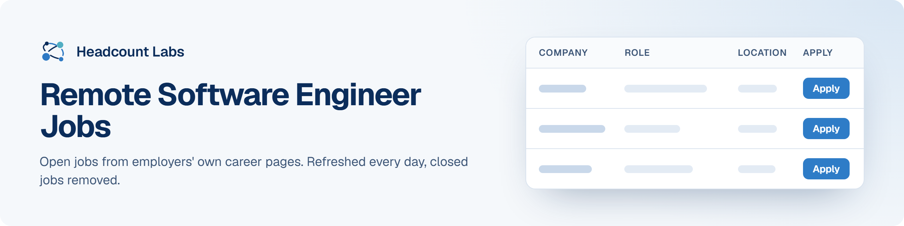

# Remote Software Engineer Jobs

Fully remote software engineering jobs at US employers, where the employer says the job is remote.

**84 open jobs** · 41 new since the last update · 87 removed because they closed or left the employer's board · updated November 18, 2026 at 4:42 AM EST

This list is built and refreshed every day by [Headcount Labs](https://headcountlabs.com/?utm_source=github&utm_medium=job-list&utm_campaign=remote-software-engineer-jobs), which reads jobs straight from employers' own career pages and job boards. Every job here was still listed on its source board when we last read that board, within the past 3 days, and was posted in the past 30 days. Copies of the same job are merged into one row, and jobs that close are removed at the next update.

Want this data in your own app or agent? Use the [Headcount Labs jobs API](https://headcountlabs.com/docs/?utm_source=github&utm_medium=job-list&utm_campaign=remote-software-engineer-jobs) (free tier), the [MCP server](https://headcountlabs.com/mcp/?utm_source=github&utm_medium=job-list&utm_campaign=remote-software-engineer-jobs) for Claude, ChatGPT and other AI assistants, or the [public dataset subsets](https://huggingface.co/HeadcountLabs) on Hugging Face (the full dataset is coming soon).

**Full dataset.** A bigger, one-off snapshot dated 2026-10-19 (all matching jobs, not only the open jobs below) is on Hugging Face: [Remote jobs](https://huggingface.co/datasets/HeadcountLabs/remote-jobs) · [Tech and software jobs](https://huggingface.co/datasets/HeadcountLabs/tech-jobs). It loads with `datasets.load_dataset` and is under the Open Database License (ODbL) 1.0.

**Jump to:** [Posted in the last 7 days (42)](#posted-in-the-last-7-days) · [Posted 8 to 30 days ago (42)](#posted-8-to-30-days-ago)

**Columns.** *Apply* opens the original posting on the employer's site. *Details* opens the job on Headcount Labs, with every posting we found for it. *Remote* shows what the employer states; a dash means the posting doesn't say. *Pay* is the range the employer published.

## Posted in the last 7 days

| Company | Role | Location | Remote | Pay | Posted | Apply | Details |
| --- | --- | --- | --- | --- | --- | :---: | :---: |
| **Bjak** | Backend Developer | United States | Remote | — | Nov 18 |  | <a href="https://headcountlabs.com/catalog/jobs/f5786e9a-4faa-4ec2-bb0b-e24cb1053d6d?utm_source=github&utm_medium=job-list&utm_campaign=remote-software-engineer-jobs">via Headcount Labs</a> |
| **Bjak** | Full Stack Engineer | United States | Remote | — | Nov 18 |  | <a href="https://headcountlabs.com/catalog/jobs/eabbc74d-c4a6-4b27-9efd-6056310ffd80?utm_source=github&utm_medium=job-list&utm_campaign=remote-software-engineer-jobs">via Headcount Labs</a> |
| **Bjak** | Mobile Developer - AI Finance Agent | United States | Remote | — | Nov 18 |  | <a href="https://headcountlabs.com/catalog/jobs/c1b4a2b1-ab4f-4db4-8215-cb7c046f0dec?utm_source=github&utm_medium=job-list&utm_campaign=remote-software-engineer-jobs">via Headcount Labs</a> |
| **Bjak** | Android Developer - AI Finance Agent | United States | Remote | — | Nov 18 |  | <a href="https://headcountlabs.com/catalog/jobs/953f2434-45d2-4390-83f1-1ba417936184?utm_source=github&utm_medium=job-list&utm_campaign=remote-software-engineer-jobs">via Headcount Labs</a> |
| **Bjak** | Mobile Application Developer | United States | Remote | — | Nov 18 |  | <a href="https://headcountlabs.com/catalog/jobs/b184114f-bb58-4ab2-9405-9ed97d40e204?utm_source=github&utm_medium=job-list&utm_campaign=remote-software-engineer-jobs">via Headcount Labs</a> |
| **Bjak** | Mobile Engineer - AI Finance Agent | United States | Remote | — | Nov 18 |  | <a href="https://headcountlabs.com/catalog/jobs/5c944591-28fa-49f5-ae05-92507abdce59?utm_source=github&utm_medium=job-list&utm_campaign=remote-software-engineer-jobs">via Headcount Labs</a> |
| **Bjak** | Mobile Application Developer - AI Finance Agent | United States | Remote | — | Nov 18 |  | <a href="https://headcountlabs.com/catalog/jobs/51bf5dc2-4a57-4b2c-900c-4d93f67a9ca9?utm_source=github&utm_medium=job-list&utm_campaign=remote-software-engineer-jobs">via Headcount Labs</a> |
| **Bjak** | Android Software Engineer | United States | Remote | — | Nov 18 |  | <a href="https://headcountlabs.com/catalog/jobs/4e702c6a-f688-4cec-b25b-8b27471f2cba?utm_source=github&utm_medium=job-list&utm_campaign=remote-software-engineer-jobs">via Headcount Labs</a> |
| **Talan** | Senior Oracle APEX Developer | Texas City, TX | Remote | $110k–$130k/yr | Nov 17 |  | <a href="https://headcountlabs.com/catalog/jobs/b5d91f5f-9659-4296-a6af-72c9aaead417?utm_source=github&utm_medium=job-list&utm_campaign=remote-software-engineer-jobs">via Headcount Labs</a> |
| **SRI International** | Drexel University Co-op: Software Engineering | Princeton, NJ | Remote | $20–$27/hr | Nov 17 |  | <a href="https://headcountlabs.com/catalog/jobs/fe151447-613c-4d79-b031-2e084196f9ff?utm_source=github&utm_medium=job-list&utm_campaign=remote-software-engineer-jobs">via Headcount Labs</a> |
| **Lynker Corporation** | Scientific Developer for AI/ML Forecasting | College Park, MD | Remote | $100k–$158k/yr | Nov 17 |  | <a href="https://headcountlabs.com/catalog/jobs/c05ac6c0-863f-4a6f-87c0-437e1d993aa5?utm_source=github&utm_medium=job-list&utm_campaign=remote-software-engineer-jobs">via Headcount Labs</a> |
| **H&amp;R Block** | Senior Software Engineer - C#/.NET | KANSAS CITY, MO | Remote | — | Nov 17 |  | <a href="https://headcountlabs.com/catalog/jobs/a5a4d842-c719-4ebc-9c1f-8c57a5491a88?utm_source=github&utm_medium=job-list&utm_campaign=remote-software-engineer-jobs">via Headcount Labs</a> |
| **Grace Hill** | Lead Software Development Engineer | United States | Remote | $175k–$185k/yr | Nov 17 |  | <a href="https://headcountlabs.com/catalog/jobs/b3438d1e-64da-4999-8073-8b564736870d?utm_source=github&utm_medium=job-list&utm_campaign=remote-software-engineer-jobs">via Headcount Labs</a> |
| **Ford Motor Company** | Software Engineer | United States | Remote | $85k–$193k/yr | Nov 17 |  | <a href="https://headcountlabs.com/catalog/jobs/cba63a6e-f787-46e8-ac3a-8531a44ed5fd?utm_source=github&utm_medium=job-list&utm_campaign=remote-software-engineer-jobs">via Headcount Labs</a> |
| **Cayuse Holdings** | ServiceNow Experience Designer/Portal Developer | United States | Remote | $70–$80/hr | Nov 17 |  | <a href="https://headcountlabs.com/catalog/jobs/9f9cedd5-9ee8-45d4-8717-a7648aeff66a?utm_source=github&utm_medium=job-list&utm_campaign=remote-software-engineer-jobs">via Headcount Labs</a> |
| **Akamai** | Senior II Site Reliability Engineer | 

2 locations
United States Cambridge, MA
 | Remote | $146k–$264k/yr | Nov 17 |  | <a href="https://headcountlabs.com/catalog/jobs/d8724bc0-a5b4-469c-ae5c-b950d72ea617?utm_source=github&utm_medium=job-list&utm_campaign=remote-software-engineer-jobs">via Headcount Labs</a> |
| **Akamai** | Senior Site Reliability Engineer | 

2 locations
United States Cambridge, MA
 | Remote | $121k–$219k/yr | Nov 17 |  | <a href="https://headcountlabs.com/catalog/jobs/027ab14b-3a04-4b06-97d0-00d0c47e2f6e?utm_source=github&utm_medium=job-list&utm_campaign=remote-software-engineer-jobs">via Headcount Labs</a> |
| **WellHive** | Senior Developer Experience Engineer | United States | Remote | $120k–$175k/yr | Nov 16 |  | <a href="https://headcountlabs.com/catalog/jobs/4721a3ef-f622-4523-a239-8d58c9695d54?utm_source=github&utm_medium=job-list&utm_campaign=remote-software-engineer-jobs">via Headcount Labs</a> |
| **WellHive** | Senior Software Engineer II, GRC Engineering (Tech Lead) | United States | Remote | $145k–$175k/yr | Nov 16 |  | <a href="https://headcountlabs.com/catalog/jobs/93c1f44a-e5a9-438c-86cd-ba0298a691fb?utm_source=github&utm_medium=job-list&utm_campaign=remote-software-engineer-jobs">via Headcount Labs</a> |
| **Terac** | Product Managers: 1-on-1 Interview on Software Strategy and Roadmaps | United States | Remote | — | Nov 16 |  | <a href="https://headcountlabs.com/catalog/jobs/dbe1a7b4-cebc-4d53-a4ea-c815e27c91a4?utm_source=github&utm_medium=job-list&utm_campaign=remote-software-engineer-jobs">via Headcount Labs</a> |
| **Steampunk** | Drupal Developer | McLean, VA | Remote | $100k–$160k/yr | Nov 16 |  | <a href="https://headcountlabs.com/catalog/jobs/1f454fbb-59d2-4260-a743-a4a97a833157?utm_source=github&utm_medium=job-list&utm_campaign=remote-software-engineer-jobs">via Headcount Labs</a> |
| **NCC/ProMax** | AI Software Engineer II (Credit) | 

2 locations
Bettendorf, IA Austin, TX
 | Remote | — | Nov 16 |  | <a href="https://headcountlabs.com/catalog/jobs/46fe6036-b821-43cd-951c-0834465feb43?utm_source=github&utm_medium=job-list&utm_campaign=remote-software-engineer-jobs">via Headcount Labs</a> |
| **HPE** | Technical Courseware Developer | 

2 locations
Warszawa All, CA
 | Remote | — | Nov 16 |  | <a href="https://headcountlabs.com/catalog/jobs/780ffa6b-547c-48cd-84d3-d214fab5c82f?utm_source=github&utm_medium=job-list&utm_campaign=remote-software-engineer-jobs">via Headcount Labs</a> |
| **General Dynamics Mission Systems, Inc** | AI Software Engineer, Applications and Agents | Manassas, VA | Remote | $157k/yr | Nov 16 |  | <a href="https://headcountlabs.com/catalog/jobs/d659df27-2787-4aa3-a9b0-e06b34219c85?utm_source=github&utm_medium=job-list&utm_campaign=remote-software-engineer-jobs">via Headcount Labs</a> |
| **General Dynamics Mission Systems, Inc** | Principal AI Platform Software Engineer, DevSecOps and Production Engineering | United States | Remote | $175k/yr | Nov 16 |  | <a href="https://headcountlabs.com/catalog/jobs/43b8e641-0e69-4354-9a00-f9a12d5a3b80?utm_source=github&utm_medium=job-list&utm_campaign=remote-software-engineer-jobs">via Headcount Labs</a> |
| **General Dynamics Mission Systems, Inc** | BICES Software Engineer - Remote | United States | Remote | $157k/yr | Nov 16 |  | <a href="https://headcountlabs.com/catalog/jobs/3d6573f3-d897-4ba3-a868-fa443c0b6dd5?utm_source=github&utm_medium=job-list&utm_campaign=remote-software-engineer-jobs">via Headcount Labs</a> |
| **ClickHouse** | Sr. Software Engineer - Enterprise Features &amp; Orchestration | Europe or US | Remote | $142k–$250k/yr | Nov 16 |  | <a href="https://headcountlabs.com/catalog/jobs/ea5423a9-fb1d-426f-94a9-7632ffdf5375?utm_source=github&utm_medium=job-list&utm_campaign=remote-software-engineer-jobs">via Headcount Labs</a> |
| **Alliance Laundry System** | Senior Manager – Software Engineering | United States | Remote | — | Nov 16 |  | <a href="https://headcountlabs.com/catalog/jobs/65c25120-16d1-47cd-97a9-e5a10398f010?utm_source=github&utm_medium=job-list&utm_campaign=remote-software-engineer-jobs">via Headcount Labs</a> |
| **Alliance Laundry System** | Lead Software Architect | United States | Remote | — | Nov 16 |  | <a href="https://headcountlabs.com/catalog/jobs/3f7a9f49-ab3d-4bb6-8466-42b334563c58?utm_source=github&utm_medium=job-list&utm_campaign=remote-software-engineer-jobs">via Headcount Labs</a> |
| **Akamai** | Software Engineer | 

2 locations
United States Cambridge, MA
 | Remote | $76k–$136k/yr | Nov 16 |  | <a href="https://headcountlabs.com/catalog/jobs/f8404858-e3f9-4c57-a169-503c57d99575?utm_source=github&utm_medium=job-list&utm_campaign=remote-software-engineer-jobs">via Headcount Labs</a> |
| **ASRC Federal Holding Company** | ServiceNow Developer | 

2 locations
United States Texas
 | Remote | — | Nov 15 |  | <a href="https://headcountlabs.com/catalog/jobs/50c49940-f912-4dee-9601-9644e2a362cc?utm_source=github&utm_medium=job-list&utm_campaign=remote-software-engineer-jobs">via Headcount Labs</a> |
| **SAIC** | Senior Software Engineer | Work, DC | Remote | $120k–$160k/yr | Nov 14 |  | <a href="https://headcountlabs.com/catalog/jobs/55a7bb49-cf4c-43f0-8e54-649bc1bac1da?utm_source=github&utm_medium=job-list&utm_campaign=remote-software-engineer-jobs">via Headcount Labs</a> |
| **Pearson** | Lead, Content Developer (K-12) | United States | Remote | $160k–$170k/yr | Nov 14 |  | <a href="https://headcountlabs.com/catalog/jobs/f8f9b0fa-570a-4f9f-a071-58204cae831f?utm_source=github&utm_medium=job-list&utm_campaign=remote-software-engineer-jobs">via Headcount Labs</a> |
| **Autodesk** | Senior Software Engineer | 

2 locations
Novi, MI Boston, MA
 | Remote | $117k–$209k/yr | Nov 14 |  | <a href="https://headcountlabs.com/catalog/jobs/d0400674-f9b6-423c-bd14-70c220212eb8?utm_source=github&utm_medium=job-list&utm_campaign=remote-software-engineer-jobs">via Headcount Labs</a> |
| **ASRC Federal** | ServiceNow Developer | Texas | Remote | — | Nov 14 |  | <a href="https://headcountlabs.com/catalog/jobs/a976ae5d-f2fc-4e69-ad14-1f2a1adaedbf?utm_source=github&utm_medium=job-list&utm_campaign=remote-software-engineer-jobs">via Headcount Labs</a> |
| **Xello** | Principal Software Engineer | Toronto | Remote | — | Nov 13 |  | <a href="https://headcountlabs.com/catalog/jobs/a8cd76c1-941b-4e64-aa95-ba1ea76b90a0?utm_source=github&utm_medium=job-list&utm_campaign=remote-software-engineer-jobs">via Headcount Labs</a> |
| **URUS Group** | AI Agent Developer (Microsoft Copilot) | Madison, WI | Remote | — | Nov 12 |  | <a href="https://headcountlabs.com/catalog/jobs/320f8279-306e-4cf1-9815-627fdd976be0?utm_source=github&utm_medium=job-list&utm_campaign=remote-software-engineer-jobs">via Headcount Labs</a> |
| **Principal Financial Group** | Sr Software Engineer II | Des Moines, IA | Remote | $127k–$158k/yr | Nov 12 |  | <a href="https://headcountlabs.com/catalog/jobs/aa50c97c-57c0-4baa-bcbd-4340b8b9ccc6?utm_source=github&utm_medium=job-list&utm_campaign=remote-software-engineer-jobs">via Headcount Labs</a> |
| **Premera Blue Cross** | Software Development Engineer IV | United States | Remote | $119k–$202k/yr | Nov 12 |  | <a href="https://headcountlabs.com/catalog/jobs/d41d7fe7-9266-42d8-be94-cbdd187a6dc3?utm_source=github&utm_medium=job-list&utm_campaign=remote-software-engineer-jobs">via Headcount Labs</a> |
| **Pearson** | Principal Software Engineer | United States | Remote | $155k–$175k/yr | Nov 12 |  | <a href="https://headcountlabs.com/catalog/jobs/1c08a069-1363-427a-b87e-8b3711a8a84e?utm_source=github&utm_medium=job-list&utm_campaign=remote-software-engineer-jobs">via Headcount Labs</a> |
| **Johns Hopkins University** | Software Engineer - AI Focus (Center for Technology in Education) - #Staff | Baltimore, MD | Remote | $38.53–$67.44/hr | Nov 12 |  | <a href="https://headcountlabs.com/catalog/jobs/ae1cfa2b-3b17-47ee-b9b3-6d7418ea9d78?utm_source=github&utm_medium=job-list&utm_campaign=remote-software-engineer-jobs">via Headcount Labs</a> |
| **World Wide Technology** | Senior Developer | Nationwide | Remote | $106k–$160k/yr | Nov 11 |  | <a href="https://headcountlabs.com/catalog/jobs/6db18b9e-1244-47bc-b089-9c21c81dc2eb?utm_source=github&utm_medium=job-list&utm_campaign=remote-software-engineer-jobs">via Headcount Labs</a> |

## Posted 8 to 30 days ago

| Company | Role | Location | Remote | Pay | Posted | Apply | Details |
| --- | --- | --- | --- | --- | --- | :---: | :---: |
| **Cupertino Electric** | Senior Full Stack Developer | 

2 locations
San Jose, CA United States
 | Remote | $128k–$168k/yr | Nov 10 |  | <a href="https://headcountlabs.com/catalog/jobs/75778428-824e-442d-bdb8-5498ad22612c?utm_source=github&utm_medium=job-list&utm_campaign=remote-software-engineer-jobs">via Headcount Labs</a> |
| **Pearson** | Senior Software Engineer | 

3 locations
Hoboken, NJ Austin, TX United States
 | Remote | $140k–$170k/yr | Nov 7 |  | <a href="https://headcountlabs.com/catalog/jobs/527786d7-b4e6-4352-bc65-ebd1ac173e97?utm_source=github&utm_medium=job-list&utm_campaign=remote-software-engineer-jobs">via Headcount Labs</a> |
| **Gardens Interactive** | Lead Backend Engineer | United States - (EST - PST) | Remote | $196k–$203k/yr | Nov 7 |  | <a href="https://headcountlabs.com/catalog/jobs/eb34e5eb-3421-47eb-84da-7cd9ce43d881?utm_source=github&utm_medium=job-list&utm_campaign=remote-software-engineer-jobs">via Headcount Labs</a> |
| **Prison Fellowship** | Sr. Salesforce Developer (Data Cloud) | Lansdowne, VA | Remote | $93k–$105k/yr | Nov 6 |  | <a href="https://headcountlabs.com/catalog/jobs/c0818cb1-56b8-482a-a52c-ed2c23ba5735?utm_source=github&utm_medium=job-list&utm_campaign=remote-software-engineer-jobs">via Headcount Labs</a> |
| **Oracle** | Principal Site Reliability Engineer - Oracle Health (US REMOTE) | 

5 locations
United States Philadelphia, PA Atlanta, GA Miami, FL Portland, OR
 | Remote | $85k–$210k/yr | Nov 6 |  | <a href="https://headcountlabs.com/catalog/jobs/68b99594-2592-4814-88e1-76247d029636?utm_source=github&utm_medium=job-list&utm_campaign=remote-software-engineer-jobs">via Headcount Labs</a> |
| **SAIC** | Senior Software Development Engineer in Test | 

2 locations
Huntsville, AL Work, AL
 | Remote | $120k–$160k/yr | Nov 5 |  | <a href="https://headcountlabs.com/catalog/jobs/90f23bf7-bfdf-4a5e-bc10-56cf4c077213?utm_source=github&utm_medium=job-list&utm_campaign=remote-software-engineer-jobs">via Headcount Labs</a> |
| **Pearson** | Specialist, Content Developer (English Language Arts) | United States | Remote | $70k–$80k/yr | Nov 4 |  | <a href="https://headcountlabs.com/catalog/jobs/5aad2211-823d-4632-9f91-751b4b5bf4fa?utm_source=github&utm_medium=job-list&utm_campaign=remote-software-engineer-jobs">via Headcount Labs</a> |
| **Pearson** | Software Engineer III | United States | Remote | $80k–$120k/yr | Nov 4 |  | <a href="https://headcountlabs.com/catalog/jobs/d99df274-12f7-4241-84d6-169e52717305?utm_source=github&utm_medium=job-list&utm_campaign=remote-software-engineer-jobs">via Headcount Labs</a> |
| **Littera Education** | Account Executive for Software Partnerships | United States | Remote | $90k–$180k/yr | Nov 4 |  | <a href="https://headcountlabs.com/catalog/jobs/54a15478-4f46-4479-a69a-15fdbd0cb25f?utm_source=github&utm_medium=job-list&utm_campaign=remote-software-engineer-jobs">via Headcount Labs</a> |
| **Terac** | Finance and Accounting Professionals: Business Operations and Software Workflows | United States | Remote | — | Nov 3 |  | <a href="https://headcountlabs.com/catalog/jobs/2e5f9d44-d92c-4177-8921-e9a415be9a15?utm_source=github&utm_medium=job-list&utm_campaign=remote-software-engineer-jobs">via Headcount Labs</a> |
| **SAIC** | ServiceNow Developer | Work, TN | Remote | $140k–$180k/yr | Nov 3 |  | <a href="https://headcountlabs.com/catalog/jobs/3b97cf6d-c853-4460-b5f8-61accb6723bb?utm_source=github&utm_medium=job-list&utm_campaign=remote-software-engineer-jobs">via Headcount Labs</a> |
| **Chimes International** | RPA Developer | United States | Remote | $69.63–$85.11/hr | Nov 3 |  | <a href="https://headcountlabs.com/catalog/jobs/a744ae8f-0418-4561-800a-b51ccbeb54a6?utm_source=github&utm_medium=job-list&utm_campaign=remote-software-engineer-jobs">via Headcount Labs</a> |
| **Yoga Alliance** | Salesforce Developer | Arlington, VA | Remote | $102k–$112k/yr | Nov 2 |  | <a href="https://headcountlabs.com/catalog/jobs/7763d3b0-04c2-4860-a605-9b34ff89ff3f?utm_source=github&utm_medium=job-list&utm_campaign=remote-software-engineer-jobs">via Headcount Labs</a> |
| **Steampunk** | Senior MuleSoft Developer | McLean, VA | Remote | $140k–$170k/yr | Nov 2 |  | <a href="https://headcountlabs.com/catalog/jobs/dad6e6b1-ed69-499a-a340-bd7ce4f7f9b3?utm_source=github&utm_medium=job-list&utm_campaign=remote-software-engineer-jobs">via Headcount Labs</a> |
| **ASRC Federal Holding Company** | Web (UI/UX) Developer | 

21 locations
New York Wisconsin Idaho New Jersey Texas Maine Kentucky Oregon Oklahoma Iowa Alaska Maryland +9 more
 | Remote | — | Oct 31 |  | <a href="https://headcountlabs.com/catalog/jobs/4fd8c6ad-ada7-41e5-9184-11055b2e3ad1?utm_source=github&utm_medium=job-list&utm_campaign=remote-software-engineer-jobs">via Headcount Labs</a> |
| **Veralto** | Vice President, Strategic Accounts (B2B Software) | 

9 locations
Bromma Massachusetts Barcelona Paris Amersham Brussels Milano Skanderborg Amsterdam
 | Remote | — | Oct 30 |  | <a href="https://headcountlabs.com/catalog/jobs/b4f45851-c704-4d47-8d32-8e23424600c9?utm_source=github&utm_medium=job-list&utm_campaign=remote-software-engineer-jobs">via Headcount Labs</a> |
| **Nelnet** | Sr Manager - Software Engineering | 

2 locations
United States Nebraska
 | Remote | $150k–$165k/yr | Oct 30 |  | <a href="https://headcountlabs.com/catalog/jobs/d526b2dc-f11d-4da0-b196-26e1aeb4f1eb?utm_source=github&utm_medium=job-list&utm_campaign=remote-software-engineer-jobs">via Headcount Labs</a> |
| **Johns Hopkins University** | Enterprise Web and DevOps Architect (IT@JH Cloud &amp; Virtualization Services) - #Staff | Baltimore, MD | Remote | $120k–$209k/yr | Oct 30 |  | <a href="https://headcountlabs.com/catalog/jobs/c3d80da1-f5d8-4711-b770-66c52e4f79c9?utm_source=github&utm_medium=job-list&utm_campaign=remote-software-engineer-jobs">via Headcount Labs</a> |
| **Activision** | Senior Expert ARM Kernel Developer – RICOCHET - Central Technology | 

2 locations
Sherman Oaks, CA Vancouver
 | Remote | — | Oct 30 |  | <a href="https://headcountlabs.com/catalog/jobs/83d995cf-01db-4007-8a6c-a83a82d2c27e?utm_source=github&utm_medium=job-list&utm_campaign=remote-software-engineer-jobs">via Headcount Labs</a> |
| **M&amp;S Consulting** | LogicMonitor Developer Consultant | United States | Remote | — | Oct 29 |  | <a href="https://headcountlabs.com/catalog/jobs/17a3c625-98bb-4104-a48f-4260bb72418b?utm_source=github&utm_medium=job-list&utm_campaign=remote-software-engineer-jobs">via Headcount Labs</a> |
| **World Wide Technology** | Developer | Nationwide | Remote | $82k–$123k/yr | Oct 28 |  | <a href="https://headcountlabs.com/catalog/jobs/d8414d98-ffc2-4439-940a-f4c13051b9ec?utm_source=github&utm_medium=job-list&utm_campaign=remote-software-engineer-jobs">via Headcount Labs</a> |
| **Vituity** | Software Engineer I - Remote - Nationwide | Sacramento, CA | Remote | $70k–$87k/yr | Oct 28 |  | <a href="https://headcountlabs.com/catalog/jobs/1c604055-fb29-4e9b-ab83-3e8f735689c7?utm_source=github&utm_medium=job-list&utm_campaign=remote-software-engineer-jobs">via Headcount Labs</a> |
| **UL, LLC** | Senior Sales Executive, Software, Consumer Sector | 

4 locations
Chicago, IL Latham, NY Northbrook, IL Austin, TX
 | Remote | $94k–$126k/yr | Oct 28 |  | <a href="https://headcountlabs.com/catalog/jobs/6a5927cf-1300-470f-9ddc-e6bb0a6cd0ff?utm_source=github&utm_medium=job-list&utm_campaign=remote-software-engineer-jobs">via Headcount Labs</a> |
| **UL, LLC** | Senior Sales Executive, Software, Industrial Sector | 

3 locations
Chicago, IL Austin, TX Latham, NY
 | Remote | $94k–$126k/yr | Oct 28 |  | <a href="https://headcountlabs.com/catalog/jobs/620d4798-5ddf-4018-b9ed-dd05b4e7dacb?utm_source=github&utm_medium=job-list&utm_campaign=remote-software-engineer-jobs">via Headcount Labs</a> |
| **UL, LLC** | Senior Sales Executive, Software, Life Sciences | 

4 locations
Latham, NY Chicago, IL Northbrook, IL Austin, TX
 | Remote | $94k–$126k/yr | Oct 28 |  | <a href="https://headcountlabs.com/catalog/jobs/f65da476-a140-4b35-8f68-d280952df608?utm_source=github&utm_medium=job-list&utm_campaign=remote-software-engineer-jobs">via Headcount Labs</a> |
| **SAIC** | Principal Software Tester | Work, TX | Remote | $80k–$120k/yr | Oct 28 |  | <a href="https://headcountlabs.com/catalog/jobs/ab023d64-a803-4f21-b14f-c1b36b17ae1a?utm_source=github&utm_medium=job-list&utm_campaign=remote-software-engineer-jobs">via Headcount Labs</a> |
| **CSC** | Software Engineer | 

2 locations
Buffalo Grove, IL Sacramento, CA
 | Remote | — | Oct 27 |  | <a href="https://headcountlabs.com/catalog/jobs/ff4207c5-c647-4169-a4a6-68ea03c63a29?utm_source=github&utm_medium=job-list&utm_campaign=remote-software-engineer-jobs">via Headcount Labs</a> |
| **ASRC Federal Holding Company** | ServiceNow Developer, Senior | United States | Remote | — | Oct 27 |  | <a href="https://headcountlabs.com/catalog/jobs/615f7422-1d82-4caf-afbd-1dcc3c5586e5?utm_source=github&utm_medium=job-list&utm_campaign=remote-software-engineer-jobs">via Headcount Labs</a> |
| **Akamai** | Machine Learning Senior II Software Engineer Lead | 

2 locations
United States Cambridge, MA
 | Remote | $146k–$264k/yr | Oct 26 |  | <a href="https://headcountlabs.com/catalog/jobs/6a089a52-d43e-4f51-b3e6-333094766c3a?utm_source=github&utm_medium=job-list&utm_campaign=remote-software-engineer-jobs">via Headcount Labs</a> |
| **Capgemini** | Software Engineer - Security | 

2 locations
Bellevue, WA Bay Area, CA
 | Remote | $77k–$151k/yr | Oct 24 |  | <a href="https://headcountlabs.com/catalog/jobs/9842ed62-4035-4dea-ae92-ae26647576e5?utm_source=github&utm_medium=job-list&utm_campaign=remote-software-engineer-jobs">via Headcount Labs</a> |
| **Oracle** | Senior Site Reliability Engineer - Oracle Health | United States | Remote | $81k–$187k/yr | Oct 23 |  | <a href="https://headcountlabs.com/catalog/jobs/e1e1017c-53e0-4fda-9a79-5cedc8a56b1e?utm_source=github&utm_medium=job-list&utm_campaign=remote-software-engineer-jobs">via Headcount Labs</a> |
| **Capgemini** | Teamcenter Developer | Atlanta, GA | Remote | $77k–$151k/yr | Oct 23 |  | <a href="https://headcountlabs.com/catalog/jobs/d98b6408-ff87-4ad1-b236-17e87462bd4f?utm_source=github&utm_medium=job-list&utm_campaign=remote-software-engineer-jobs">via Headcount Labs</a> |
| **SonoSim** | Full Stack Software Engineer | Venice, CA | Remote | $120k–$130k/yr | Oct 22 |  | <a href="https://headcountlabs.com/catalog/jobs/9a31e920-b56b-4fd7-accc-dbd2e4ff7d94?utm_source=github&utm_medium=job-list&utm_campaign=remote-software-engineer-jobs">via Headcount Labs</a> |
| **SAIC** | Software Systems Engineer Principal | Work, VA | Remote | $160k–$200k/yr | Oct 22 |  | <a href="https://headcountlabs.com/catalog/jobs/a669db70-d9de-4976-a13d-e4bcc9af22a9?utm_source=github&utm_medium=job-list&utm_campaign=remote-software-engineer-jobs">via Headcount Labs</a> |
| **Akamai** | Software Development Engineer in Test II (Kubernetes) | 

2 locations
United States Cambridge, MA
 | Remote | $95k–$171k/yr | Oct 22 |  | <a href="https://headcountlabs.com/catalog/jobs/413615ff-1b06-4713-b3a7-841fb6b19b5d?utm_source=github&utm_medium=job-list&utm_campaign=remote-software-engineer-jobs">via Headcount Labs</a> |
| **Veeam Software** | Software Development Engineer III, MuleSoft | United States | Remote | $153k–$256k/yr | Oct 21 |  | <a href="https://headcountlabs.com/catalog/jobs/cd975edc-1e0f-4e31-a75b-9bd3b07c182a?utm_source=github&utm_medium=job-list&utm_campaign=remote-software-engineer-jobs">via Headcount Labs</a> |
| **SAIC** | Software Engineer Senior | Work, VA | Remote | $80k–$120k/yr | Oct 21 |  | <a href="https://headcountlabs.com/catalog/jobs/f9471759-3e9f-415a-90cf-e544afd19718?utm_source=github&utm_medium=job-list&utm_campaign=remote-software-engineer-jobs">via Headcount Labs</a> |
| **Patterson Companies, Inc.** | Software Account Manager | United States | Remote | $68k–$89k/yr | Oct 21 |  | <a href="https://headcountlabs.com/catalog/jobs/00933813-ff9b-4b79-91e9-00b6127d17a5?utm_source=github&utm_medium=job-list&utm_campaign=remote-software-engineer-jobs">via Headcount Labs</a> |
| **World Wide Technology** | Sr. Developer | Nationwide | Remote | $106k–$160k/yr | Oct 20 |  | <a href="https://headcountlabs.com/catalog/jobs/4bbda8cf-f3e6-4e49-baf4-55b7f84b8224?utm_source=github&utm_medium=job-list&utm_campaign=remote-software-engineer-jobs">via Headcount Labs</a> |
| **Saint-Gobain** | Software Engineer | United States | Remote | $102k–$158k/yr | Oct 20 |  | <a href="https://headcountlabs.com/catalog/jobs/a7e7553d-ef2f-4488-a484-117f6751ac49?utm_source=github&utm_medium=job-list&utm_campaign=remote-software-engineer-jobs">via Headcount Labs</a> |
| **Markon** | Web Developer 2 | Annapolis Junction, MD | Remote | $120k–$200k/yr | Oct 20 |  | <a href="https://headcountlabs.com/catalog/jobs/dafb28bb-b0b0-47b6-a6a0-bf9a8d732e08?utm_source=github&utm_medium=job-list&utm_campaign=remote-software-engineer-jobs">via Headcount Labs</a> |
| **Markon** | Software Engineer 2 | Annapolis Junction, MD | Remote | $120k–$200k/yr | Oct 20 |  | <a href="https://headcountlabs.com/catalog/jobs/b047558e-766c-4b28-8bec-0eb526a7002a?utm_source=github&utm_medium=job-list&utm_campaign=remote-software-engineer-jobs">via Headcount Labs</a> |

## Related data on Headcount Labs

- [Software engineer salary data from posted pay](https://headcountlabs.com/salary-data/software-engineer/)
- [Software engineer job postings dataset](https://headcountlabs.com/data/software-engineer-job-postings/)
- [US job market report: open jobs by state, top employers, pay and remote share](https://headcountlabs.com/reports/us-job-market/)

## More lists from Headcount Labs

[Software Engineering Internships](https://github.com/HeadcountLabs/software-engineering-internships) · [Data Science, AI and Machine Learning Internships](https://github.com/HeadcountLabs/data-science-ai-internships) · [Engineering Internships](https://github.com/HeadcountLabs/engineering-internships) · [Business, Finance and Marketing Internships](https://github.com/HeadcountLabs/business-finance-internships) · [Internships in the US](https://github.com/HeadcountLabs/internships) · [New Grad Software Engineer Jobs](https://github.com/HeadcountLabs/new-grad-software-engineer-jobs) · [Entry-Level and New Grad Jobs](https://github.com/HeadcountLabs/entry-level-jobs) · [Entry-Level Data Analyst Jobs](https://github.com/HeadcountLabs/entry-level-data-analyst-jobs) · [Remote Data, AI and Machine Learning Jobs](https://github.com/HeadcountLabs/remote-data-jobs) · [Remote Product Manager Jobs](https://github.com/HeadcountLabs/remote-product-manager-jobs) · [Remote Marketing Jobs](https://github.com/HeadcountLabs/remote-marketing-jobs) · [Remote Sales Jobs](https://github.com/HeadcountLabs/remote-sales-jobs) · [Remote Customer Support and Success Jobs](https://github.com/HeadcountLabs/remote-customer-support-jobs) · [Remote Healthcare Jobs](https://github.com/HeadcountLabs/remote-healthcare-jobs) · [Remote Finance and Accounting Jobs](https://github.com/HeadcountLabs/remote-finance-accounting-jobs) · [Remote Jobs in the US](https://github.com/HeadcountLabs/remote-jobs) · [AI and Machine Learning Engineer Jobs](https://github.com/HeadcountLabs/ai-ml-engineer-jobs) · [Data Engineer Jobs](https://github.com/HeadcountLabs/data-engineer-jobs) · [Cybersecurity Jobs](https://github.com/HeadcountLabs/cybersecurity-jobs) · [Product Manager Jobs](https://github.com/HeadcountLabs/product-manager-jobs) · [Registered Nurse Jobs](https://github.com/HeadcountLabs/registered-nurse-jobs) · [Software Jobs Paying $200k+](https://github.com/HeadcountLabs/high-paying-software-jobs) · [Tech and Software Jobs in the US](https://github.com/HeadcountLabs/tech-jobs) · [Jobs with Salary Listed in the US](https://github.com/HeadcountLabs/pay-transparency-jobs) · [San Francisco Bay Area Tech Jobs](https://github.com/HeadcountLabs/bay-area-tech-jobs) · [New York City Tech Jobs](https://github.com/HeadcountLabs/new-york-tech-jobs) · [Seattle Tech Jobs](https://github.com/HeadcountLabs/seattle-tech-jobs) · [Austin Tech Jobs](https://github.com/HeadcountLabs/austin-tech-jobs) · [Boston Tech Jobs](https://github.com/HeadcountLabs/boston-tech-jobs) · [Los Angeles Tech Jobs](https://github.com/HeadcountLabs/los-angeles-tech-jobs) · [Washington, DC Tech Jobs](https://github.com/HeadcountLabs/washington-dc-tech-jobs)

## Contributing

This README is generated, so edits to it are overwritten at the next update. If a job is closed, a link is broken or a detail is wrong, [open an issue](../../issues/new) with the link and we'll fix it in the data, which fixes it everywhere. Requests for new lists are welcome too.

## License

The list data is under the [Open Database License (ODbL) 1.0](LICENSE). Our own values in it are under the [Database Contents License (DbCL) 1.0](https://opendatacommons.org/licenses/dbcl/1-0/). Credit "Headcount Labs (https://headcountlabs.com)" when you reuse it. Job description text is the employer's own text and is not licensed by us. Takedown requests: [https://headcountlabs.com/remove/](https://headcountlabs.com/remove/). Location data includes data from OpenStreetMap contributors (ODbL) and Overture Maps. The same rows are in [`data/jobs.csv`](data/jobs.csv).

Generated by Headcount Labs from the jobs API on November 18, 2026 at 4:42 AM EST. At most 8 jobs per employer are shown in each list.
